

## System context and architecture

dev-loops is a workflow toolchain that drives GitHub issues to reviewed, tested pull requests. The operator works through an agent harness (Claude Code, Pi or Codex). The harness loads skills and agent definitions, and every deterministic step runs as a Node script behind one CLI. The scripts depend on the shared package `@dev-loops/core`, and core never imports a script. GitHub is the system of record for issues, pull requests, review threads, CI and the queue board. The diagrams below are derived from the code in `cli/`, `lib/`, `scripts/`, `packages/core/src/`, `extension/`, `agents/`, `skills/` and `.claude/`. Every number names the shell command that produced it, run against the checkout on 2026-11-23.

### System context

Type: `C4Context`

The operator, the agent roles, the three harnesses and the external systems around dev-loops. The insight: GitHub reads and writes go through the `gh` CLI that core wraps (`ghJson` in `gh.mjs`). The CLI reaches the npm registry only in the `doctor` stale-install check, and publishing runs in the `npm-publish.yml` workflow. Codex has no packaged plugin; core only detects it by environment. The agent box lists all 9 files in `agents/` (`ls agents`). Derived from `packages/core/src/loop/run-context.mjs` (`resolveRuntimeHarness`), `packages/core/src/github/gh.mjs`, `cli/index.mjs` (`fetchLatestPublishedVersion`, `buildStaleInstallChecks`), `.github/workflows/npm-publish.yml`, `agents/*.agent.md` and `package.json` (`pi` manifest).

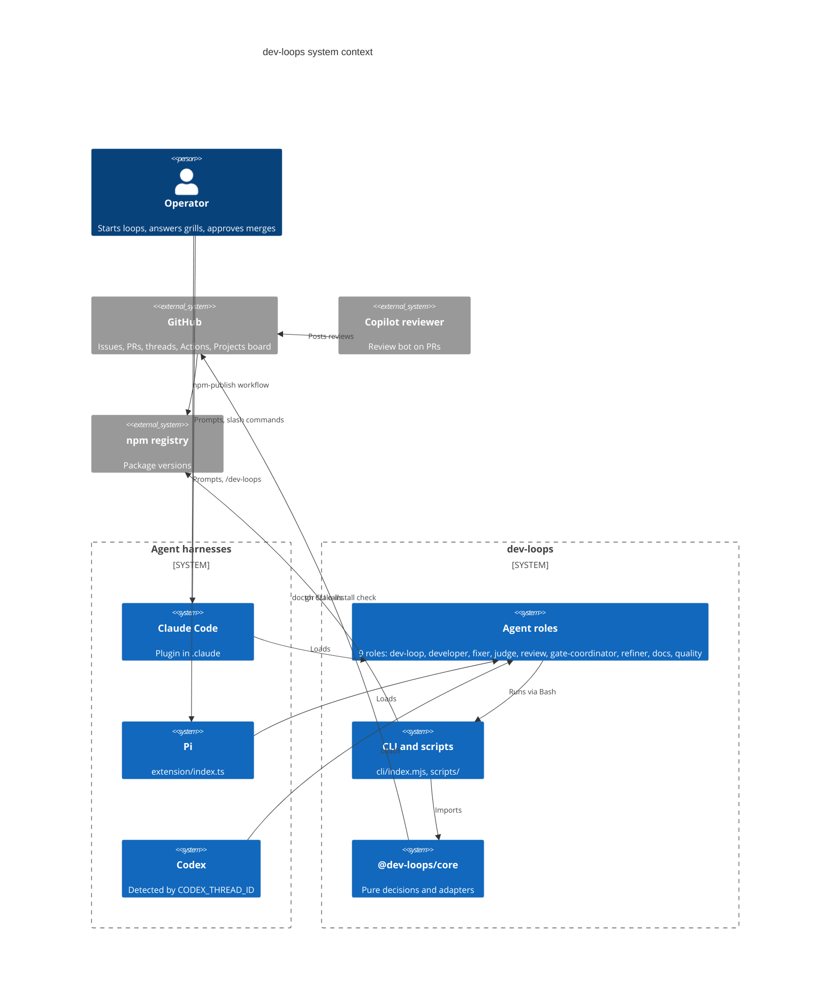

### Deployment view

Type: `architecture-beta`

Where the code lives at run time. The insight: the Claude plugin ships without `scripts/`, `packages/core` or `node_modules`, so its launcher `dev-loops-run` must find a toolchain root (a live checkout or the auto-installed package) before any script runs. The Pi package instead loads `extension/`, `skills/` and `agents/` straight from the installed package. The hooks never call the launcher. They run on their own vendored copies of core modules. Derived from `.claude/bin/dev-loops-run`, `.claude/hooks/hooks.json`, `package.json` (`bin`, `pi`, `workspaces`) and `cli/index.mjs` (`isCoreResolvable`).

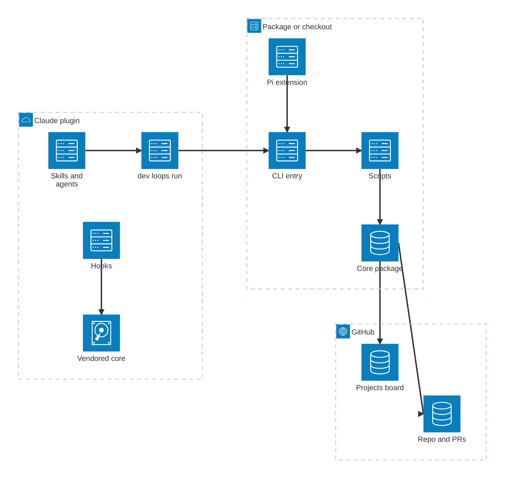

### Layered stack

Type: `block-beta`

The runtime layers from the harness surfaces down to external tools. The insight: the stack is mostly top-down, with three known skips. The Pi extension imports seven core subpaths (`config`, `harness` and five `loop/*` modules) and one script module (`scripts/loop/inspect-run-viewer/managed-instance.mjs`), counted with `grep -hoE "from ['\"][^'\"]+['\"]" extension/*.ts extension/*.mjs`. `lib/dev-loops-core.mjs` dynamically imports `scripts/loop/print-gates.mjs`. The Claude hooks skip the launcher and use vendored core copies. Derived from `cli/index.mjs`, `lib/dev-loops-core.mjs`, `extension/index.ts`, `.claude/hooks/hooks.json` and `packages/core/package.json` (dependencies `yaml`, `zod`, `@secretlint/core`).

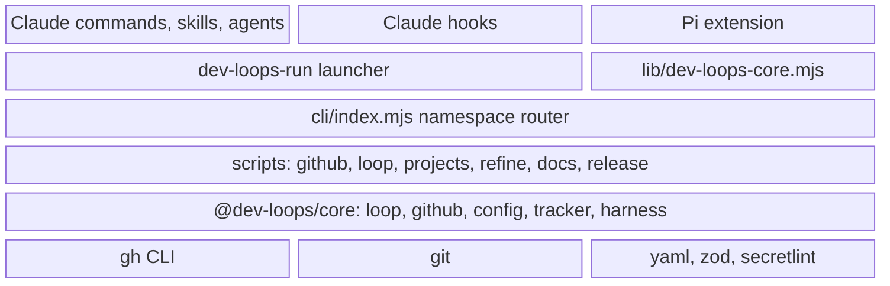

### Top-level module graph

Type: `flowchart`

Import and generation edges between the top-level directories. The insight: `.claude/` is a generated tree. `scripts/claude/generate-claude-assets.mjs` writes it from `agents/`, `skills/`, `commands/` and nine vendored core modules, and `--check` fails on drift. Core has zero imports from `scripts/` (`grep -rlE "from ['\"]\.\./(\.\./)?scripts" packages/core/src | wc -l` gives 0). Only 2 of the 6 non-test skill scripts import core, `log-bash-exit-1.mjs` and `phase-files.mjs` (`grep -lE "@dev-loops/core" skills/dev-loop/scripts/*.mjs`); `post-gate-verdict-fallback.mjs` stays zero-dependency on purpose. Derived from `cli/index.mjs`, `lib/dev-loops-core.mjs`, `extension/index.ts`, `scripts/claude/generate-claude-assets.mjs` and `test/core-runtime-boundary.test.mjs`.

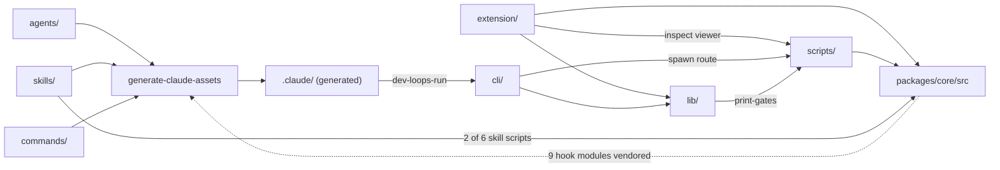

### Scripts to core import flow

Type: `sankey-beta`

How many script files in each `scripts/` subdirectory import each `@dev-loops/core` area. A file counts once per area. Only flows of 3 or more files are shown. The insight: `scripts/loop` and `scripts/github` carry almost all core use, and they cross over heavily: 44 github scripts use core loop logic and 48 loop scripts use core github helpers. Counts come from `for f in $(find scripts -name '*.mjs'); do grep -oE "@dev-loops/core/[a-z-]+" $f | sort -u; done` grouped by subdirectory. Derived from `scripts/**/*.mjs` and `packages/core/package.json` (`exports`).

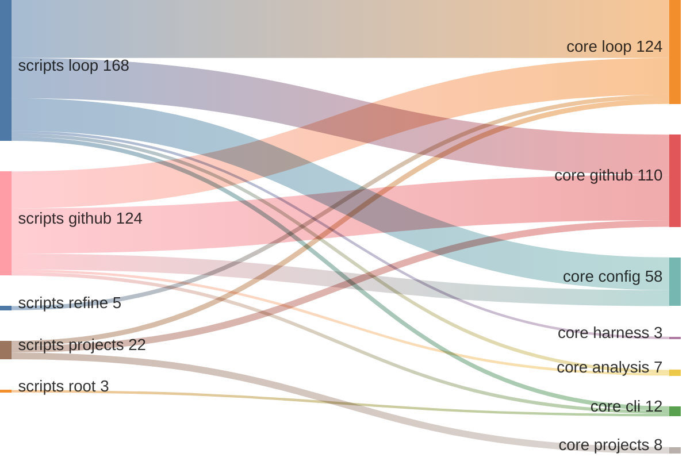

### Dependencies inside core

Type: `flowchart`

Cross-directory imports inside `packages/core/src`. Edge labels give the number of files in the source directory that import the target directory. The insight: `loop` is the hub, and it has two-way edges with `github`, `config`, `claude` and `projects`. Core is a layered package by name only; its directories form import cycles. Counts come from `grep -oE "from ['\"]\.\./[a-z]+/"` per file under `packages/core/src`, grouped by source and target directory.

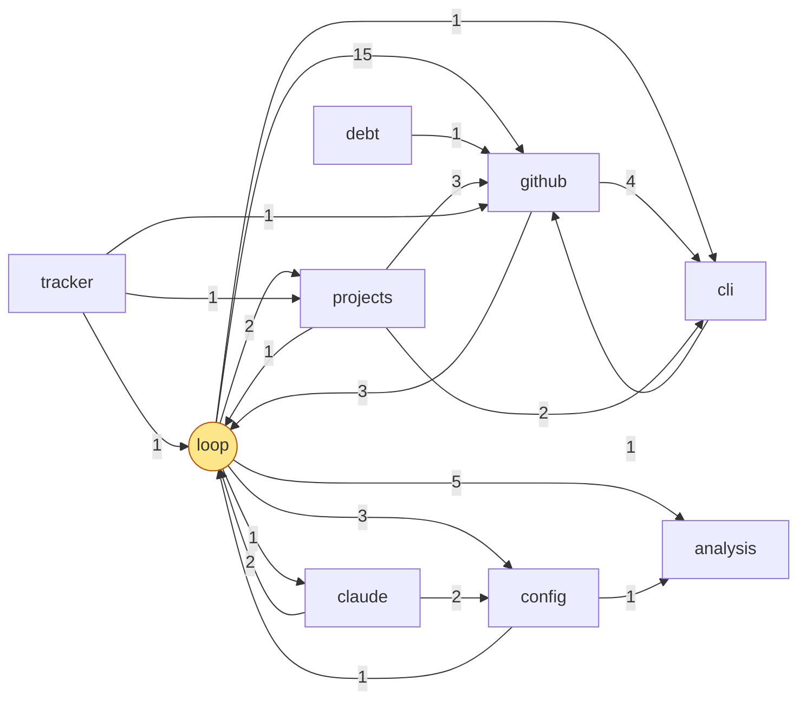

### Core size by directory

Type: `xychart-beta`

Module count per `packages/core/src` directory. The insight: `loop` holds 84 of 132 core modules, almost two thirds of the package, so most deterministic workflow policy lives in one directory. Counts come from `find packages/core/src/<dir> -name '*.mjs' | wc -l`; the total comes from `find packages/core/src -name '*.mjs' | wc -l`, which also counts `bash-exit-one.mjs` at the root. Derived from `packages/core/src/`.

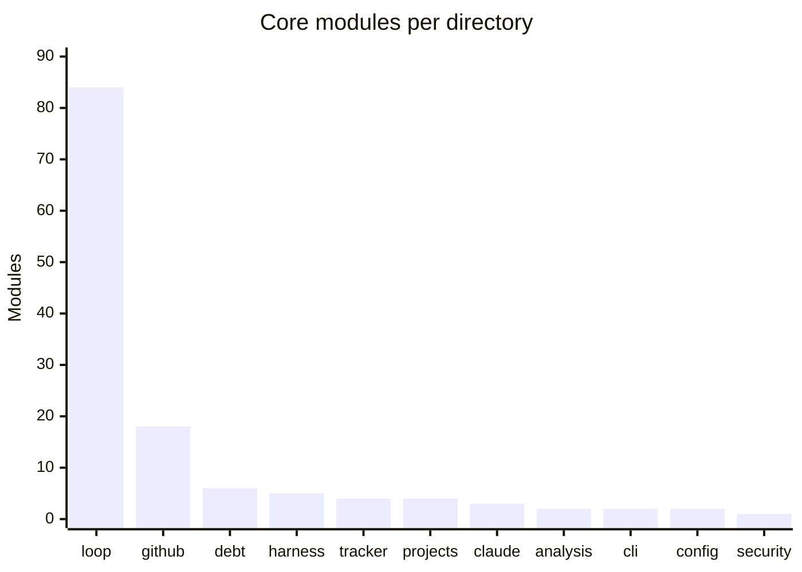

### Scripts tree

Type: `treemap-beta`

Script modules per `scripts/` subdirectory. The insight: `scripts/loop` (127) and `scripts/github` (94) hold 221 of 286 script modules. Counts come from `find scripts/<dir> -name '*.mjs' | wc -l`; the root count comes from `find scripts -maxdepth 1 -name '*.mjs' | wc -l`; the total comes from `find scripts -name '*.mjs' | wc -l`. Derived from `scripts/`.

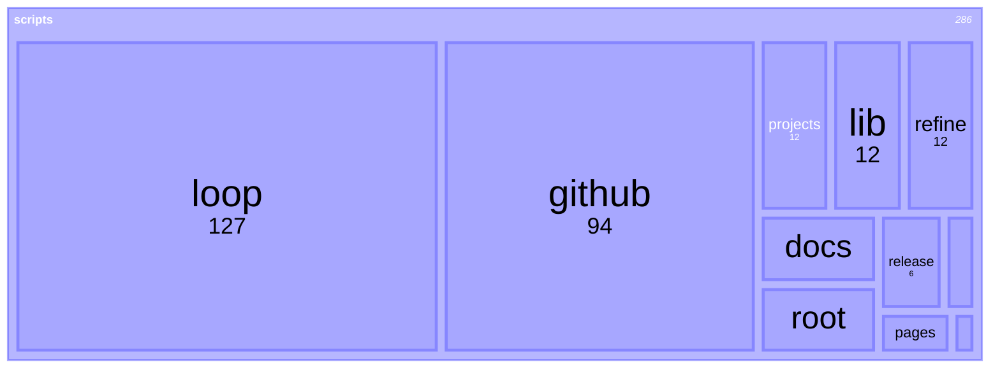

### CLI namespaces

Type: `mindmap`

The nine CLI namespaces and the number of subcommands each one routes to a script. The insight: `loop` (34) and `gate` (18) are the main control surfaces, and `project` is `queue` minus the `run` driver, derived in code and not duplicated. Counts come from a Node one-liner that imports `SUBCOMMAND_ROUTES` from `cli/index.mjs` and prints `Object.keys(routes).length` per namespace. Derived from `cli/index.mjs` (`SUBCOMMAND_ROUTES`, `QUEUE_ROUTES`, `TOP_LEVEL_COMMANDS`).

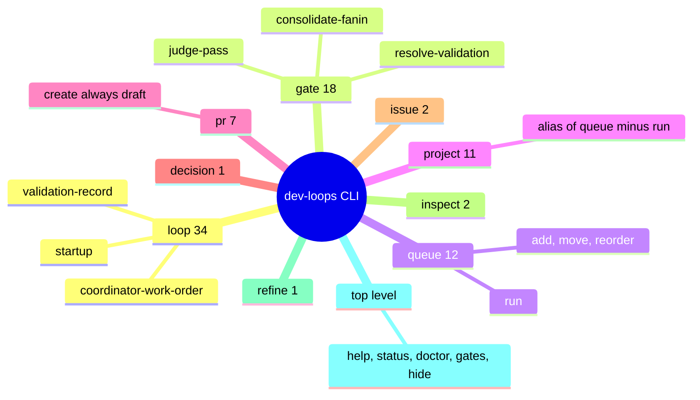

### Namespace to script directory routing

Type: `flowchart`

Which `scripts/` subdirectory each CLI namespace routes into, with the route count on each edge. The insight: the `gate` namespace splits across `scripts/github` (9) and `scripts/loop` (9), so a gate step can live in either directory, and the directory name does not predict the namespace. Counts come from the same Node one-liner over `SUBCOMMAND_ROUTES`, grouped by the second path segment of each route. Derived from `cli/index.mjs`.

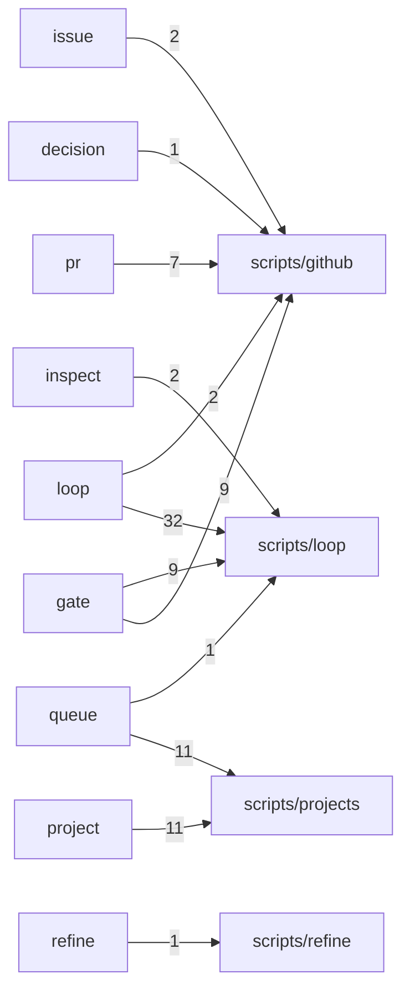

### One CLI call under Claude Code

Type: `sequenceDiagram`

The path of one routed command from an agent Bash call to GitHub. The insight: the harness asks the PreToolUse hooks first (the approval guard and the Bash gate), and each returns allow or deny before any script runs. The hooks do not start the launcher; the harness runs the command after an allow. The hooks work using core logic vendored into `.claude/hooks/`, because the hook cannot resolve `@dev-loops/core` from the plugin cache. Derived from `.claude/hooks/hooks.json`, `.claude/hooks/pre-tool-use-bash-gate.mjs`, `.claude/bin/dev-loops-run`, `cli/index.mjs` and `packages/core/src/github/gh.mjs`.

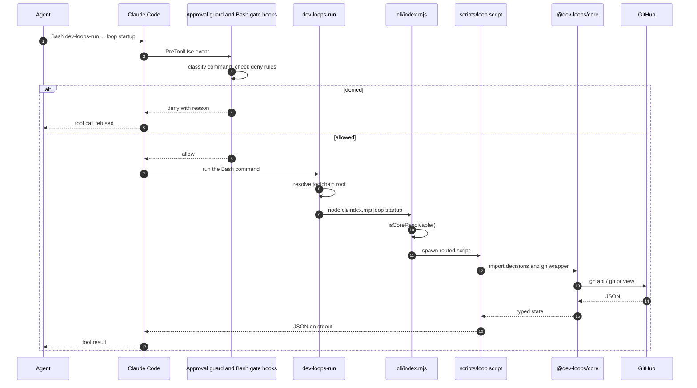

### Toolchain root and harness resolution

Type: `flowchart`

Two deterministic resolvers. The launcher picks the toolchain root in a fixed order with no version comparison. `resolveRuntimeHarness` picks the harness from environment markers, and Pi is the fallback. The insight: a live checkout always wins over an installed package, so the operator's local edits run without a release. Derived from `.claude/bin/dev-loops-run` and `packages/core/src/loop/run-context.mjs`.

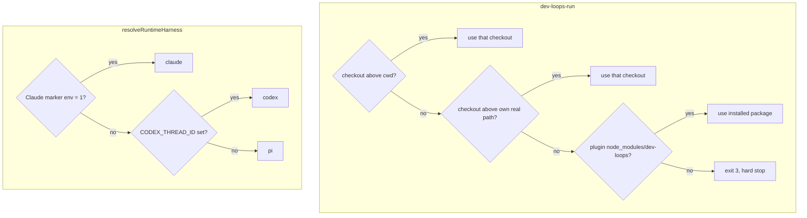

### Adapter contracts

Type: `classDiagram`

The two adapter seams in core. `createHarnessAdapter` and `createTrackerAdapter` validate the required methods and freeze the object. The insight: the tracker contract splits a required Issues group from an optional Board group, so a tracker without a board stays valid. GitHub is the only registered tracker provider (`BUILTIN_PROVIDERS` in `tracker/index.mjs`). Other providers, such as Jira, are spec-only: Jira appears only in a doc comment. The class names stand for factory functions (`createPiAdapter`, `createExtensionHarnessAdapter`, `createNoopAdapter`, `createGithubTrackerAdapter`, `createNoopTrackerAdapter`); core defines no classes for them. Derived from `packages/core/src/harness/adapter.mjs`, `packages/core/src/harness/index.mjs`, `packages/core/src/tracker/adapter.mjs` and `packages/core/src/tracker/index.mjs`.

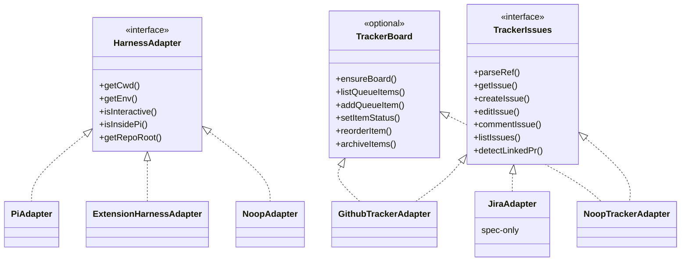

### Claude hook bundle

Type: `flowchart`

The eight Claude Code hook entry files, the event that triggers each one, and the local modules each imports. The insight: every hook entry reaches core policy only through `_`-prefixed sibling files, and 9 of those are generated copies of core modules (the `HOOK_BUNDLE` list). `_hook-io.mjs` and `_fixer-grants.mjs` are hand-authored. The count 9 comes from reading the `HOOK_BUNDLE` array in `generate-claude-assets.mjs` (9 `source` entries). The edges come from `grep -oE "from \"\./_[a-z-]+\.mjs\""` per hook file. Derived from `.claude/hooks/hooks.json`, `.claude/hooks/*.mjs` and `scripts/claude/generate-claude-assets.mjs`.

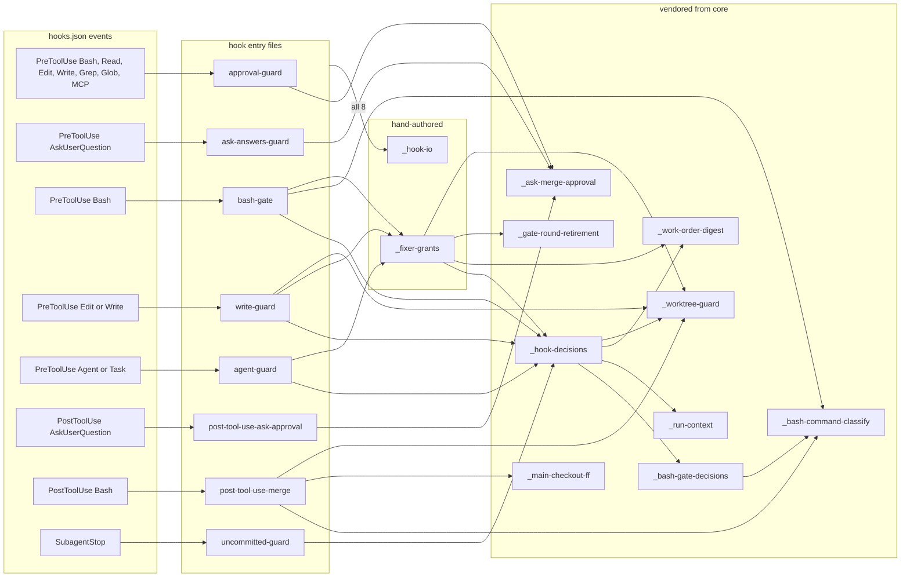

