

## Data model: state files and records

The loop keeps its state in small JSON files on disk and validates each file at the boundary where it is read. Two roots hold them. The `.pi/` directory of the main checkout holds long-lived state: the run-context file, the PR runner claims and the retrospective checkpoint. The `tmp/` directory holds per-round artifacts: work orders and their plans, the fan-in findings ledger, the judge verdict, the enriched ledger and the act list. The `.devloops` file is the only operator-authored record, and a zod schema checks it. Every record keys on the same few identities: a run id, a repo slug with a PR number, a head SHA and a `sha256:` work-order digest. Record field counts in this section are hand counts of the writer object literals in the cited files, and no command produced them. The config counts come from `jq` over `schemas/dev-loop-config.schema.json`, and each config caption names that command.

### Record relationships

Type: `erDiagram`

The loop records and the keys that join them. The run id links the run-context file to runner claims. The head SHA links the fan-in ledger, the judge verdict and the act list. The judge verdict disposes clusters by `clusterId`. The act list is one possible fixer source: a fixer order pins it as a required read of kind `act-list`, either as its source or beside a CI-failure source when the round's verdict post was refused for red CI. Other fixer orders read a CI, thread or review-body source only. The hand-back packet carries no key into the coordinator order; the order names the hand-back rule in `ruleReferences`, and the packet closes the round by contract. Derived from `packages/core/src/loop/run-context.mjs`, `scripts/loop/_pr-runner-coordination.mjs`, `packages/core/src/loop/coordinator-work-order.mjs`, `scripts/loop/emit-judge-work-order.mjs`, `scripts/loop/emit-fixer-work-order.mjs`, `scripts/loop/consolidate-fanin.mjs`, `scripts/loop/judge-pass.mjs` and `scripts/loop/checkpoint-contract.mjs`.

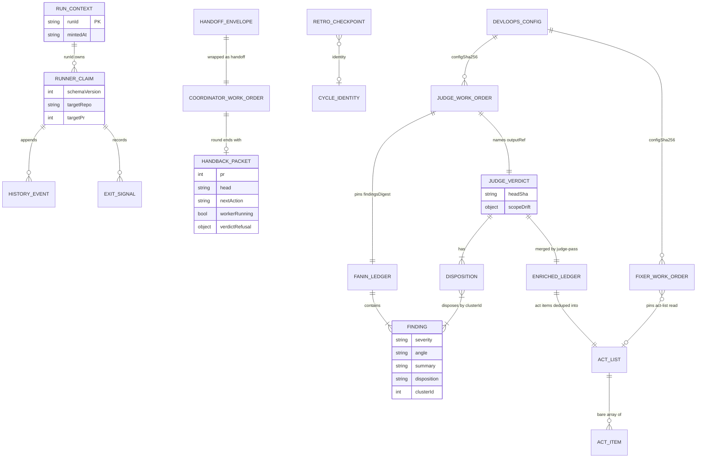

### Where each record lives

Type: `block-beta`

The on-disk layout of every record in this section. Long-lived state sits under `.pi/` in the main checkout, and per-round artifacts sit under `tmp/` in families keyed by repo slug, PR number, gate and head SHA. A claiming lane also writes `dev-loop-run-context.json` under the `.pi/` directory of its linked worktree, and `resolveRunId` reads that file as its last fallback. Derived from `packages/core/src/loop/run-context.mjs` (`runContextPath`, `ensureLaneRunContext`), `scripts/loop/_pr-runner-coordination.mjs` (`defaultRunnerCoordinationFilePathForTarget`), `scripts/loop/checkpoint-contract.mjs` (`CHECKPOINT_FILE`), `scripts/github/_gate-artifact-paths.mjs`, `scripts/loop/emit-coordinator-work-order.mjs` (`unitDir`), `scripts/loop/emit-fixer-work-order.mjs` (`buildFixerDir`) and `packages/core/src/loop/work-order-digest.mjs` (`executionIndexPath`).

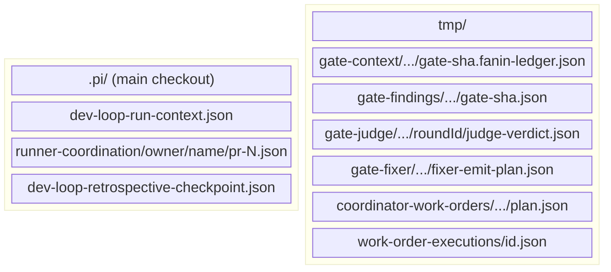

### PR runner claim record

Type: `classDiagram`

The shape of `pr-N.json`, the per-PR ownership lease, at `schemaVersion` 2. The normalizer accepts versions 1 and 2 and emits 2. The handoff writer spreads the raw record, so it keeps the stored version and any unrelated keys. Seven history event types exist, and two of them carry extra fields: `takeover` adds `previousRunId`, and `watch_claim` adds `head` and `waitKind`. A watch claim is all-or-nothing: a missing or unparseable `head`, `waitKind` or `updatedAt` drops the whole `watch` object. History keeps the latest 50 events. Derived from `scripts/loop/_pr-runner-coordination.mjs` (`createRunnerCoordinationState`, `normalizeRunnerCoordinationState`, `normalizeWatch`) and `packages/core/src/loop/watcher-exclusivity.mjs` (`WATCH_KINDS`).

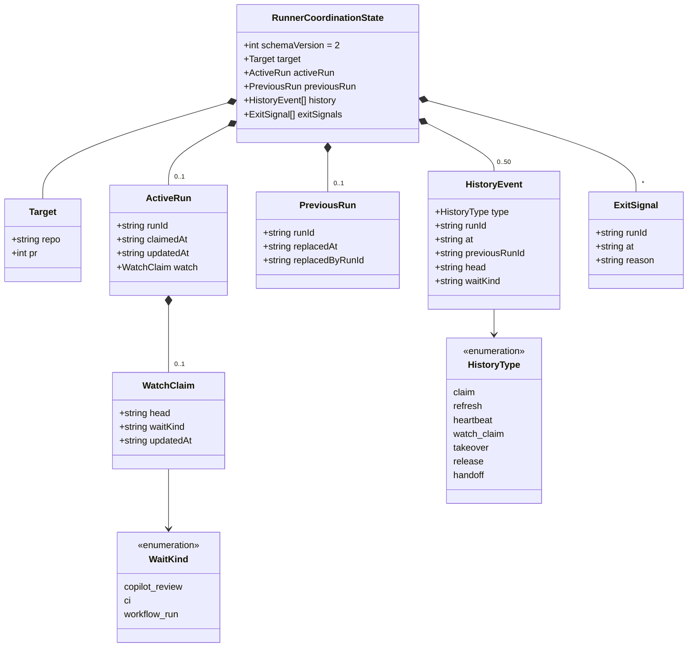

### Runner claim lifecycle

Type: `stateDiagram-v2`

The transitions that write each `history` event type. A release and a handoff both clear `activeRun` and fill `previousRun`, and a handoff also appends an exit signal with reason `handoff`. A takeover writes a fresh `activeRun` without a `watch`, moves the old owner to `previousRun` and drops the new owner's stale exit signals. A takeover refuses when the owner run id or the claim generation (`claimedAt`, `updatedAt`) changed after the stale read. A heartbeat and a refresh spread the old `activeRun`, so they keep a recorded watch. Recording a plain exit signal changes no ownership and writes no history event, so it is left out. Derived from `scripts/loop/_pr-runner-coordination.mjs` (`claimRunnerOwnership`, `recordWatchClaim`, `releaseRunnerOwnership`, `recordExitSignalForRunner` and the handoff path).

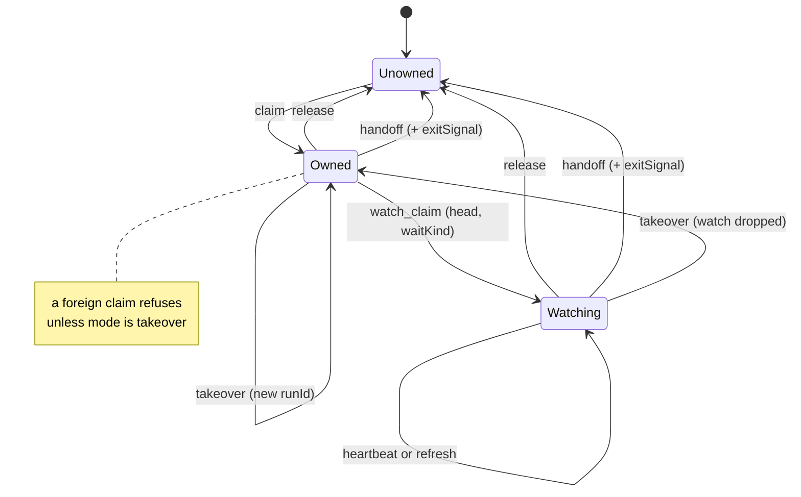

### Work order family

Type: `classDiagram`

The three dispatch work orders and the identity triple that addresses each one. All three share `role`, `target` and `operation`. The digest is the sha256 of the canonical order with sorted keys and with machine-local keys and absolute paths removed, so two checkouts get the same digest for the same unit. The coordinator order carries the handoff envelope with three changes: it drops `gateState.derivedAt`, it sorts the `gateConfig` angle and severity lists, and it refuses an envelope that carries `overrides`. The coordinator order carries no head SHA. The judge and fixer plans spread the full identity triple; the coordinator plan stores `workOrderRef` and `workOrderDigest` and writes `executionIdentity` only to the execution index. The class shows the main fields; optional keys such as `operatorFocus` are left out. Derived from `packages/core/src/loop/coordinator-work-order.mjs`, `scripts/loop/emit-judge-work-order.mjs`, `scripts/loop/emit-fixer-work-order.mjs` and `packages/core/src/loop/work-order-digest.mjs` (`LOCAL_MATERIAL_KEYS`, `EXECUTION_IDENTITY_RE`).

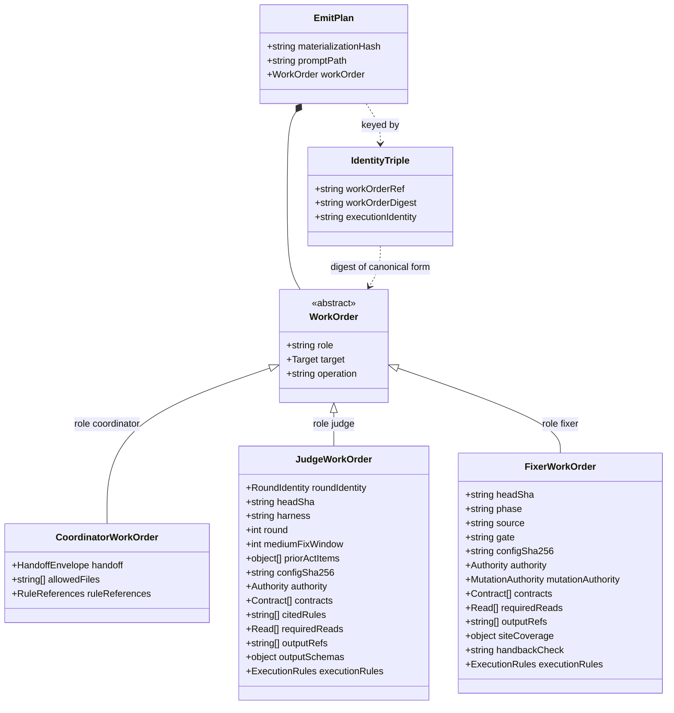

### Gate round record lineage

Type: `flowchart`

The order in which a gate round writes its records, and which script writes each one. Fan-in never disposes a finding: it writes `disposition: unjudged` and only the judge sets `judgeDisposition`. The act list is always a bare array. The pinned spec-authority identity rides on the ledgers as one `specAuthority` key, never on the act list. The verifier's `--construct` step writes `fixer-disposition.json`; the fixer agent must not write it by hand. A well-formed empty fan-in ledger with no pinned Copilot body ends the lineage early: `emit-judge-work-order.mjs` writes no order and returns `judgeSkipped`, and no judge or `judge-pass.mjs` runs. Derived from `packages/core/src/loop/gate-fanin.mjs` (`consolidateFanin`, `UNJUDGED_DISPOSITION`), `scripts/loop/consolidate-fanin.mjs`, `scripts/loop/emit-judge-work-order.mjs`, `scripts/loop/judge-pass.mjs` and `scripts/loop/emit-fixer-work-order.mjs`.

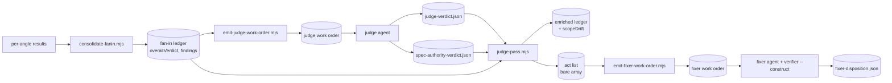

### Finding and judge verdict shapes

Type: `classDiagram`

The judge verdict as `validateJudgeVerdict` accepts it, and the ledger finding before and after `judge-pass` merges the verdict. The merge copies one disposition onto every member of a cluster. It clears a prior round's judge fields first, so a stale `followUpDraft`, `judgeCriterion`, `failOpen` or `resurfaces` never survives. `consolidate-fanin.mjs` stamps `clusterId` (the cluster's representative index), and `judge-pass.mjs` adds `fingerprint` after the merge. Derived from `packages/core/src/loop/gate-fanin.mjs` (`consolidateFanin`, `validateJudgeVerdict`, the enrichment block), `scripts/loop/judge-pass.mjs` and `agents/judge.agent.md`.

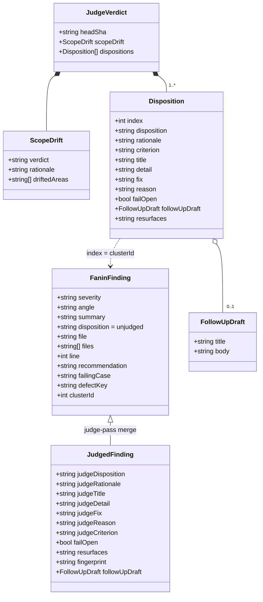

### Validator rules on records

Type: `requirementDiagram`

The fail-closed rules that the validators enforce on the hand-back packet, the judge verdict and the run-context file. Each requirement names the field it checks. `validateJudgeVerdict` refuses a duplicate disposition index, and the merge step `applyJudgeDispositions` refuses a verdict that leaves a cluster undisposed. Derived from `scripts/loop/_coordinator-handback.mjs` (`FIELD_CHECKS`), `packages/core/src/loop/gate-fanin.mjs` (`validateJudgeVerdict`, `applyJudgeDispositions`) and `packages/core/src/loop/run-context.mjs` (`writeRunContext`, `readRunContext`).

```mermaid
requirementDiagram
    requirement handback_fields {
        id: H1
        text: "pr positive int, head 40 or 64 hex, nextAction non-empty"
        risk: high
        verifymethod: test
    }
    requirement worker_joined {
        id: H2
        text: "workerRunning must be false"
        risk: high
        verifymethod: test
    }
    requirement ci_red_route {
        id: H3
        text: "verdictRefusal needs reason ci_red, actListPath and nextAction fix_ci_failure"
        risk: medium
        verifymethod: test
    }
    requirement defer_draft {
        id: J1
        text: "defer requires followUpDraft title and body"
        risk: medium
        verifymethod: test
    }
    requirement unique_index {
        id: J2
        text: "no duplicate disposition index"
        risk: medium
        verifymethod: test
    }
    requirement every_cluster {
        id: J3
        text: "every clusterId is disposed"
        risk: high
        verifymethod: test
    }
    requirement run_id_present {
        id: R1
        text: "runId non-empty string or record is null"
        risk: medium
        verifymethod: test
    }
    element validateCoordinatorHandback {
        type: "function"
    }
    element validateJudgeVerdict {
        type: "function"
    }
    element applyJudgeDispositions {
        type: "function"
    }
    element readRunContext {
        type: "function"
    }
    validateCoordinatorHandback - satisfies -> handback_fields
    validateCoordinatorHandback - satisfies -> worker_joined
    validateCoordinatorHandback - satisfies -> ci_red_route
    validateJudgeVerdict - satisfies -> defer_draft
    validateJudgeVerdict - satisfies -> unique_index
    applyJudgeDispositions - satisfies -> every_cluster
    readRunContext - satisfies -> run_id_present
```

### Hand-back packet check

Type: `sequenceDiagram`

How a coordinator round ends. The coordinator writes the four-field packet, plus an optional `verdictRefusal` when a verdict post was refused for red CI, and the validator CLI reads it before the hand-back. A refused packet never exits 0, whatever output flags the caller passes. Derived from `scripts/loop/validate-coordinator-handback.mjs` and `scripts/loop/_coordinator-handback.mjs`.

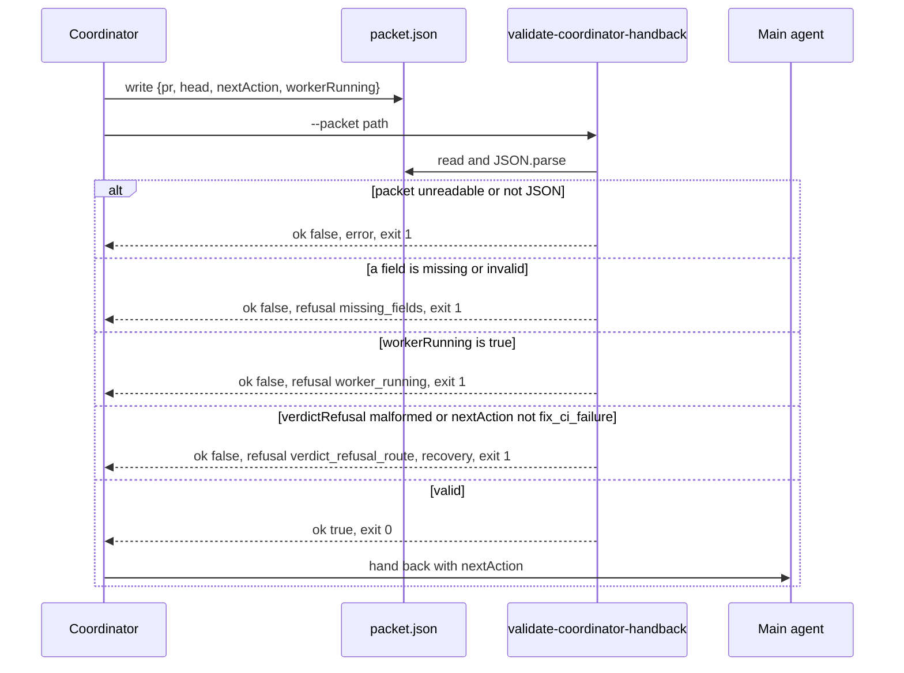

### Retrospective checkpoint resolution

Type: `stateDiagram-v2`

How the reader maps the durable `state` field of `.pi/dev-loop-retrospective-checkpoint.json` to a gate state. Only `complete` with fresh-context provenance and no newer merge resolves to COMPLETE. A malformed record, an inline retro or a newer merge all fail closed to MISSING. Derived from `packages/core/src/loop/retrospective-checkpoint.mjs` (`resolveCheckpointStateFromArtifact`, `normalizeRetroProvenance`) and `scripts/loop/checkpoint-contract.mjs` (`buildRetrospectiveCheckpointPayload`).

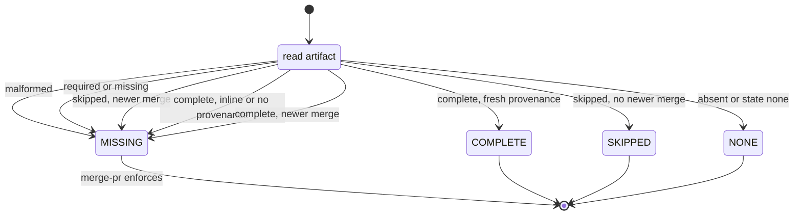

### .devloops config schema

Type: `mindmap`

The 23 top-level keys of the `.devloops` config schema, grouped by purpose (the grouping is editorial). Only `version` is required, and `additionalProperties` is false, so an unknown key fails validation. The count comes from `jq '.properties | keys | length' schemas/dev-loop-config.schema.json`. The JSON schema is generated from the zod `FileConfigSchema`. Derived from `schemas/dev-loop-config.schema.json`, `packages/core/src/config/config.mjs` and `scripts/generate-config-schema.mjs`.

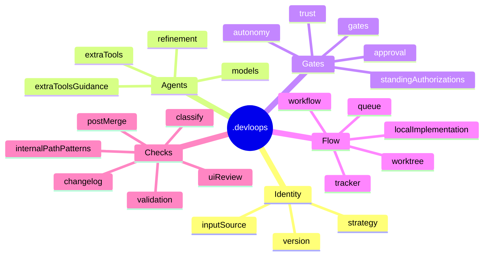

### Config keys per section

Type: `xychart-beta`

The number of property keys declared in each object-valued top-level section of the config schema, nested keys included. The `gates` section holds 128 of the counted keys, about half of the schema. Produced by `jq -r '.properties | to_entries[] | "\(.key) \([.value | .. | objects | select(has("properties")) | .properties | keys | length] | add)"' schemas/dev-loop-config.schema.json`. Sections without nested properties (`version`, `strategy`, `inputSource`, `extraTools`, `extraToolsGuidance`, `internalPathPatterns`) are left out. Derived from `schemas/dev-loop-config.schema.json`.

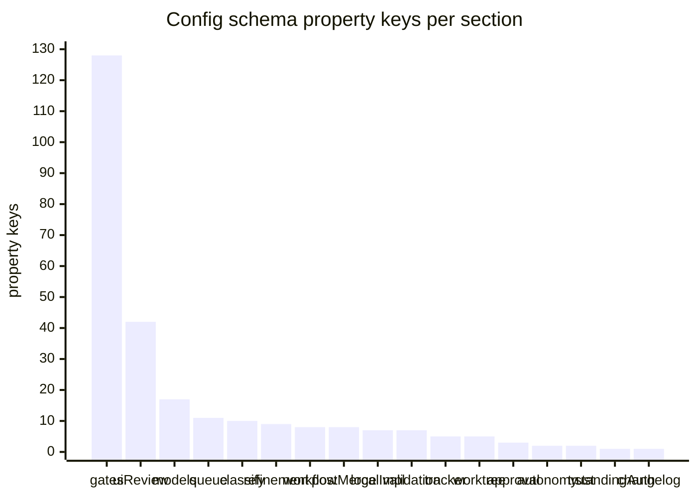

### Fields per record

Type: `treemap-beta`

The top-level field count of each loop record, optional fields included. Values are reviewer hand counts of the writer object literals and their conditional spreads, with no command: `writeRunContext` (2), `createRunnerCoordinationState` (6), the coordinator `workOrder` literal (6), the judge `workOrder` literal (23: 17 fixed plus `copilotBodyClusterId`, `closureRound`, `operatorFocus`, `operatorFocusDigest`, `sliceLinkage` and `sliceLinkageIssues`), the fixer `workOrder` literal (22, with `threadsShape`, `failedChecks`, `failedChecksOmitted`, `deltaFindings`, `operatorFocus` and `operatorFocusDigest` optional), the handoff `envelope` (26: the 18-key literal plus eight keys set after it, such as `gateConfig`, `unitBoundaries`, `specSource` and `gateState`), the fan-in `ledgerWrapper` after `stampOptionalSpecAuthority` (5), the judge-pass `ledgerRecord` after the stamp (5), the judge verdict (3), the disposition entry (11), the hand-back `FIELD_CHECKS` (4) and the `complete` retrospective payload (5). The spec-authority stamp adds one nested `specAuthority` key, not four top-level keys. The handoff envelope, the judge order and the fixer order are the widest records. The two orders are wide because they pin every input by digest. Derived from `packages/core/src/loop/run-context.mjs`, `scripts/loop/_pr-runner-coordination.mjs`, `packages/core/src/loop/coordinator-work-order.mjs`, `packages/core/src/loop/handoff-envelope.mjs`, `scripts/loop/emit-judge-work-order.mjs`, `scripts/loop/emit-fixer-work-order.mjs`, `scripts/loop/consolidate-fanin.mjs`, `scripts/loop/judge-pass.mjs`, `scripts/loop/_coordinator-handback.mjs`, `scripts/loop/checkpoint-contract.mjs`, `scripts/lib/spec-authority-stamp.mjs` and `packages/core/src/loop/spec-authority.mjs` (`stampSpecAuthorityIdentity`).

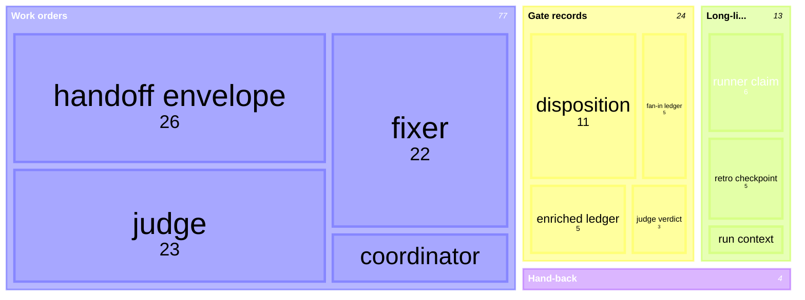

