

## State machines and lifecycles

dev-loops drives every routing decision from frozen enums and explicit transition tables in `packages/core/src/loop/`. Most modules export a `*_TRANSITIONS` object that the code enforces. Others, such as the public dev-loop status and the gate-coordination checkpoints, are precedence cascades: an ordered list of `if` branches maps one snapshot to one result. The diagrams below follow the code. Where a doc names a state that no code produces, the diagram marks it.

### Machine sizes at a glance

Type: `xychart-beta`

The bars show the state count of each transition-table machine. The line shows its legal edge count. The tracker machine is dense because its `unknown` state may move to any of its 8 states, itself included. The reviewer machine is dense because every pre-gate state may move to `submitted_review` and to `blocked_needs_user_decision`. Counts come from `node count-states.mjs` (a scratchpad script that imports `copilot-loop-state.mjs`, `reviewer-loop-state.mjs`, `lifecycle-state.mjs`, `queue-state.mjs`, `fix-loop-state.mjs`, `refinement-grill-state.mjs`, `pr-lifecycle.mjs` and `tracker-first-loop-state.mjs` and sums the transition arrays; pr-lifecycle excludes the `[*]` marker rows).

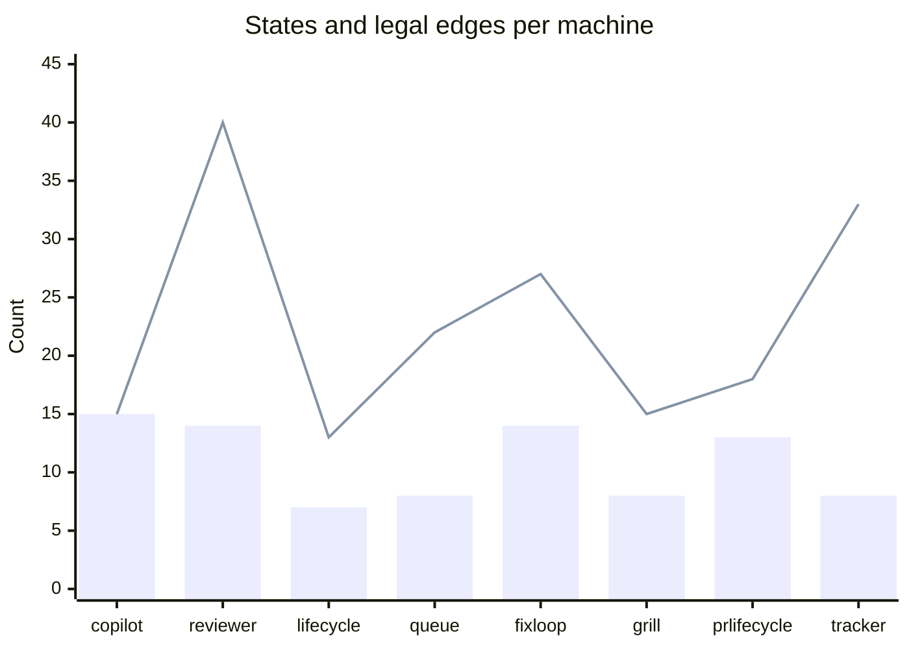

### Dev-loop status to gate selection

Type: `stateDiagram-v2`

`selectGateForState` maps the canonical `status`, `authorization`, `target.kind` and `ownership` to one of 13 gates. The order matters. Lifecycle stops (blocked, done, merge authorization, approval, waiting) win before any target or ownership check, so an explicit `--review` or `--ui-review` request can never bypass them. Anything that falls through ends at `fail_closed_reconcile`. Derived from `packages/core/src/loop/public-dev-loop-routing.mjs` and `packages/core/src/loop/public-dev-loop-routing-contract.mjs`.

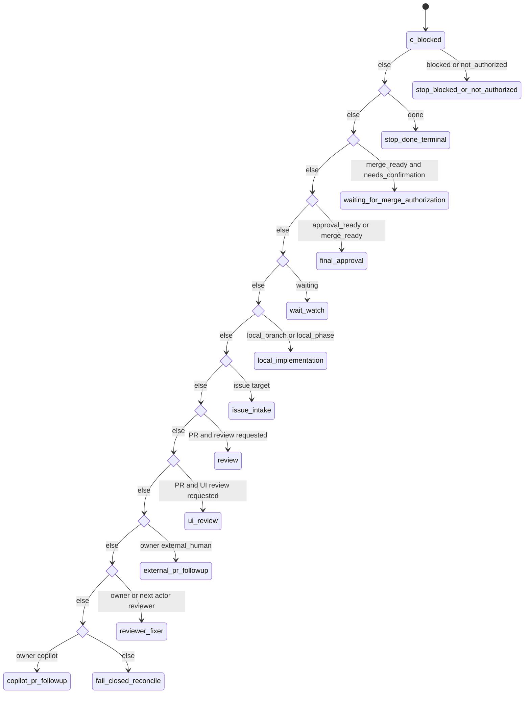

### Dev-loop status values and their route kinds

Type: `stateDiagram-v2`

The status enum has no transition table. Each status maps to a route kind through the gate above. `not_authorized` stops every status first. `blocked`, `done` and a `merge_ready` state that still needs confirmation stop. `waiting` is the only status that yields a wait route. `approval_ready` and `merge_ready` without a pending confirmation route to final approval, but the router turns that into `needs_reconcile` when no clean current-head `pre_approval_gate` evidence is visible. `active` routes by target and ownership, and fall through to `needs_reconcile` when nothing matches. Derived from `packages/core/src/loop/public-dev-loop-routing-contract.mjs` (`DEV_LOOP_STATUS`, `DEV_LOOP_ROUTE_KIND`) and `selectGateForState` plus the gate-to-result branches in `packages/core/src/loop/public-dev-loop-routing.mjs`.

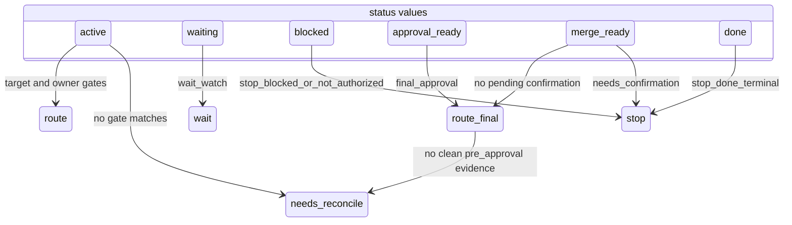

### Gate-coordination evaluator precedence

Type: `stateDiagram-v2`

`evaluatePrGateCoordinationCore` checks PR facts in a fixed order before it looks at the Copilot lifecycle state. Merged or closed PRs report done first. Merge conflicts, UI end-to-end scoping and designer-review scoping all outrank the draft gate. A draft PR never reaches the post-draft branches. A draft PR with failing required CI, or a refused draft round that is not ready, reports blocked. A clean `pre_approval_gate` still yields to a merge-blocking title marker and to missing `draft_gate` evidence. An unmapped lifecycle state falls through to `report_blocked`. Derived from `packages/core/src/loop/pr-gate-coordination.mjs` and `scripts/loop/detect-pr-gate-coordination-state.mjs`.

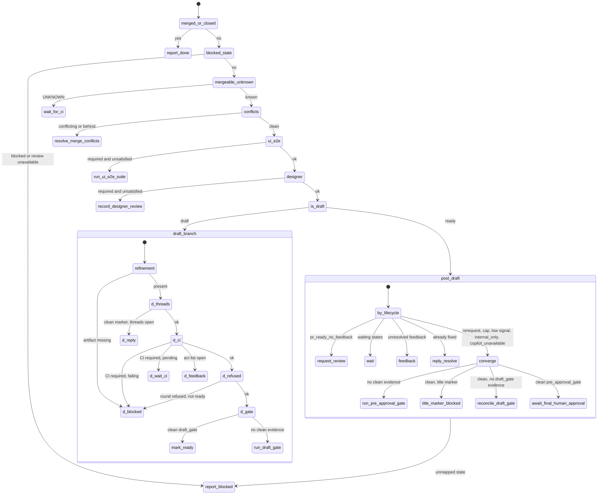

### Gate checkpoint to nextAction flow

Type: `sankey-beta`

Each band counts the result sites in the evaluator that pair a `gateBoundary` checkpoint with a literal `nextAction`. `report_blocked` has 15 sites: 10 literal `return buildResult(...)` sites plus 5 calls to `buildTitleMarkerBlockedResult`, which shows how many paths fail closed. The 5 calls to `buildDraftGateNeededForMergeResult` produce `draft_gate_needed` with `reconcile_draft_gate`. The `pre_approval_gate_needed` band is the single rewrite site in the script wrapper. It converts a pre-approval or final-approval boundary when no contract-complete `pre_approval_gate` marker exists. Ternary sites (draft gate versus mark ready, the two wait actions, the round-cap action list) are not literal and are left out. The literal counts come from an `awk` scan of `packages/core/src/loop/pr-gate-coordination.mjs` lines 1290 to 2718 piped to `sort | uniq -c`. The helper counts come from `grep -c "return buildTitleMarkerBlockedResult("` and `grep -c "return buildDraftGateNeededForMergeResult("` on the same file. The wrapper site is in `scripts/loop/detect-pr-gate-coordination-state.mjs`.

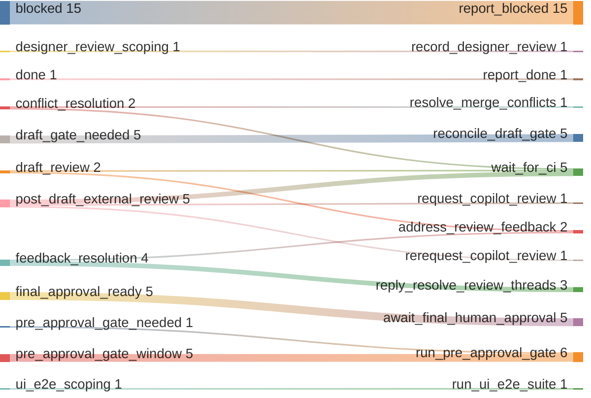

### Copilot PR loop transitions

Type: `stateDiagram-v2`

This is the inner PR loop that the gate evaluator consumes as `lifecycleState`. The table allows only one exit from draft and one from ready-no-feedback. Six states have no outgoing edge: `review_request_unavailable`, `blocked_needs_user_decision`, `low_signal_converged`, `round_cap_reached`, `round_cap_clean_fallback` and `copilot_unavailable`. The gate evaluator routes the last four onward to `pre_approval_gate`; this table holds no edge for them. `no_pr` also has no edge. Derived from `TRANSITIONS` in `packages/core/src/loop/copilot-loop-state.mjs`.

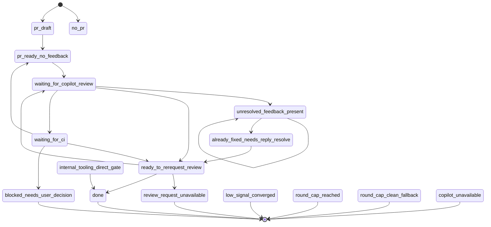

### Outer lifecycle phases

Type: `stateDiagram-v2`

The outer lifecycle has 7 states: 6 working phases and the terminal `merge`. Every phase after implementation can send work back to `implementation`, so a failed gate always reopens code work. `draft_gate` can skip ahead to `feedback_resolution`. `LIFECYCLE_GRAPH.entryStates` lists all 7 states, `merge` included, so a run may resume at any of them. Derived from `LIFECYCLE_TRANSITIONS` and `LIFECYCLE_GRAPH` in `packages/core/src/loop/lifecycle-state.mjs`.

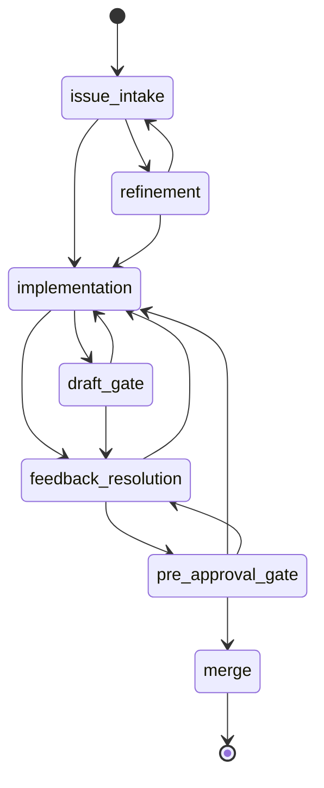

### PR lifecycle contract graph

Type: `stateDiagram-v2`

The PR lifecycle table has 13 states and 18 real edges. Terminal states are derived from the edge list, not hand-listed. A human can send an approved PR back to `draft_local_review_gate`, which restarts the whole gate sequence. Only two states are absorbing: `terminal_slice_complete` and `stopped_needs_user_decision`. Derived from `PR_LIFECYCLE_TRANSITIONS` in `packages/core/src/loop/pr-lifecycle.mjs`.

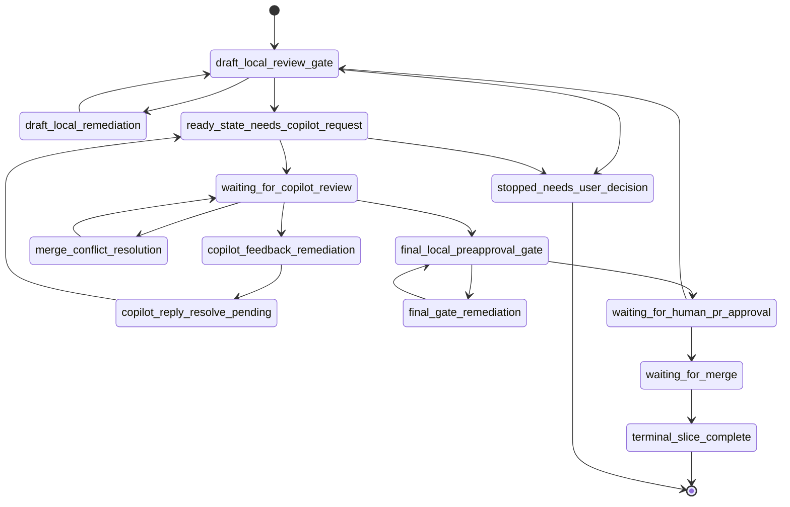

### Reviewer loop state graph

Type: `stateDiagram-v2`

The reviewer loop runs a linear pipeline from request to a posted draft review, then waits for the operator to submit. A head change invalidates a pending draft. A head change after submission marks `re_review_needed`. Two fan-in edges are drawn as notes to keep the graph readable. A recorded `submitted` outcome jumps any state from `waiting_for_review_request` to `waiting_for_user_submit` to `submitted_review`. A `failed` outcome sends every state except the two legacy states to `blocked_needs_user_decision`. The legacy states `waiting_for_author_followup` and `waiting_for_re_request` keep table rows, but `interpretReviewerLoopState` never produces them. Derived from `REVIEWER_TRANSITIONS` in `packages/core/src/loop/reviewer-loop-state.mjs` and `skills/docs/reviewer-loop-state-graph.md`.

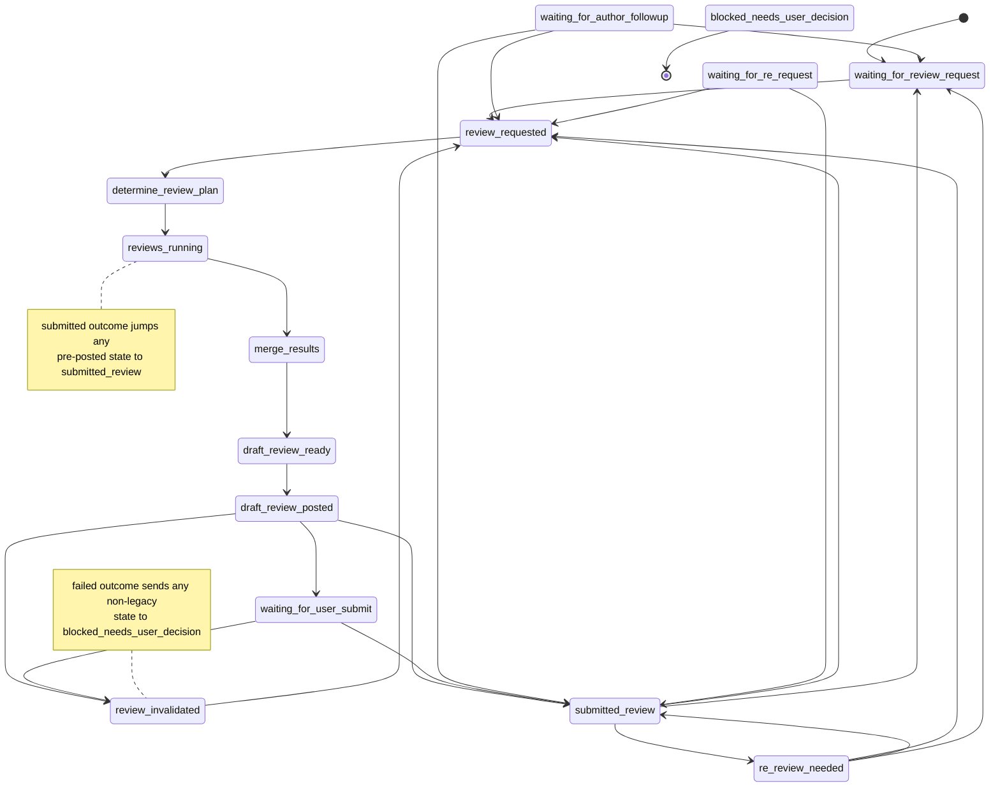

### Ownership classification and Next Up claim

Type: `stateDiagram-v2`

`classifyOwnership` checks for a Copilot assignee first, so a Copilot-owned item never needs the viewer login. `assigned_to_me` requires the viewer to be the sole human assignee. A co-assigned viewer counts as `assigned_to_other`. Next Up pickup skips `assigned_to_other` items and picks Copilot-owned and own items directly. It claims an unassigned item, re-reads the assignees, and resolves a contest with a case-insensitive lexicographic tiebreak. The loser unassigns itself. The winner removes the other login. Derived from `packages/core/src/github/ownership-helpers.mjs` and `resolveNextUpHead` plus `attemptClaimAndArbitrate` in `scripts/projects/resolve-active-board-item.mjs`.

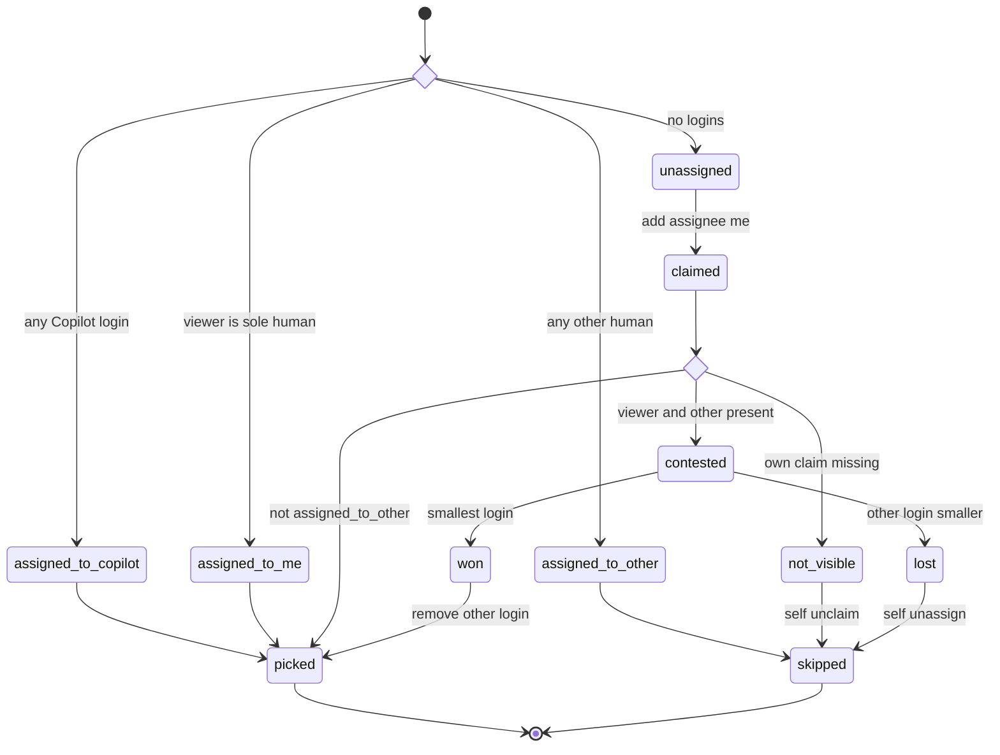

### Retrospective checkpoint resolution

Type: `stateDiagram-v2`

The durable checkpoint artifact resolves to one of 4 states. A missing file or a recorded `none` resolves to `none`. A malformed file, a stale record after a newer merge, or a `complete` record without fresh-context provenance all fail closed to `missing`. The routing gate passes `missing` through unchanged, and `merge-pr` enforces it at merge time through its `retrospective_checkpoint` precondition. Only an unrecognized checkpoint state produces `needs_reconcile`. A proposed route that is already stop, inspect or needs\_reconcile passes through untouched. Derived from `resolveCheckpointStateFromArtifact` and `evaluateRetrospectiveGate` in `packages/core/src/loop/retrospective-checkpoint.mjs`, `scripts/github/merge-pr.mjs` and `skills/docs/retrospective-checkpoint-contract.md`.

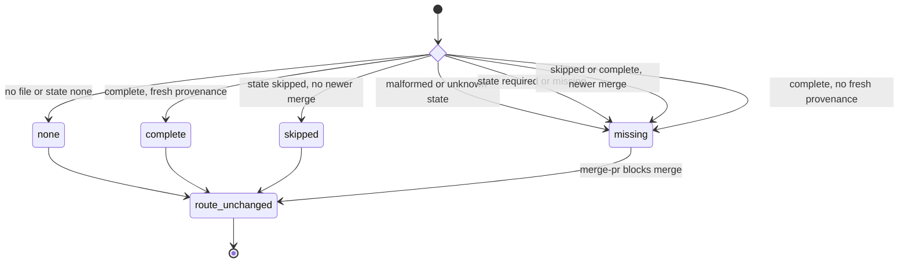

### Board columns

Type: `stateDiagram-v2`

The board has 4 logical columns: `next_up`, `in_progress`, `ready_for_review` and `done`. Backlog is not a logical column. It is the default non-success column (`nonSuccessStatus`), and the queue driver moves an item there when its run throws. Display names come from config, and `ready_for_review` resolves to "In Progress" unless the board configures it. Reconcile moves an item to `in_progress` when any linked PR is open and to `done` when the PR merges or the issue closes. Otherwise it leaves Backlog and Next Up untouched. The state-to-column map is stateless, so a PR demoted to draft maps back to `in_progress`. Pickup reads only Next Up and never falls back to Backlog. Derived from `deriveReconcileColumn` and `nonSuccessBoardColumn` in `packages/core/src/loop/queue-board-sync.mjs`, `packages/core/src/loop/queue-driver.mjs` and `scripts/projects/resolve-active-board-item.mjs`.

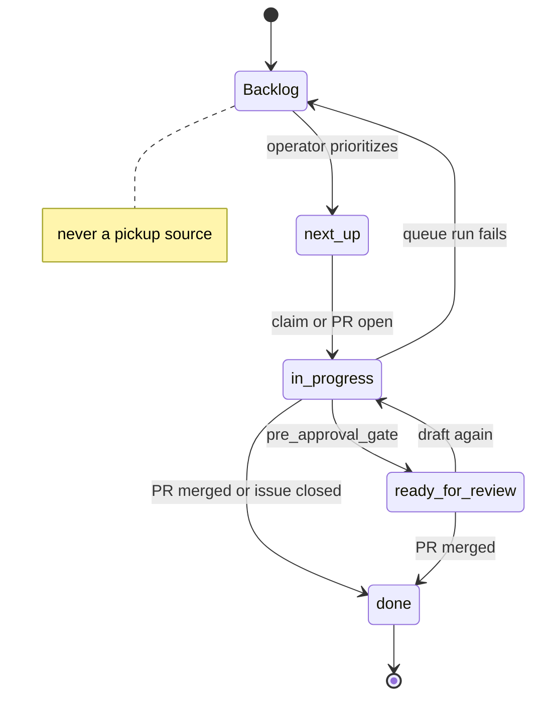

### Loop states per board column

Type: `pie`

`DEFAULT_STATE_LOGICAL_MAP` assigns 29 loop-state names to columns. 19 of them land in In Progress, including blocked and round-cap states, and any unmapped state also falls back to In Progress. Counts come from `node count-columns.mjs` (a scratchpad script that tallies `DEFAULT_STATE_LOGICAL_MAP` values in `packages/core/src/loop/queue-board-sync.mjs`).

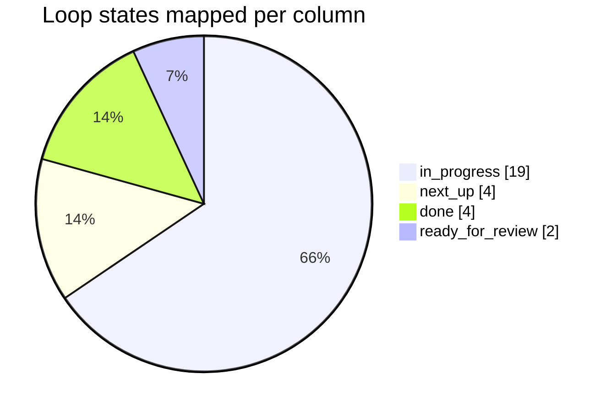

### Pre-push delta review results

Type: `stateDiagram-v2`

A delta sequence allows at most 3 reviewer invocations (`DELTA_MAX_INVOCATIONS`). A fresh, valid `locally_clear` result grants the push. Below the bound, any other result is `needs_fix`. A fresh result loops through the fixer, and a stale result re-reviews the moved head. At the bound the sequence ends `bounded_out` and pushes into the normal gate path with no success claim. Per-item statuses are `resolved`, `not_resolved` and `cannot_verify`. Any status other than `resolved`, or a new finding of medium or higher severity, forbids `locally_clear`. Derived from `decideDeltaNextStep` and `deriveDeltaOutcome` in `packages/core/src/loop/pre-push-delta-review.mjs`.

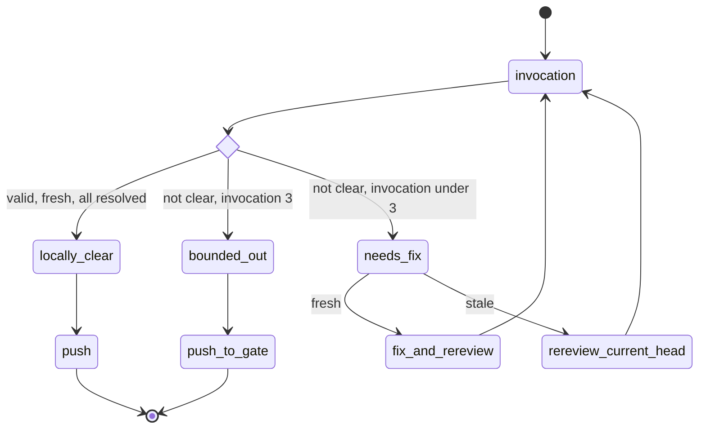

### Gate fixer loop

Type: `stateDiagram-v2`

The fix loop wraps the delta review. A `commit_only` fixer commits without pushing, the delta review checks the candidate, and only then does a `full` order push it. `head_moved` is reachable from every in-flight state and always ends in a full gate round. `stopped` has no inbound edge in the table. `interpretFixLoopState` enters it directly when the snapshot carries the operator stop flag, ahead of every other check. Derived from `FIX_LOOP_TRANSITIONS` and `interpretFixLoopState` in `packages/core/src/loop/fix-loop-state.mjs`.

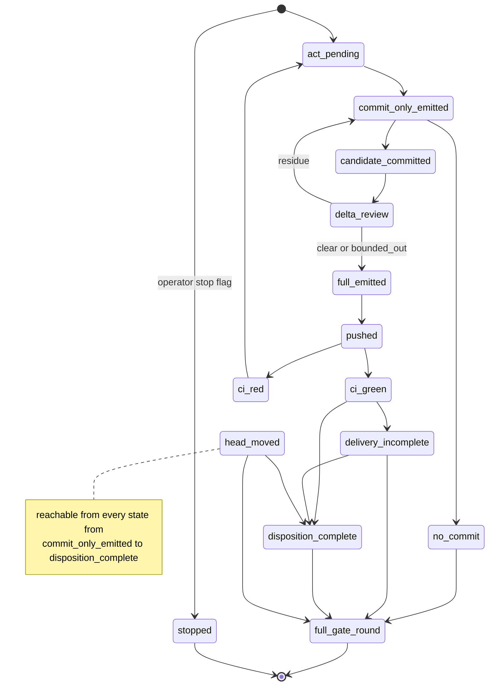

### Queue entry status

Type: `stateDiagram-v2`

The local queue entry has 8 statuses. `blocked` can resume at `queued` or `running`. `failed` can only re-queue. `done` is the only terminal. When a run throws, the driver marks the entry `failed` only for a failure kind in `RECOVERABLE_FAILURES` (`acceptance_report_parse_failure`, `round_cap_reached`, `timeout`) with retries left. Every other failure marks it `blocked`. Only those recoverable `failed` entries are picked up again. Derived from `VALID_TRANSITIONS` and `RECOVERABLE_FAILURES` in `packages/core/src/loop/queue-state.mjs` and the failure branch in `packages/core/src/loop/queue-driver.mjs`.

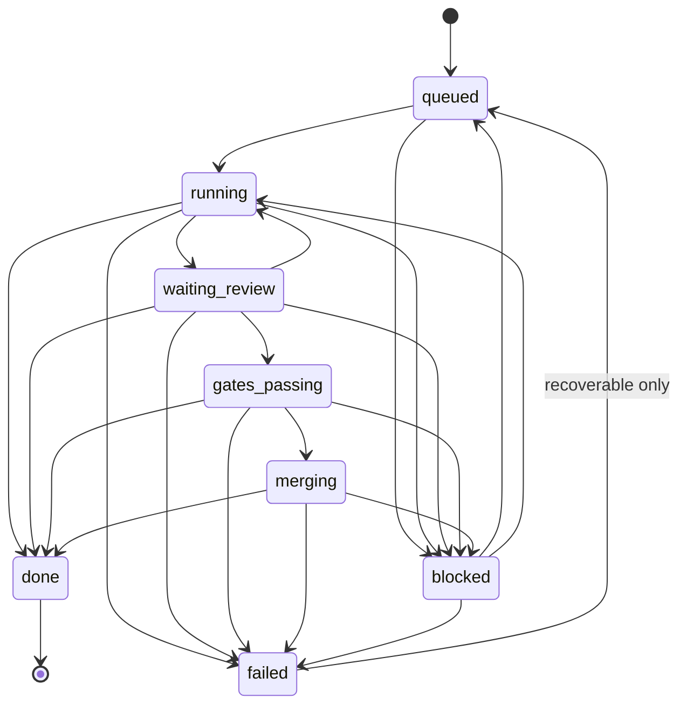

### Refinement grill loop

Type: `stateDiagram-v2`

The grill iterates to a fixed point: detect gaps, collect answers, synthesize, then re-grill. Three terminals exist. `grill_clean` is the fixed point, `needs_human_handoff` covers a gap with no citable answer, and `blocked_needs_user_decision` covers an I/O or parse failure. Derived from `GRILL_TRANSITIONS` in `packages/core/src/loop/refinement-grill-state.mjs`.

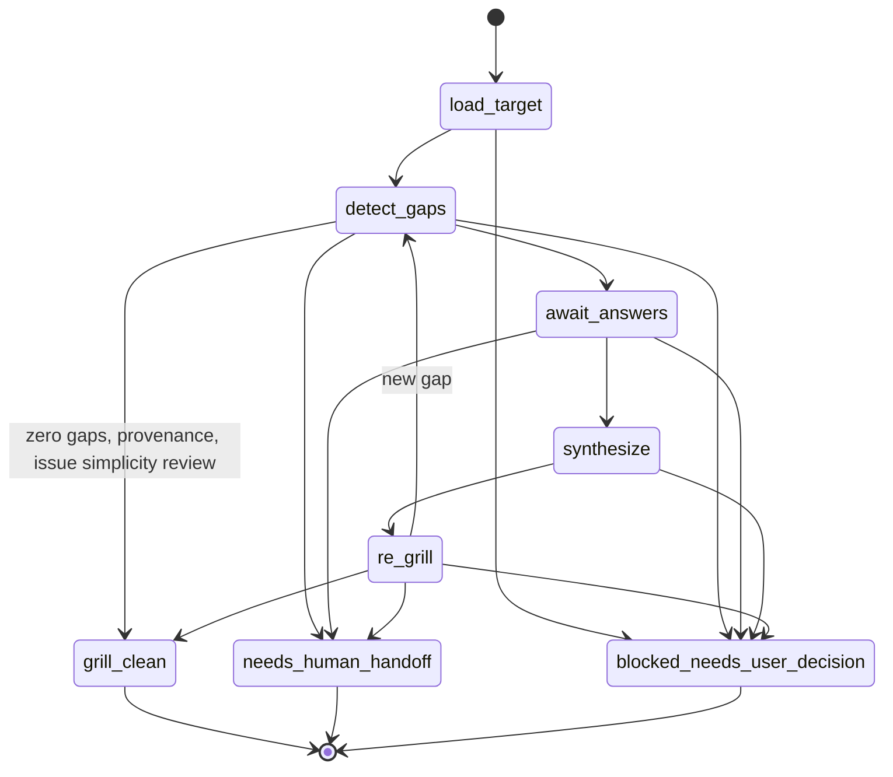

### Tracker-first issue states

Type: `stateDiagram-v2`

The tracker-first machine maps a raw tracker state to 8 canonical states. Every state may move to `unknown`, and `unknown` may move to any state, itself included. That is why the bar chart shows 33 edges for 8 states. `completed` can only leave through `unknown`. An unrecognized raw state fails closed to `needs_triage`. Derived from `TRACKER_TRANSITIONS` and `interpretTrackerLoopState` in `packages/core/src/loop/tracker-first-loop-state.mjs`.

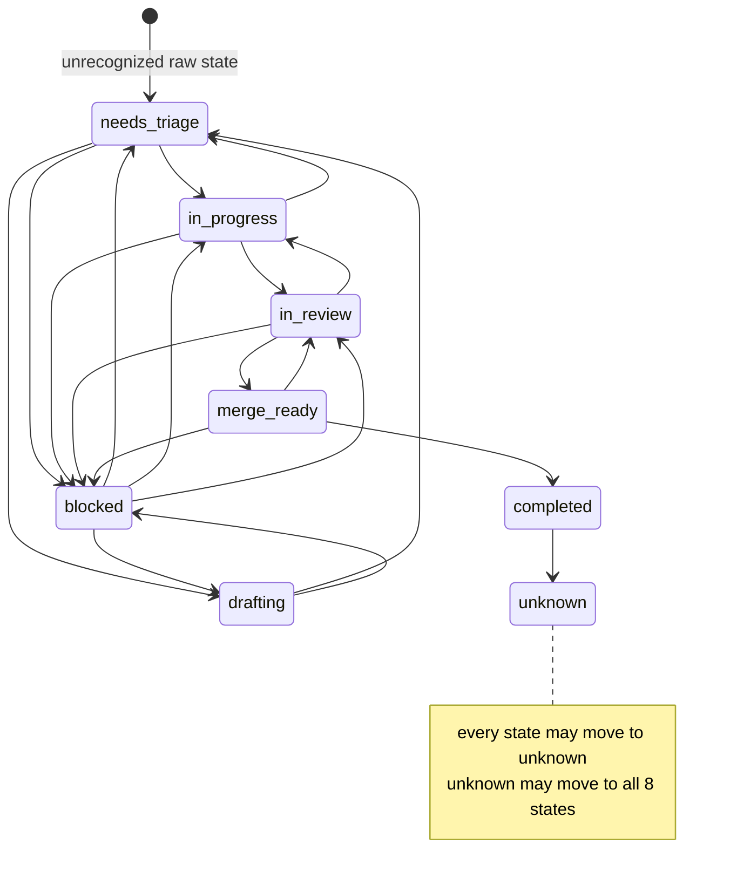

