

## Main flows from issue to merge

This section follows one unit of work from a raw idea to a merged PR. An idea becomes a grilled issue through the intake procedure and the grill sub-loop. The main agent then dispatches a `dev-loop` coordinator. The coordinator runs `loop startup`, opens a draft PR, and runs the draft\_gate. The coordinator continues at a routine `nextAction` and hands back a typed packet at a stop or at the routine-boundary cap, and the orchestrator dispatches a fresh coordinator from an emitted work order. After a clean draft\_gate the PR goes ready, Copilot reviews it, the pre\_approval gate runs, and `merge-pr.mjs` merges it under a recorded human approval. The diagrams below are derived from the CLI route table in `cli/index.mjs`, the scripts it routes to, the pure state modules in `packages/core/src/loop/`, and the contracts under `skills/docs/`. No diagram shows measured counts.

### End-to-end commands from issue to merge

Type: `flowchart`

The main path as the skills, CLI subcommands and scripts that carry it, grouped by owner. The insight is that the coordinator steps are routed `dev-loops` subcommands, the intake steps are skills, and the merge is a direct script that only the orchestrator runs. `merge-pr.mjs` has no CLI route. Derived from `SUBCOMMAND_ROUTES` in `cli/index.mjs`, the orchestrator-owned list in `skills/docs/main-agent-contract.md`, `skills/loop-grill/SKILL.md`, and `scripts/github/merge-pr.mjs`.

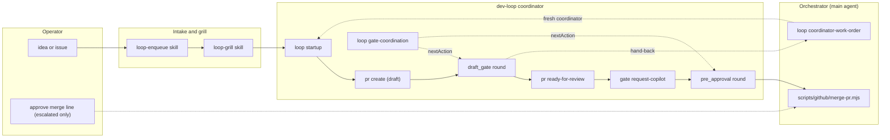

### Issue intake with the new-idea safety layer

Type: `sequenceDiagram`

How a new idea becomes a tracked issue before any GitHub write. The insight is that classification and proposal run in fresh context, and every mutation waits for operator approval and runs in a second async pass. The quick-capture path through `loop-enqueue` replaces the proposal artifact with an inline confirm, create, and grill step. This flow is contract prose with no single code driver, so the ordering is spec-only; the `issue create` route it ends in is code. Derived from `INTAKE-NEW-IDEA-SAFETY` and `INTAKE-STOP-STATES` in `skills/docs/issue-intake-procedure.md` and the `issue create` route in `cli/index.mjs`.

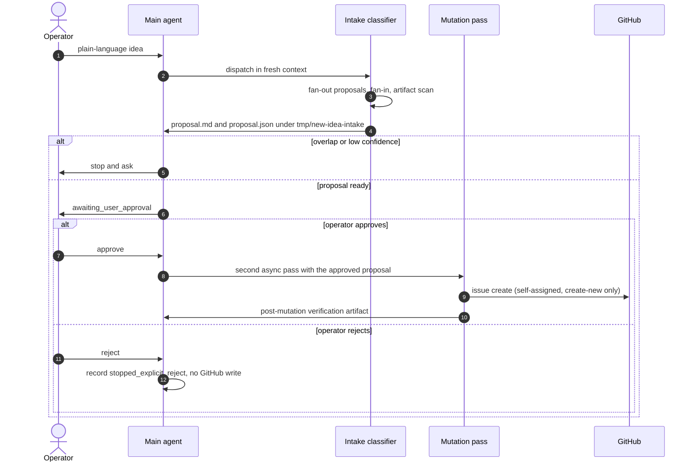

### Intake state machine

Type: `stateDiagram-v2`

The deterministic intake and mutation-gate states with the three stop states. The insight is that `awaiting_user_approval` sits between the proposal and any write, so no path reaches `mutation_executed` without the operator. Derived from the state listing in `skills/docs/issue-intake-procedure.md` (contract prose; no code module implements this list, so it is spec-only). The contract lists the main chain and the three stop states but not where each stop state branches off; the edges into the stop states are inferred from `INTAKE-STOP-STATES`.

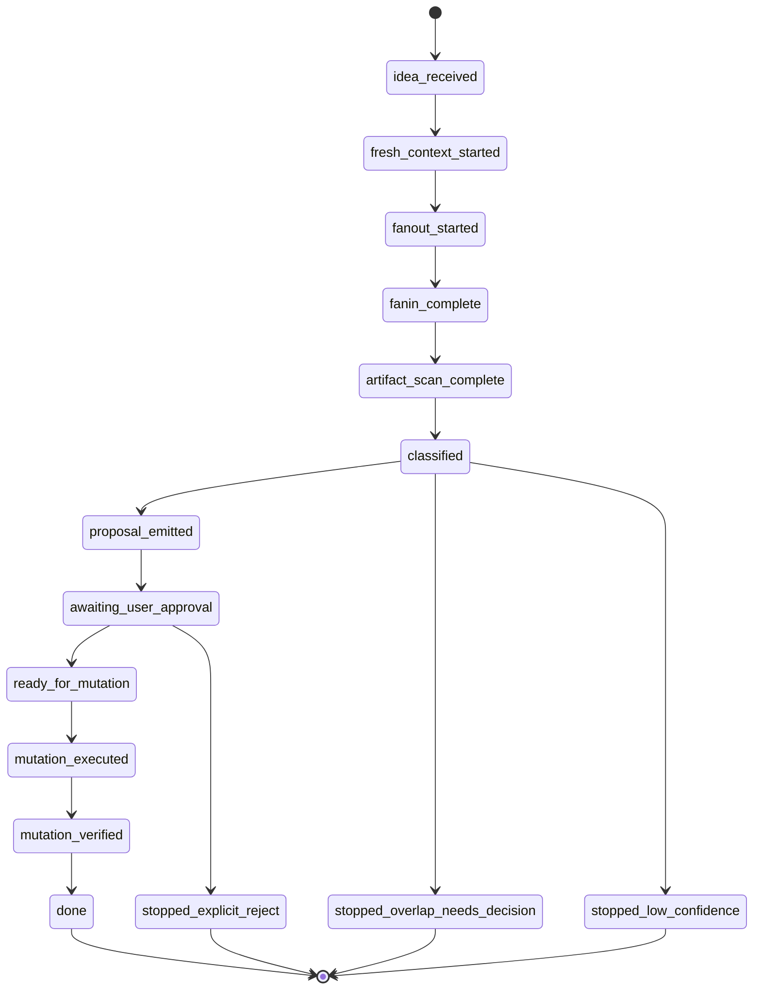

### Grill sub-loop transitions

Type: `stateDiagram-v2`

The closed grill loop that turns an issue body into a refined spec. The insight is that iteration lives in the transition table: `re_grill` either finds a new gap and re-enters `detect_gaps` or reaches the `grill_clean` fixed point, and an uncitable gap ends honestly at `needs_human_handoff`. Any I/O or parse failure fails closed to `blocked_needs_user_decision`. Derived from `GRILL_STATE` and `GRILL_TRANSITIONS` in `packages/core/src/loop/refinement-grill-state.mjs`.

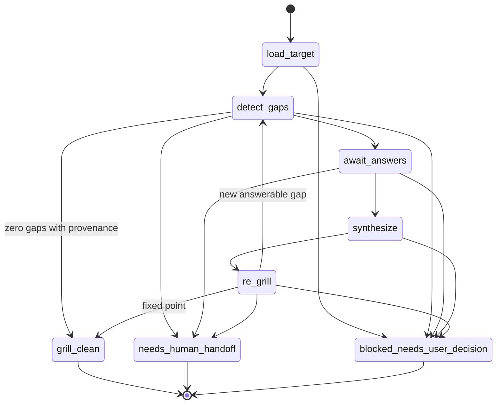

### One grill run

Type: `sequenceDiagram`

The calls one `loop-grill` run makes against an issue. The insight is that the synthesized sections go into the body and the results comment, while the raw Q\&A stays in an ephemeral tmp file and never reaches GitHub. The spec-lint runs before the zero-iteration exit, because a size-forecast or contract-matrix finding cancels that exit. Derived from Steps 1 to 4 of `skills/loop-grill/SKILL.md`, `scripts/loop/detect-refinement-grill-state.mjs`, and the `loop spec-lint` route in `cli/index.mjs`.

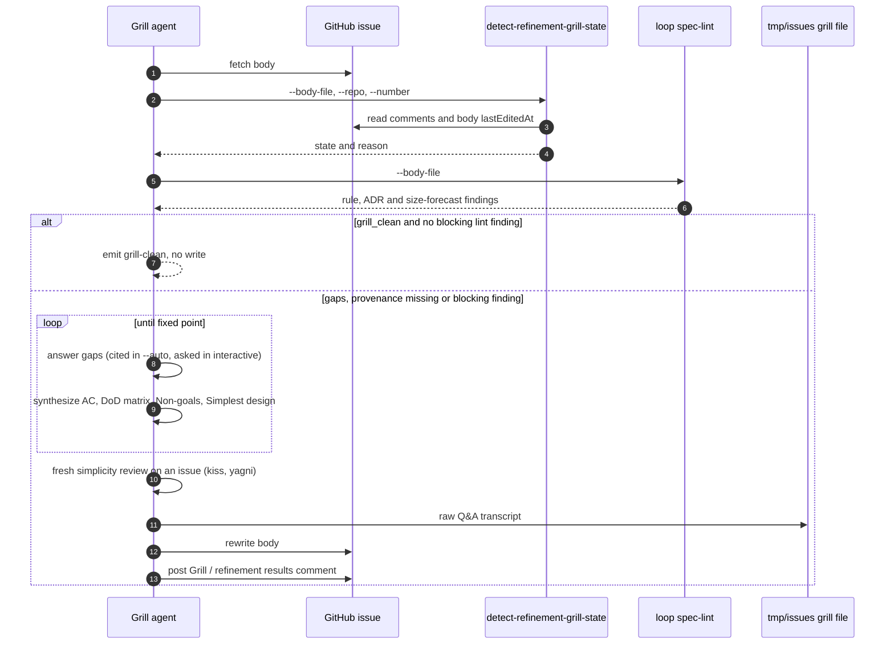

### Loop startup and first work order

Type: `sequenceDiagram`

How a trigger becomes a running coordinator. The insight is that the main agent never runs `loop startup`: the coordinator resolves the route, and the orchestrator builds every later dispatch from the startup-output path a coordinator names, through the digest-pinned work order. Derived from the "Dev-loop startup" and "Unit coordinator boundaries" sections of `skills/docs/main-agent-contract.md`, `scripts/loop/resolve-dev-loop-startup.mjs`, `deriveUnitBoundaries` in `packages/core/src/loop/handoff-envelope.mjs`, and `materializeCoordinatorWorkOrder` and `runCli` in `scripts/loop/emit-coordinator-work-order.mjs`.

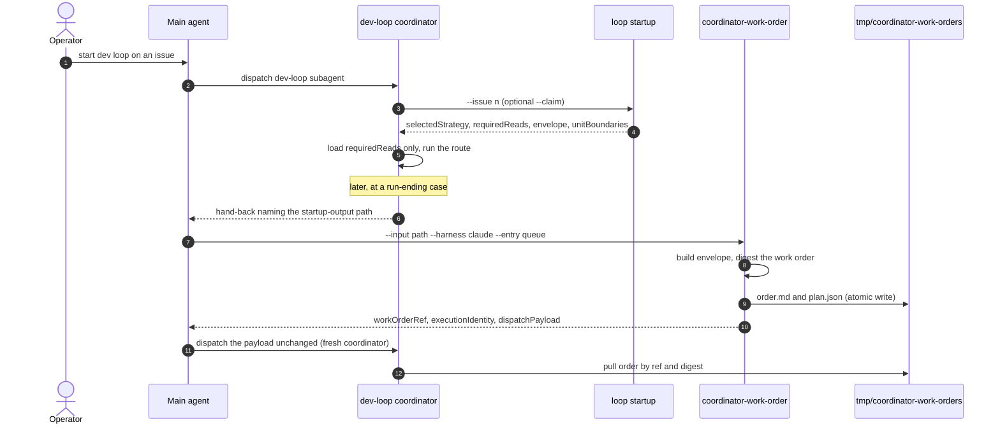

### Route selection order

Type: `flowchart`

The order in which `selectGateForState` picks a gate and the router maps it to an internal strategy. The insight is that blocked, done, merge-authorization and final-approval checks run before any work route, an explicit review request outranks PR ownership, and an issue with a linked PR is re-targeted to that PR first. An issue without a linked PR routes to `issue_intake` unless the target prefers local work. A state that matches no branch fails closed to reconcile. Derived from `selectGateForState`, `toRoutableCanonicalState` and the `selectedGate` branches in `packages/core/src/loop/public-dev-loop-routing.mjs`.

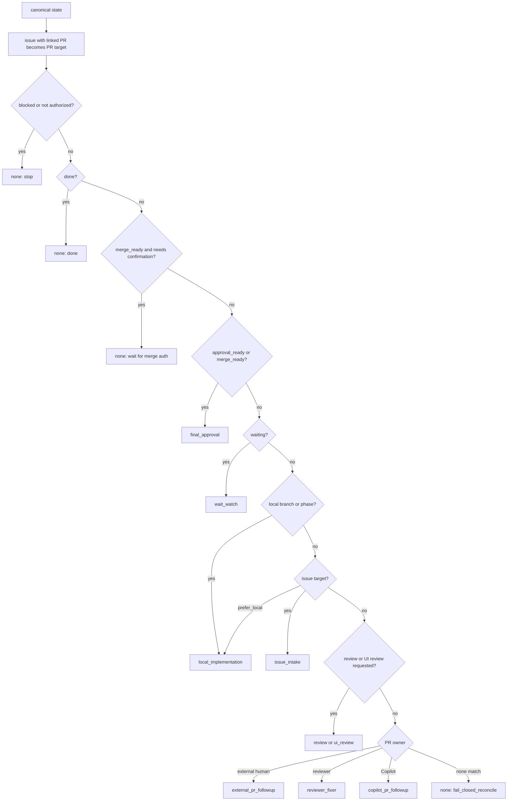

### Coordinator round-boundary hand-back

Type: `sequenceDiagram`

The fixed order at a stop: a gate-round end or a fix-pass end whose `nextAction` is not routine, or the routine-boundary cap. A routine `nextAction` continues in the same run. The insight is that the coordinator joins every worker, validates the typed packet, and releases its runner claim before the one `SubagentHandback`, and the replacement re-derives all gate state from detectors instead of from the predecessor's text. Derived from `COORDINATOR-ROUND-BOUNDARY-HANDBACK` and `COORDINATOR-HANDBACK-ONE-REPORT` in `skills/docs/main-agent-contract.md`, the `loop validate-handback` route in `cli/index.mjs`, `scripts/loop/validate-coordinator-handback.mjs`, `scripts/loop/_coordinator-handback.mjs`, and `scripts/loop/emit-coordinator-work-order.mjs`.

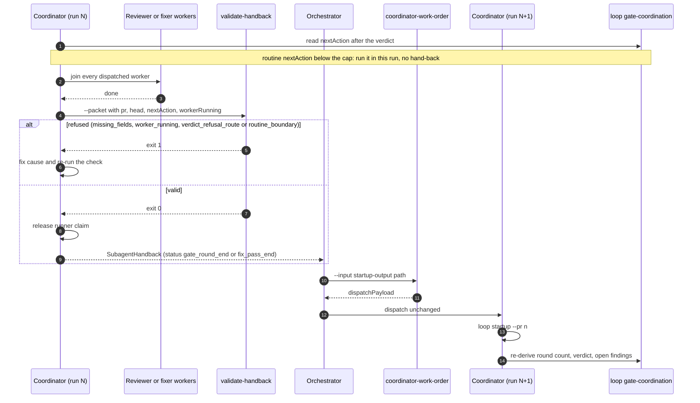

### Hand-back packet validation

Type: `flowchart`

The decision `validateCoordinatorHandback` makes on one packet. The insight is that a packet with a running worker is refused even when every field is valid, so a coordinator cannot hand back mid-round. A packet with a `verdictRefusal` is refused unless it carries `reason: "ci_red"`, a non-empty `actListPath` and `nextAction` `fix_ci_failure`. A packet with a round-boundary or missing `status`, a routine `nextAction` and `routineBoundaries` below the cap is refused as `routine_boundary`. Derived from `FIELD_CHECKS` and `validateCoordinatorHandback` in `scripts/loop/_coordinator-handback.mjs` and the exit-code rule in `scripts/loop/validate-coordinator-handback.mjs`.

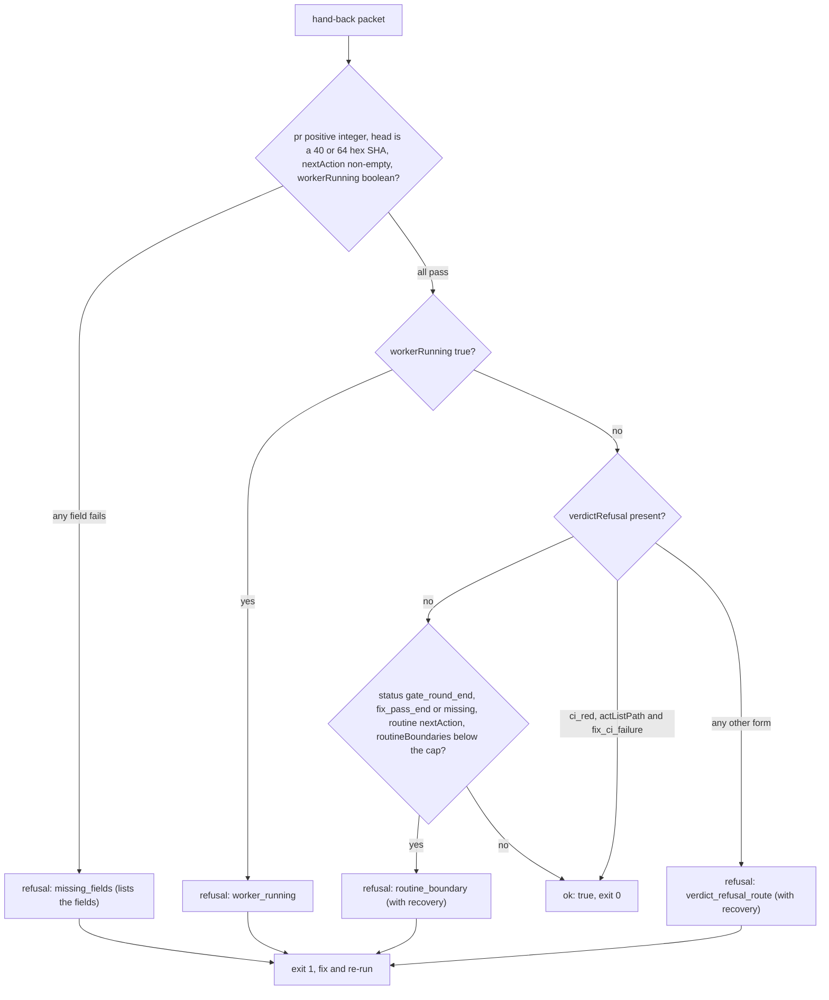

### Coordinator runs across one PR

Type: `timeline`

The chain of fresh coordinators that one issue passes through on one path. The insight is that before ADR 0325 each run ended at the first gate-round end or fix-pass end (a run now continues at routine boundaries up to the cap), and the `draft_pr_opened` report point never ends a run. In this path one draft\_gate round has findings and Copilot raises none, so the PR passed through five coordinator runs on the pre-ADR-0325 path. This is an illustrative sequence of run-ending cases, not measured data. Derived from `UNIT_BOUNDARY` and `deriveUnitBoundaries` in `packages/core/src/loop/handoff-envelope.mjs` and the run-ending case list in `skills/docs/main-agent-contract.md`.

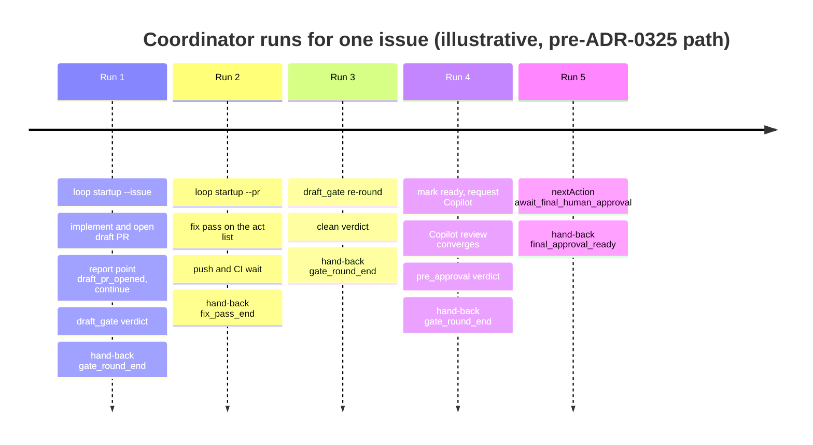

### Draft gate to merge

Type: `sequenceDiagram`

The PR path after the draft PR exists. The insight is that `pr ready-for-review` refuses without clean draft\_gate evidence and a passing size budget, Copilot only reviews a ready PR, and `merge-pr.mjs` refuses without a named human approver. `gate request-copilot` returns `suppressed_draft` on a draft PR. Only a lightweight PR is auto-added to the board at creation; a tracker-backed PR never calls the board there. Derived from `PR_CHECKPOINT_ACTION` in `packages/core/src/loop/pr-gate-coordination.mjs`, `scripts/github/create-pr.mjs`, `scripts/github/ready-for-review.mjs`, `scripts/github/request-copilot-review.mjs`, the `gate` routes in `cli/index.mjs`, and `scripts/github/merge-pr.mjs`.

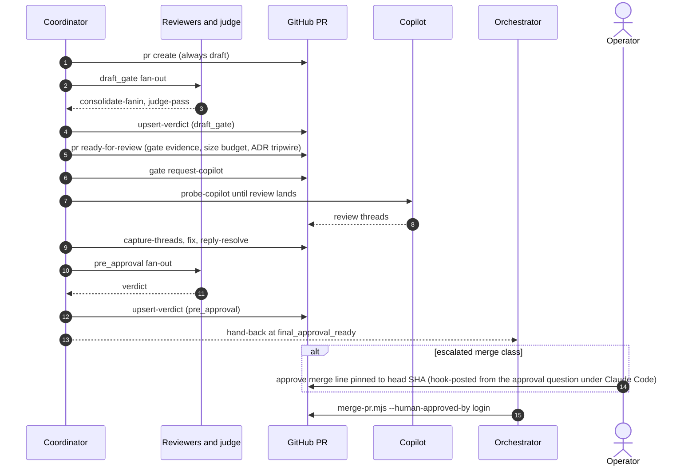

### Gate-coordination next action priority

Type: `flowchart`

A simplified view of the order in which `evaluatePrGateCoordination` picks the next action for an open PR. The insight is that CI, merge conflicts and open review threads all outrank a new gate round, and `CONFLICT_FORBIDDEN_ACTIONS` blocks every gate and Copilot action while the head conflicts with the base. The view omits the blocked, UI e2e and designer-review branches. Derived from the return order in `evaluatePrGateCoordinationCore` and `CONFLICT_FORBIDDEN_ACTIONS` in `packages/core/src/loop/pr-gate-coordination.mjs`.

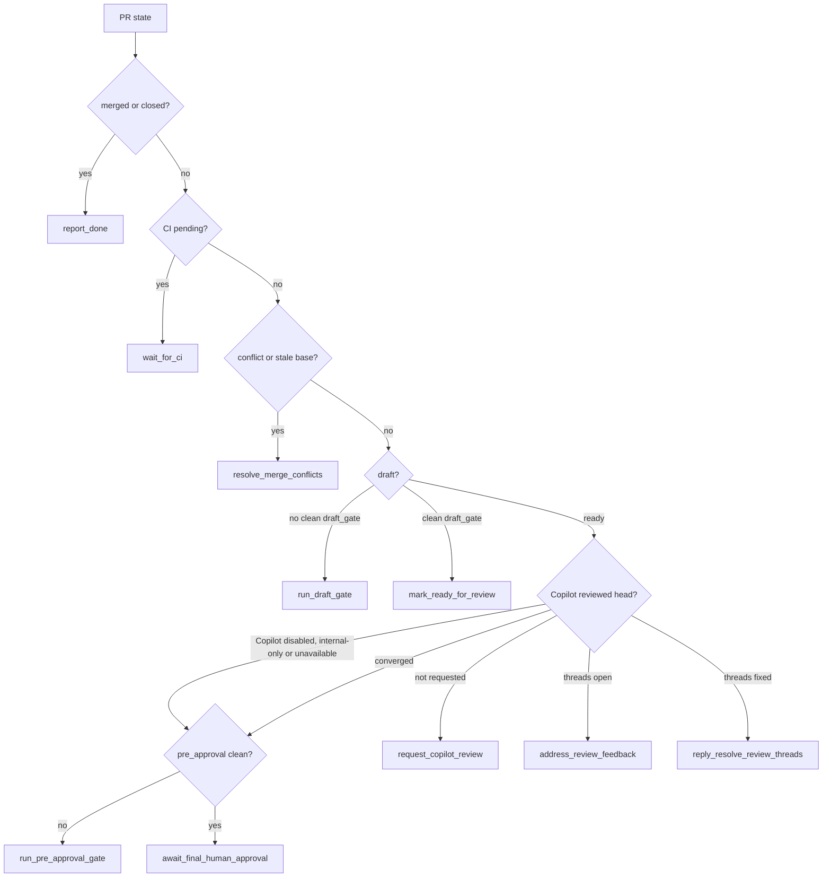

### Merge class and approval

Type: `flowchart`

How `merge-pr.mjs` decides which approval satisfies a merge. The insight is that a standing authorization covers only a drain merge, while a stable release, an escalated or blocked size outcome, or a T1 path forces a fresh human approval on the current head. A fresh approval is a head-pinned APPROVED review by the named login, else a head-pinned "approve merge" comment by that login, else an "approve merge" comment by that login whose patch-id matches the current diff; a bot login never satisfies it. Under Claude Code the hook posts that line from the operator's yes answer to the approval question. Derived from `MERGE_CLASS`, `resolveMergeClass` and `verifyFreshHumanApproval` in `packages/core/src/loop/merge-approval.mjs`, `GATE-EXEC-OPERATOR-LINE-APPROVE-MERGE` in `skills/docs/gate-review-sub-loop-contract.md`, and the usage text and argument parser in `scripts/github/merge-pr.mjs`.

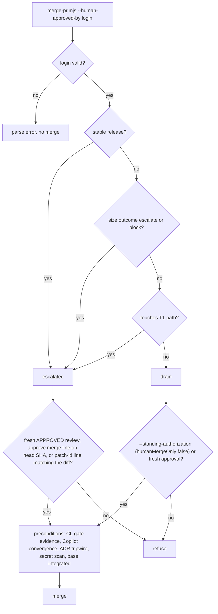

### Operator journey from idea to merge

Type: `journey`

What the operator does and feels along the main path. The insight is that the operator acts at three points only: approving the intake proposal, answering escalations or decision stops, and approving an escalated merge (the approval question under Claude Code, the approve merge line under Pi). Scores are synthetic, chosen by the analyst to show effort, and no command produced them. Derived from `skills/docs/issue-intake-procedure.md`, `skills/loop-grill/SKILL.md`, the operator-question and escalation rules in `skills/docs/main-agent-contract.md`, and `OPERATOR-OWNED-LINE` in `skills/docs/decision-record-contract.md`.

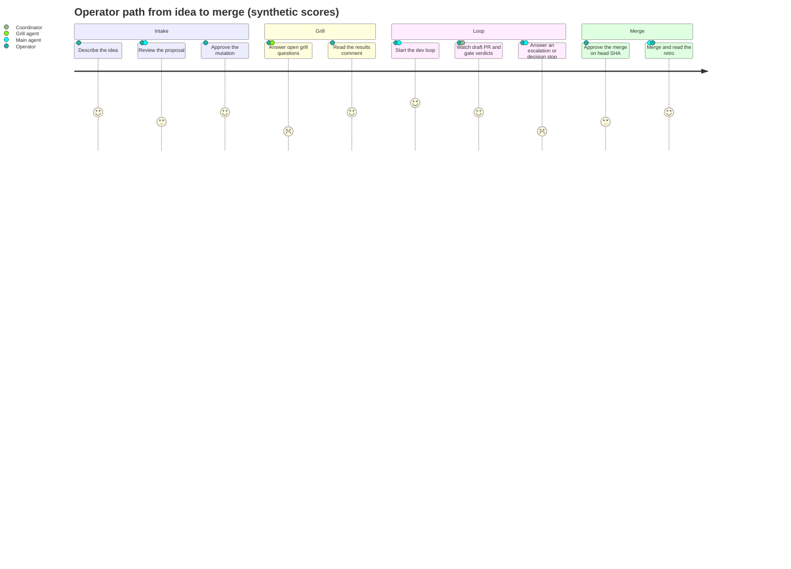

