

## Gate sub-loop: fan-out, fan-in, judge, fixer

A `draft_gate` or `pre_approval_gate` round is a fixed pipeline of deterministic scripts around four kinds of agents. The context writer builds one neutral bundle. Independent reviewers run one dispatch unit per angle group, in bounded waves. Fan-in consolidates their per-angle artifacts without disposing any finding. A judge disposes each finding cluster as `act`, `defer` or `reject`. A fixer pushes the act list in the `full` phase. A new head always starts a new full round that judges the fix, so the loop ends on a clean verdict, the body-only converged post, or a typed blocker for the operator. The diagrams below are derived from the pure core modules under `packages/core/src/loop/` and the CLI scripts under `scripts/loop/` and `scripts/github/`.

### One gate round, end to end

Type: `flowchart`

The full round as the coordinator drives it, from the context bundle to the re-gate. The insight is that every agent step sits between two deterministic scripts, and every push passes through the delta review first. Derived from `cli/index.mjs` (the `gate` and `loop` subcommand routes), `scripts/github/write-gate-context.mjs`, `scripts/github/emit-fanout-dispatch.mjs`, `scripts/loop/wait-for-gate-units.mjs`, `scripts/loop/consolidate-fanin.mjs`, `scripts/loop/judge-pass.mjs`, `scripts/loop/emit-fixer-work-order.mjs` and `scripts/loop/check-pre-push-delta.mjs`.

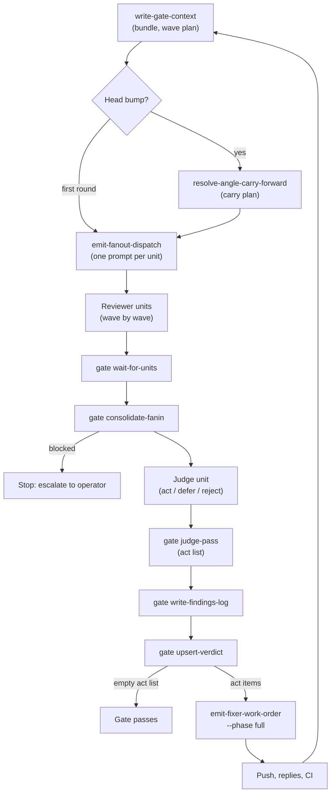

### Coordinator conversation for one round

Type: `sequenceDiagram`

The same round as a message exchange. The coordinator is the only actor that talks to every role, and each child is joined by `gate wait-for-units` before the next script reads its output. The judge never sees a raw finding list; it sees clusters. Derived from `scripts/github/emit-fanout-dispatch.mjs`, `scripts/loop/wait-for-gate-units.mjs`, `scripts/loop/emit-judge-work-order.mjs`, `scripts/loop/judge-pass.mjs`, `scripts/loop/emit-fixer-work-order.mjs` and `scripts/loop/check-pre-push-delta.mjs`.

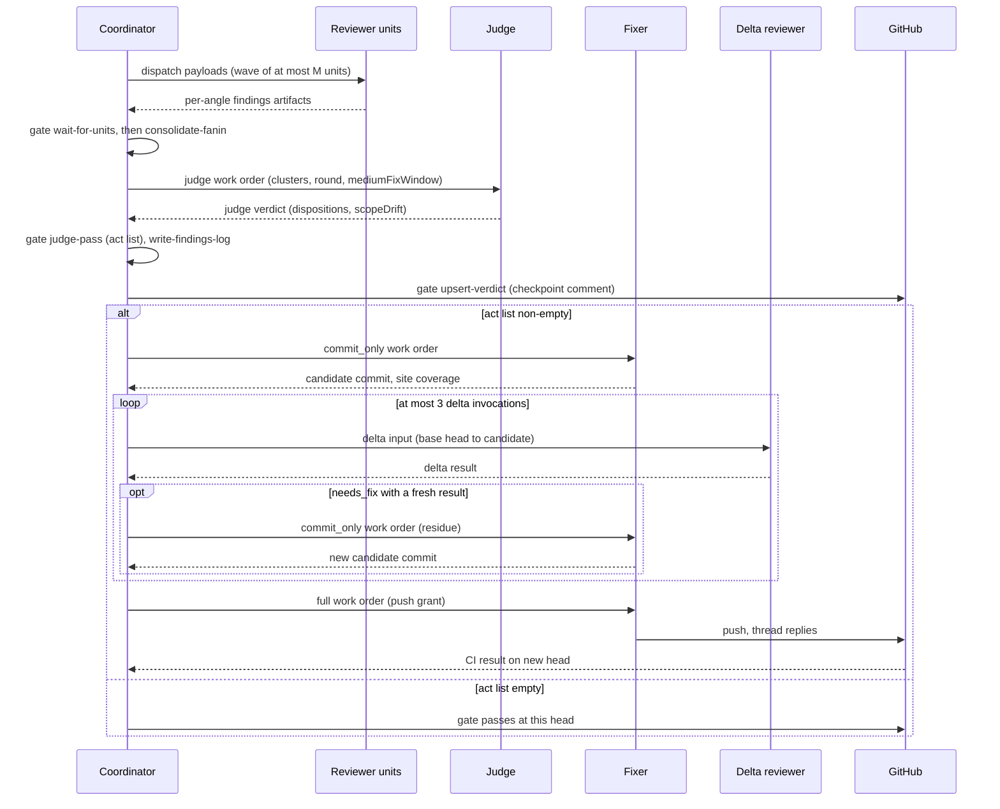

### Fan-out dispatch: units, waves and retries

Type: `flowchart`

How the resolved angles become dispatch units and waves, and what a dispatch failure does. A transient error (429 or 5xx) retries the same unit first, and the halving signal turns on only at attempt index 2. A hard 4xx escalates at once. The unit split and the wave plan run in scripts. The retry and halving helpers are pure exports with no script caller: `grep -rln "planDispatchRetry\|backoffMaxConcurrent" scripts cli packages skills` finds only `gate-fanin.mjs`, its tests and the contract, so the coordinator applies `GATE-EXEC-DISPATCH-RETRY-BACKOFF` from contract prose. The defaults (5 angles per unit, 5 units per wave) were read with `grep -n "REVIEWER_UNIT_MAX_ANGLES =" packages/core/src/loop/reviewer-unit-bound.mjs` and `grep -n "maxConcurrent: z" packages/core/src/config/config.mjs`. Derived from `scheduleFanoutWaves`, `backoffMaxConcurrent` and `planDispatchRetry` in `packages/core/src/loop/gate-fanin.mjs` and the unit split in `scripts/github/emit-fanout-dispatch.mjs`.

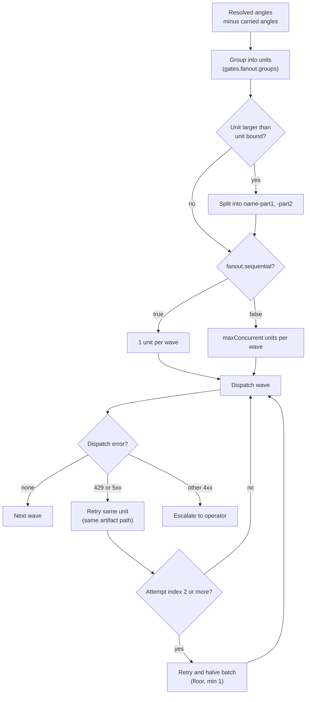

### Same-unit retry delay per attempt

Type: `xychart-beta`

The retry delay that `planDispatchRetry` returns for each prior failed attempt on one unit. The delay holds at 120 s after the third attempt, and the batch-halving signal turns on at attempt index 2. The helper has no script caller (see the fan-out caption). The values are the frozen constant read with `grep -n "DISPATCH_RETRY_BACKOFF_SCHEDULE_MS = " packages/core/src/loop/gate-fanin.mjs`; attempts 3 and 4 show the hold. Derived from `packages/core/src/loop/gate-fanin.mjs`.

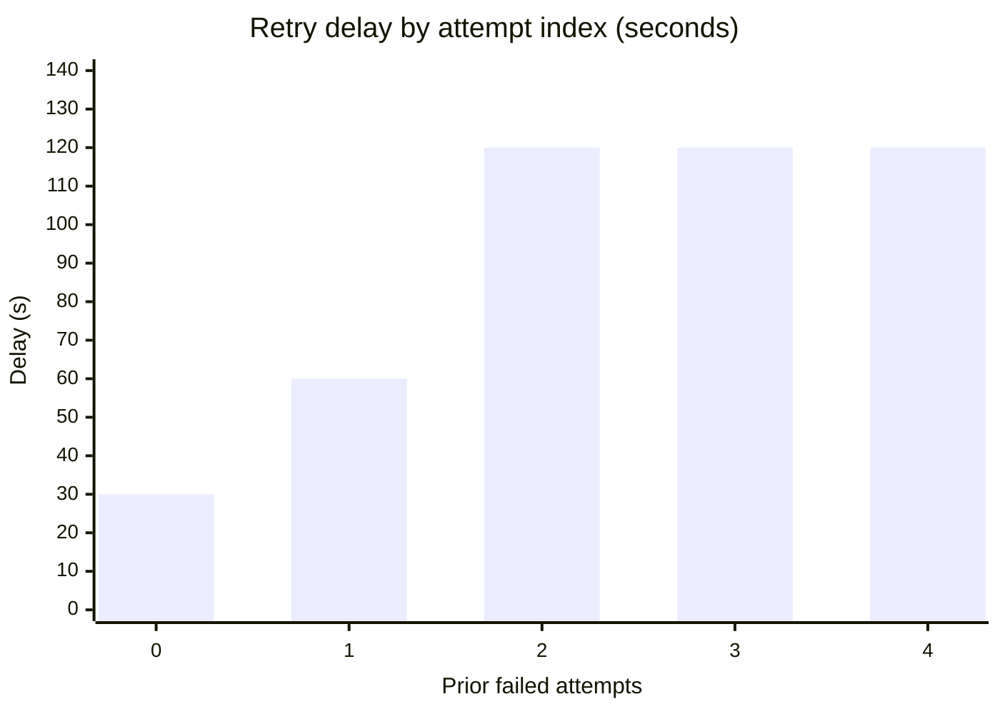

### Default angle catalog sizes per gate

Type: `xychart-beta`

How many reviewer angles each shipped gate catalog declares, and how many named fan-out groups exist. The draft catalog declares more angles than the pre-approval catalog. The pre-approval catalog holds the design-principle angles (`dry`, `kiss`, `yagni`, `srp` and the SOLID set). These are declared counts; one round reviews only the angles its config resolves. Counts were produced by `awk '/^  [a-zA-Z]+:$/{sec=$1} /^ +- name:/{c[sec]++} END{for(s in c) print s, c[s]}' packages/core/src/config/extension-defaults.yaml`. Derived from `packages/core/src/config/extension-defaults.yaml`.

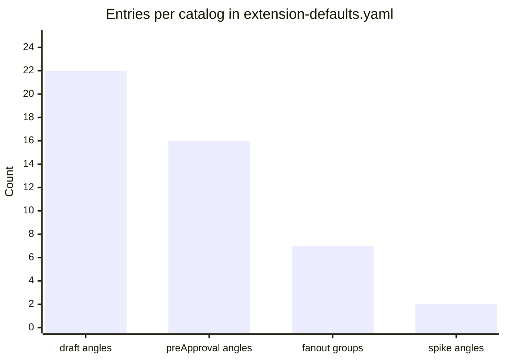

### Fan-in verdict and posted verdict

Type: `flowchart`

Fan-in decides a provisional verdict from severities only and leaves every finding `unjudged`. A per-angle artifact with verdict `blocked` fails `validateAngleResult`, which accepts only `clean` or `findings_present`, so it counts as malformed. Any malformed artifact gives the fan-in verdict `blocked`, and the CLI wrapper then exits 1. A duplicate angle name across artifact files is a separate CLI check that throws before consolidation. The posted verdict comes from the judge's act list on a fully judged round. A partly judged round keeps the fan-in verdict unless an act item is open, and `blocked` is never lowered. The default blocking severity set is `["high"]`. Derived from `consolidateFanin`, `validateAngleResult`, `isFullyJudged` and `composeReviewVerdict` in `packages/core/src/loop/gate-fanin.mjs` and the exit-code table in `scripts/loop/consolidate-fanin.mjs`.

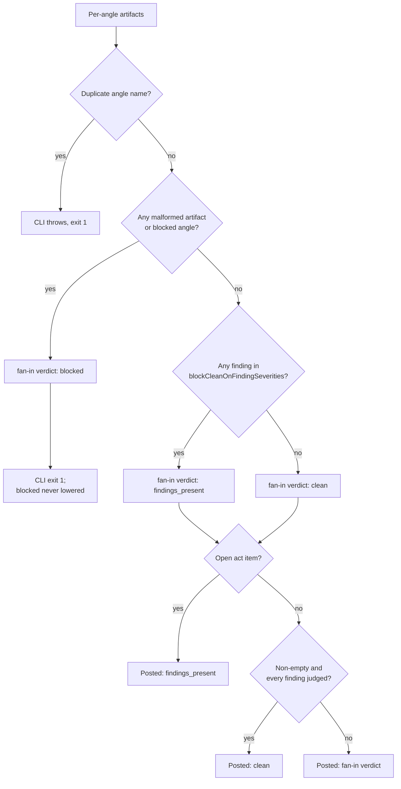

### Judge disposition coercion per cluster

Type: `flowchart`

What `applyJudgeDispositions` does with one cluster disposition before the fixer sees it. A `defer` on a cluster with a `high`, a `question` or only `nit` members fails the judge pass closed. An `act` on a low/nit-only cluster is coerced by gate and round (`GATE-EXEC-LOW-ROUND-FLOOR`), a `defer` on a low cluster from draft round 2 rejects the same way unless the judge sets `lowException`, and `failOpen` promotes a low to medium. Any undisposed cluster also fails closed. Derived from `applyJudgeDispositions`, `neverDeferredSeverity` and `validateJudgeVerdict` in `packages/core/src/loop/gate-fanin.mjs`, `scripts/github/write-gate-context.mjs` (`resolveDraftRoundCap`) and `scripts/loop/judge-pass.mjs`.

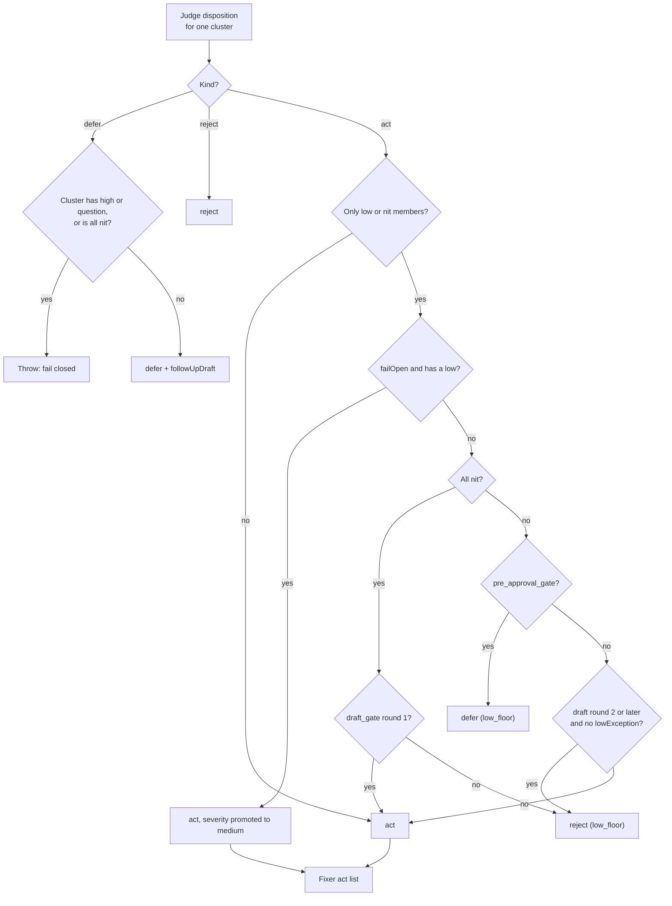

### Fix sequence state machine

Type: `stateDiagram-v2`

The frozen transition table for one fix sequence at a PR head. Every state reaches a terminal (`full_gate_round` or `stopped`), and any foreign commit moves the sequence to `head_moved`, which exits to a full round. A `residue` delta verdict re-enters `commit_only_emitted`. `stopped` is reached from the operator stop flag, not from a table edge. Derived from `FIX_LOOP_TRANSITIONS` and `interpretFixLoopState` in `packages/core/src/loop/fix-loop-state.mjs`.

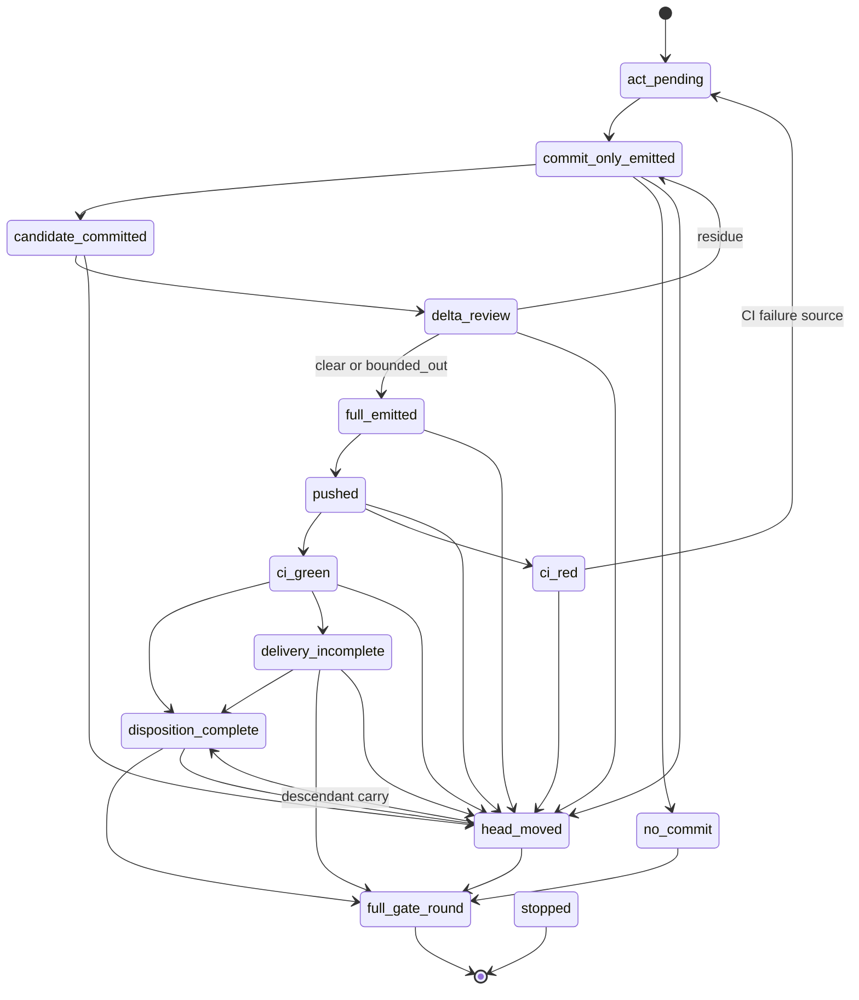

### Pre-push delta review bound

Type: `stateDiagram-v2`

The decision after each delta invocation. A fresh, valid `locally_clear` result grants the push. Below the bound a stale result re-reviews the current head and a fresh failing one goes back to the fixer. At the third invocation the sequence ends `bounded_out`: it pushes into the normal gate path and claims no success. The bound of 3 was read with `grep -n "DELTA_MAX_INVOCATIONS =" packages/core/src/loop/pre-push-delta-review.mjs`. Derived from `resolveDeltaTrigger`, `deriveDeltaOutcome` and `decideDeltaNextStep` in `packages/core/src/loop/pre-push-delta-review.mjs` and `scripts/loop/check-pre-push-delta.mjs`.

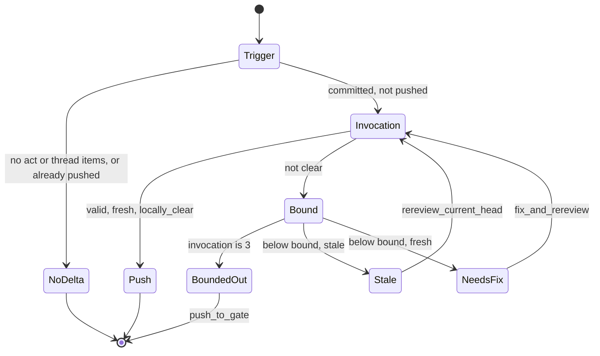

### Draft-gate round cap and exits

Type: `flowchart`

How a `draft_gate` round ends under the round cap. Rounds 1 to the cap run and a clean round stops early. Round cap+1 is the scoped final round of `GATE-EXEC-CAP-BRAKES`, and its clean verdict is the only draft exit after the cap round. A later round goes to the operator. Below the cap, act items go to the fixer and the next full round runs. At the cap, only a named human decision blocks (`pastCapBlockers`); every other act list goes to the fixer. A body-only act list converges through the body-only post at every round up to the cap, and a blocker in it blocks at any round. A cap of 0 disables the cap, because `isRoundRefused` and `isCapRound` both require `cap > 0`. The growth stop (`growth_past_forecast`) is enforced: `resolveCapBrakes` reads the forecast and `decideCapRound` stops the lane. Derived from `packages/core/src/loop/review-round-cap.mjs`, `pastCapBlockers` in `packages/core/src/loop/gate-fanin.mjs`, `composeBodyOnlyConvergedDraftGate` in `packages/core/src/loop/pre-push-delta-review.mjs`, and `countCompletedRounds` in `scripts/github/write-gate-context.mjs`.

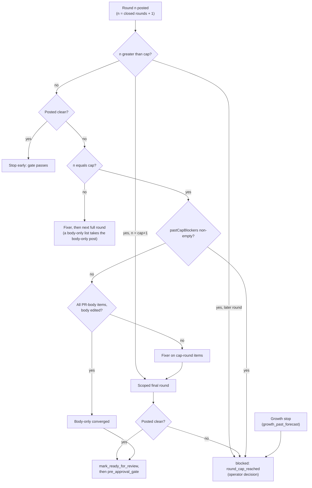

### Cap-round blocker test per finding

Type: `flowchart`

How `pastCapBlockers` classifies one ledger finding at or after the draft-gate cap round. Only a named human decision blocks, and each blocker carries the kind `round_cap_reached` with the reason `new_act`, `resurfaced` or `severity_disagreement`. A `high` act item with a non-blank `judgeFix` goes to the fixer at the cap round and blocks only after it. Medium, low and nit act items never block. Derived from `pastCapBlockers`, `isOpenActItem` and `JUDGE_DISPOSITIONS` in `packages/core/src/loop/gate-fanin.mjs`.

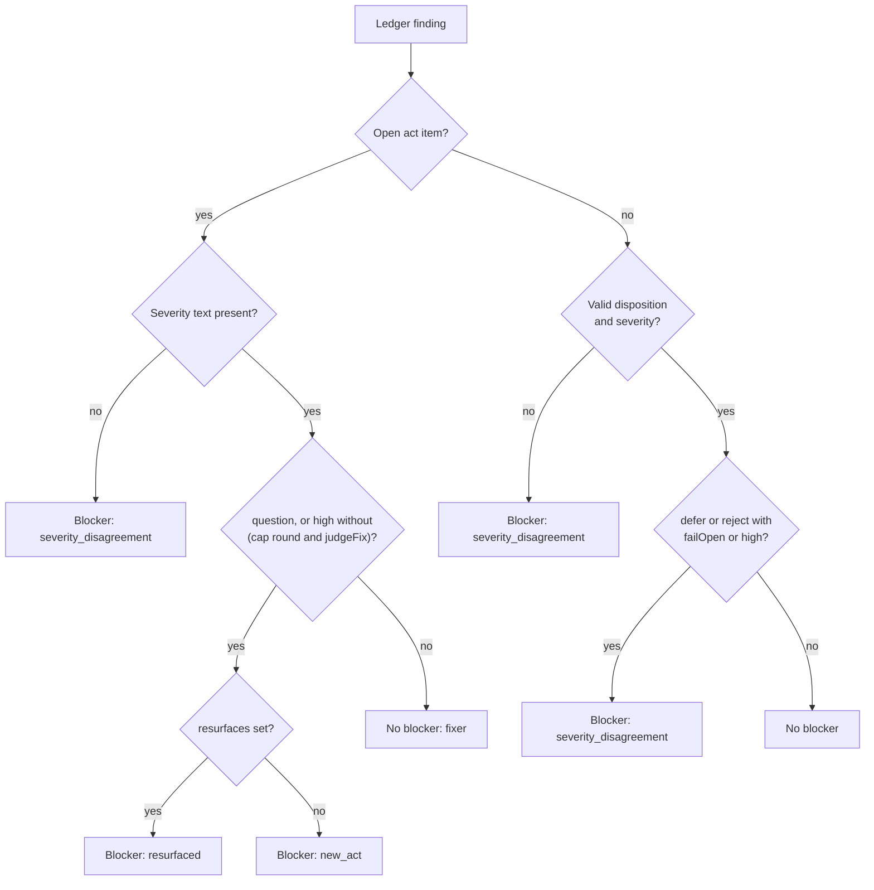

### Artifacts that cross each seam

Type: `classDiagram`

The data shapes passed between the steps of a round. Fan-in adds `angle` and the `unjudged` disposition; the judge keys dispositions by cluster id; the delta result binds to the candidate head. The insight is that each seam has one validator that fails closed. Derived from the shape comments and validators in `packages/core/src/loop/gate-fanin.mjs` (`validateAngleResult`, `validateJudgeVerdict`), `packages/core/src/loop/finding-cluster.mjs` (`computeRootCauseKey`), and `packages/core/src/loop/pre-push-delta-review.mjs` (`deltaResultShapeErrors`).

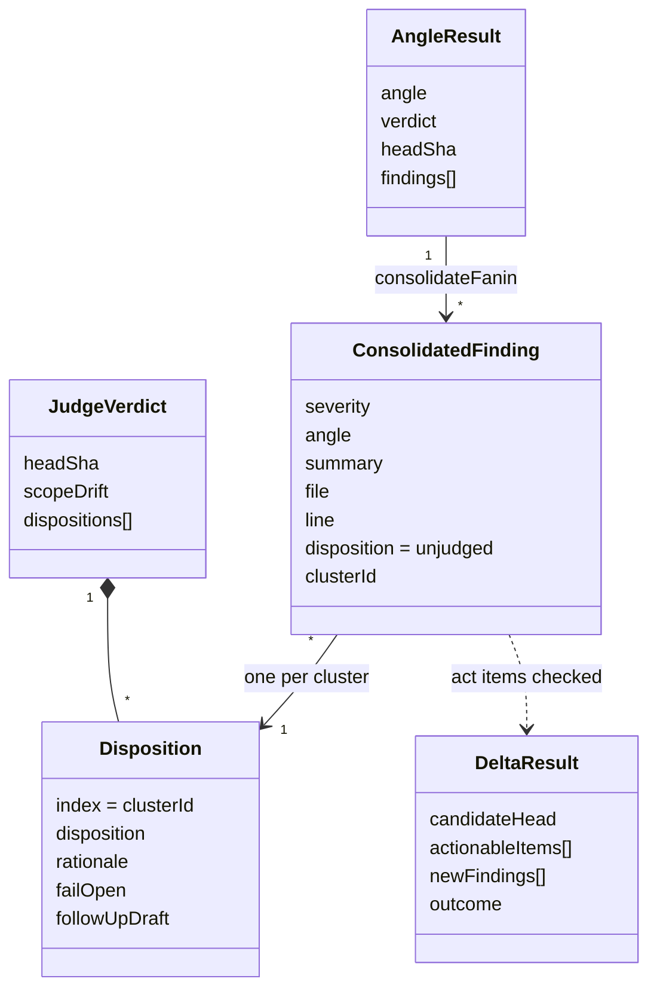

