

## External integrations and adapters

dev-loops reaches the outside world through a small set of seams. GitHub is reached through the `gh` CLI, as REST calls (`gh api`, `gh pr`, `gh issue`) and GraphQL calls (`gh api graphql`), and most of those calls go through one child-process primitive, `runChild`. Copilot is a GitHub reviewer that the loop requests, probes and withdraws through the same `gh` seam. Three agent harnesses run the loop: Pi (the native extension host), Claude Code (agents, skills, commands and hooks in a plugin generated from the Pi sources) and Codex (detected, configured and evidenced, with no launcher of its own in core). Two frozen adapter interfaces in `packages/core/src/harness` keep call sites harness-agnostic, and a tracker adapter in `packages/core/src/tracker` keeps issue access provider-agnostic.

### Integration landscape

Type: `flowchart`

The diagram shows each external system and the module family that reaches it. The insight is that GitHub and Copilot share one exit point, the `gh` binary, and most callers spawn it through `runChild` in `packages/core/src/cli/primitives.mjs`, so auth, rate limits and test doubles are handled at one seam. `grep -l runChild scripts/github/*.mjs | wc -l` gives 48 scripts and `grep -lE 'github/gh(\.mjs)?"' scripts/github/*.mjs | wc -l` gives 15 scripts that import the `gh.mjs` helpers. Derived from `packages/core/src/cli/primitives.mjs`, `packages/core/src/github/gh.mjs`, `packages/core/src/github/issue-ops.mjs`, `packages/core/src/tracker/github-adapter.mjs`, `scripts/github/request-copilot-review.mjs`, `scripts/claude/headless-dev-loop.mjs`, `extension/pi-extension-adapter.ts` and `packages/core/src/loop/codex-execution-evidence.mjs`.

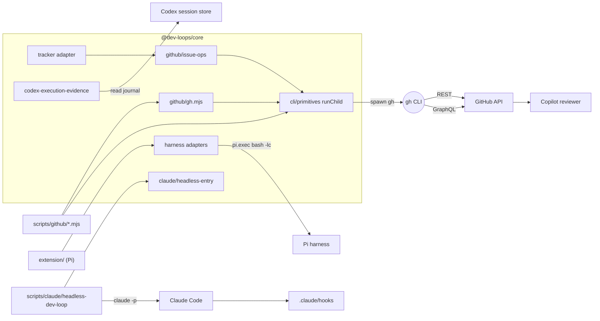

### Harness adapter interfaces

Type: `classDiagram`

The diagram shows the two harness seams and their concrete factories. `HarnessAdapter` answers "where am I running"; `ExtensionHarnessAdapter` answers "how do I talk to the harness". Both factories check a `REQUIRED_METHODS` list and return a frozen object. The only `ExtensionHarnessAdapter` implementation is the Pi one: `git grep -l createExtensionHarnessAdapter` finds no other caller. A Claude implementation is named only in code comments, so it is marked spec-only. Derived from `packages/core/src/harness/adapter.mjs`, `packages/core/src/harness/extension-adapter.mjs`, `packages/core/src/harness/pi-adapter.mjs`, `packages/core/src/harness/noop-adapter.mjs`, `packages/core/src/harness/index.mjs` and `extension/pi-extension-adapter.ts`.

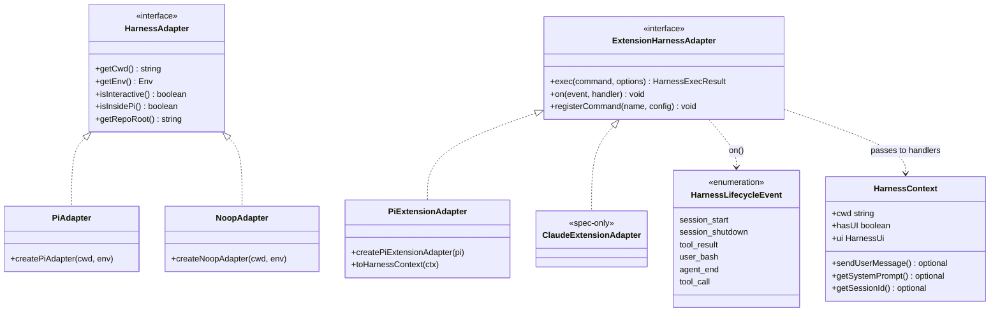

### Pi command dispatch through the extension seam

Type: `sequenceDiagram`

The diagram shows how a Pi slash command reaches dev-loops code. `pi-extension-adapter.ts` is the only module allowed to import the Pi SDK. It converts each Pi `ExtensionContext` into a neutral `HarnessContext` at call time, so the rest of the extension never sees a Pi type. `exec` runs every command as `bash -lc` with the caller's cwd and timeout. Derived from `extension/pi-extension-adapter.ts`, `extension/harness-types.ts` and `packages/core/src/harness/extension-adapter.mjs`.

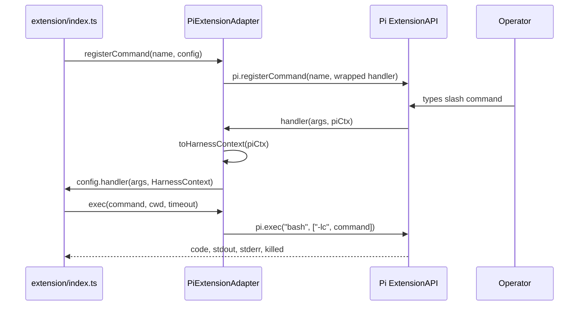

### Runtime harness detection

Type: `flowchart`

The diagram shows two independent decisions. `resolveRuntimeHarness` picks the CLI harness: Claude wins over Codex, and Pi is the fallback. `CODEX_THREAD_ID` alone is a lookup key; `validateNativeCodexMetadata` must accept the native session header before a Codex run id exists, otherwise `resolveRunId` returns null. Separately, the Pi context adapter decides interactivity from `PI_INTERACTIVE` and `CI`. Derived from `packages/core/src/loop/run-context.mjs` (`isClaudeHarness`, `resolveRuntimeHarness`, `validateNativeCodexMetadata`, `resolveRunId`) and `packages/core/src/harness/pi-adapter.mjs` (`isInteractive`).

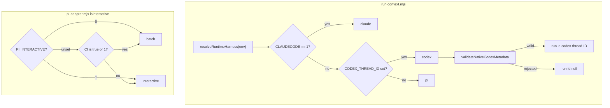

### GraphQL call with rate-limit wait

Type: `sequenceDiagram`

The diagram shows the shared GraphQL path. `ghGraphql` spawns `gh api graphql` and maps failures to `GH_API_ERROR` (non-zero exit) or `GRAPHQL_ERROR` (an `errors` array). A secondary rate limit or a pre-send transport failure (dial or TLS handshake timeout) makes `ghGraphql` back off 30 seconds and retry once, and a second secondary limit throws `RATE_LIMITED` while a second transport failure surfaces as `GH_API_ERROR`. `withGraphqlRateLimitWait` acts only when the error message matches `isRateLimitError`; every other error is rethrown unchanged. It reads the GraphQL reset from `gh api rate_limit`, which spends no GraphQL points, sleeps once and retries once. It fails closed with `RATE_LIMITED` when budget remains (a REST or secondary limit) or when the reset is unknown, past, beyond `maxWaitMs` or more than 24 hours ahead. Derived from `packages/core/src/github/gh.mjs`.

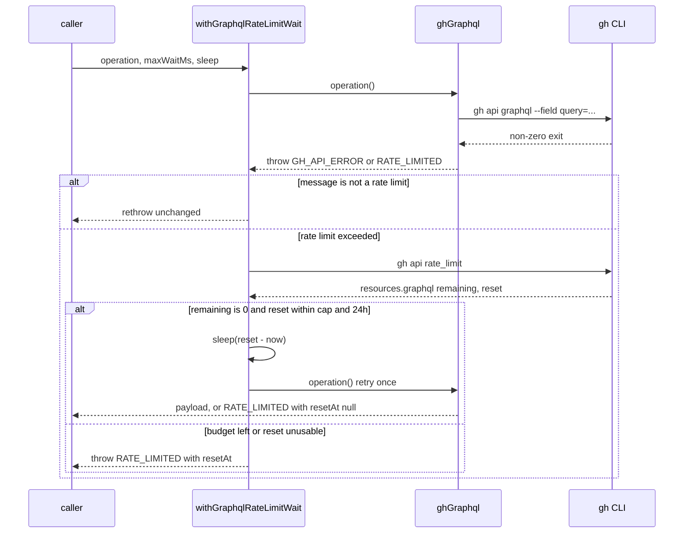

### Copilot review request

Type: `sequenceDiagram`

The diagram shows one run of `request-copilot-review.mjs` after its suppression checks pass. The POST targets the REST `requested_reviewers` endpoint with the `[bot]` reviewer login. Only the verification read repeats, never the POST. One GraphQL cross-check runs before the delayed retries, and the retry loop stops as soon as a read observes the review. When the POST succeeded but no read observes the review, the script reports `requested` with an eventual-consistency detail below 2 unobservable requests on the head, and `copilot_unavailable` at 2. A 422 classified as unavailable re-reads state and reports `already-requested` or `unavailable`. Derived from `scripts/github/request-copilot-review.mjs`.

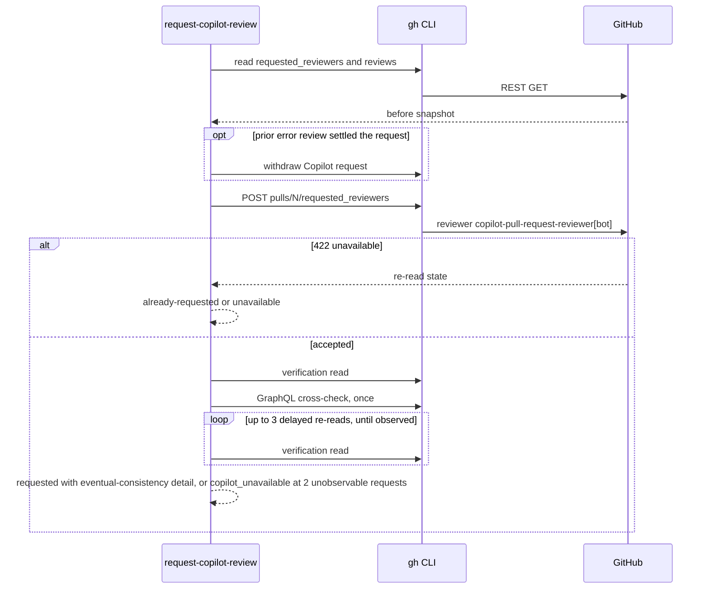

### Copilot verification backoff

Type: `xychart-beta`

The chart shows the cumulative wait before each verification read after the review POST. The bounded window ends after 30 seconds, so the script never hangs on an unobservable request. Values come from the constant `VERIFICATION_RETRY_DELAYS_MS = [5000, 10000, 15000]`, found with `grep -n VERIFICATION_RETRY_DELAYS_MS scripts/github/request-copilot-review.mjs`. Derived from `scripts/github/request-copilot-review.mjs`.

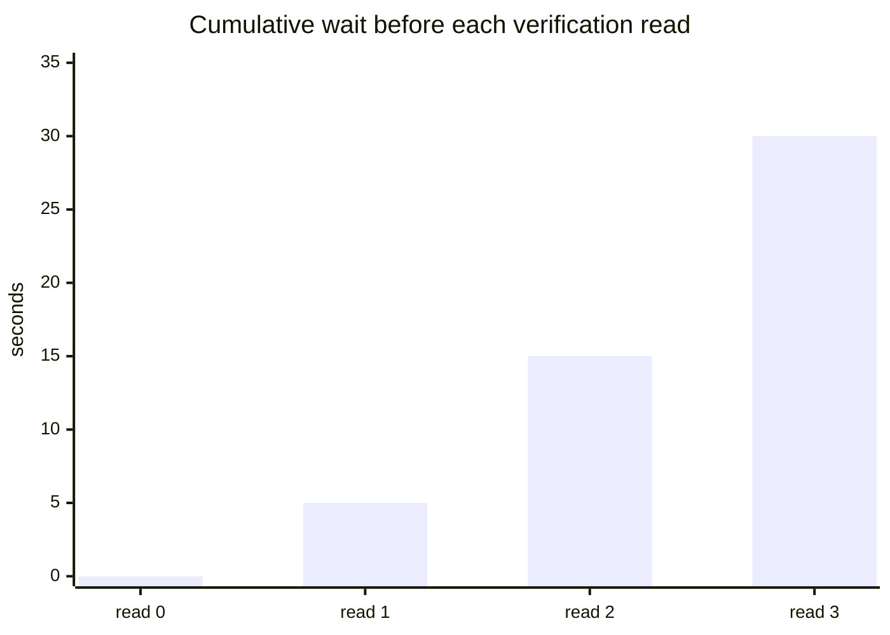

### Copilot request outcomes

Type: `mindmap`

The mindmap groups the eleven status values that `request-copilot-review.mjs` can return. Most statuses are suppressions that save a redundant Copilot round; only `requested` starts a new review. `blocked_by_copilot_comment` asks the operator to delete a non-Copilot comment that contains `@copilot` or `/copilot`. Derived from the `*_STATUS` constants and the usage text in `scripts/github/request-copilot-review.mjs`.

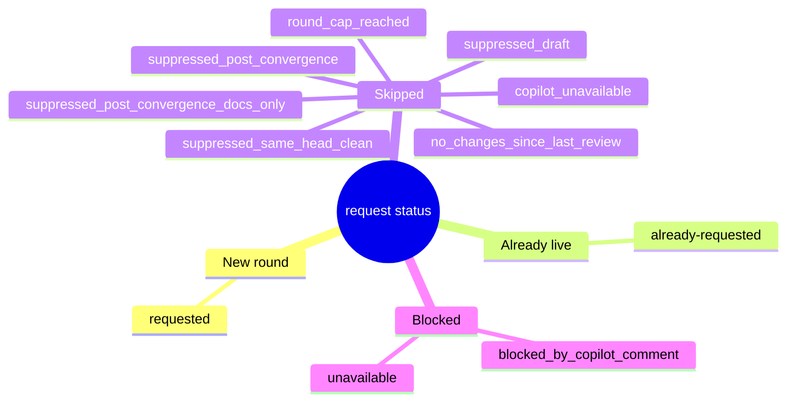

### GitHub script surface

Type: `pie`

The chart shows how the GitHub wrapper scripts reach GraphQL. Most scripts use REST through `gh pr`, `gh issue` or `gh api`; GraphQL is reserved for review threads, project boards and cross-checks. Scripts can also reach GraphQL indirectly through imported core modules, which this count does not see. Counts come from `ls scripts/github/*.mjs | wc -l` (94), `grep -l '"graphql"' scripts/github/*.mjs | wc -l` (10) and `grep -lE '"graphql"|ghGraphql' scripts/github/*.mjs | wc -l` (12). Derived from `scripts/github/`.

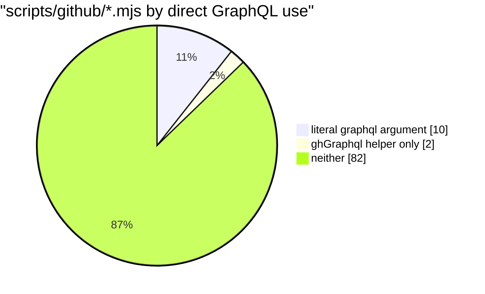

### Tracker adapter

Type: `classDiagram`

The diagram shows the tracker seam over the core `gh issue` operations. The Issues capability is required; the Board capability is optional and copied through only when present. The built-in GitHub provider wires two board methods, `listQueueItems` and `setItemStatus`, through `packages/core/src/projects`. The other board operations exist as `scripts/projects/*.mjs` CLI tools (`ensure-queue-board`, `add-queue-item`, `reorder-queue-item`, `archive-done-items`). The noop adapter stubs every method for tests. An unknown `tracker.provider` fails closed in `resolveTrackerAdapter`. Derived from `packages/core/src/tracker/adapter.mjs`, `packages/core/src/tracker/github-adapter.mjs`, `packages/core/src/tracker/noop-adapter.mjs`, `packages/core/src/tracker/index.mjs` and `packages/core/src/github/issue-ops.mjs`.

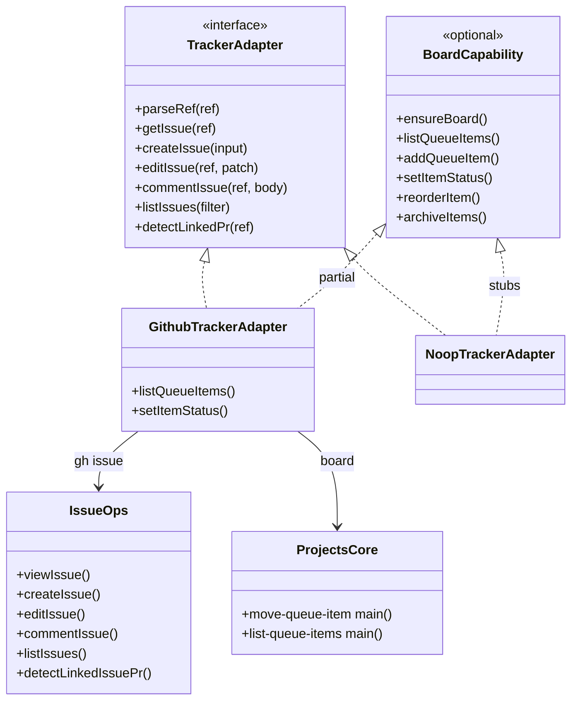

### Claude Code hook pipeline

Type: `sequenceDiagram`

The diagram shows the eight hook registrations the plugin installs and when Claude Code fires them. PreToolUse hooks can deny a tool call. The approval guard runs first on Bash, Read, Edit, Write, NotebookEdit, Grep, Glob and MCP calls and denies a call that names the merge approval record. The answers guard denies an AskUserQuestion approval question that carries a pre-filled `answers` map, and the AskUserQuestion PostToolUse hook records the operator's yes answer. The PostToolUse merge hook fast-forwards the main checkout with `--ff-only` and always exits 0. The SubagentStop guard refuses a stop with exit 2 when a worktree under `tmp/worktrees/` is dirty. The bash gate denies raw `gh pr create`, raw `gh pr merge`, raw PR-body writes, raw comment writes and `git stash`. Counts come from `.claude/hooks/hooks.json` (8 registrations) and `ls .claude/hooks/*.mjs | wc -l` (19 files: 8 hooks and 11 helper modules). Derived from `.claude/hooks/hooks.json`, `.claude/hooks/pre-tool-use-approval-guard.mjs`, `.claude/hooks/pre-tool-use-ask-answers-guard.mjs`, `.claude/hooks/pre-tool-use-bash-gate.mjs`, `.claude/hooks/pre-tool-use-write-guard.mjs`, `.claude/hooks/pre-tool-use-agent-guard.mjs`, `.claude/hooks/post-tool-use-merge.mjs` and `.claude/hooks/subagent-stop-uncommitted-guard.mjs`.

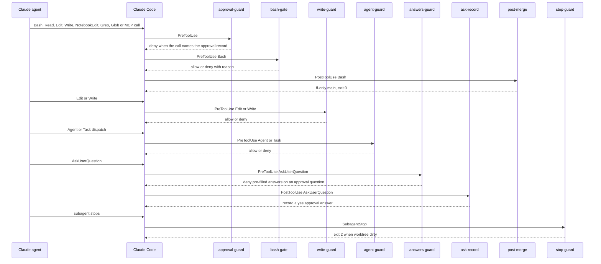

### Hook bundle vendoring

Type: `flowchart`

The diagram shows why the hooks import local `_*.mjs` files. The plugin ships without `node_modules`, so a hook cannot import `@dev-loops/core`. The generator copies pure core deciders into `.claude/hooks/` and rewrites their cross-module imports to sibling paths; a `--check` run keeps the copies in sync. Edges on the right show which helper each hook imports, from `grep -o 'from "./_[a-z-]*.mjs"' .claude/hooks/[a-z]*.mjs`. `_hook-io`, `_fixer-grants` and the other helpers without a core source are hand-written. Derived from `HOOK_BUNDLE` in `scripts/claude/generate-claude-assets.mjs` and the hook files under `.claude/hooks/`.

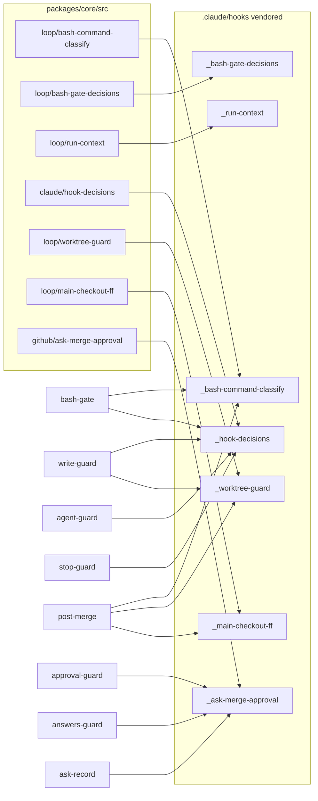

### Claude asset generation

Type: `flowchart`

The diagram shows how the Claude Code plugin is built from the Pi sources. Agents, skills and commands are authored once for Pi; the generator maps tool names, strips `pi-only` blocks and rewrites CLI calls to the `dev-loops-run` launcher. It also copies `skills/docs`, the dev-loop templates and the hook bundle, and stamps the version into `plugin.json`. The marketplace manifest points its plugin source at `./.claude`. Agent counts come from `ls agents/*.agent.md | wc -l` (9) and `ls .claude/agents/*.md | wc -l` (9). Derived from `scripts/claude/generate-claude-assets.mjs`, `packages/core/src/claude/asset-generation.mjs` and `.claude-plugin/marketplace.json`.

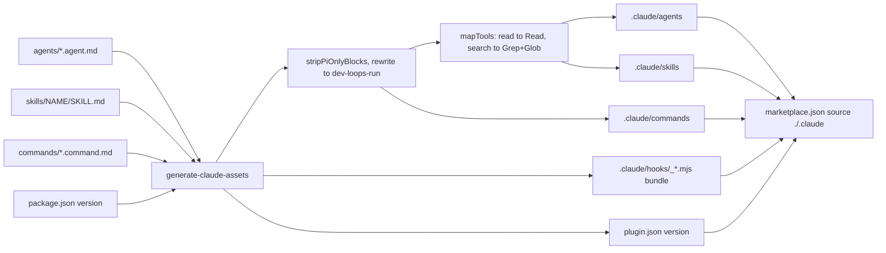

### Headless Claude launch

Type: `sequenceDiagram`

The diagram shows the headless entry that runs the dev-loop under Claude Code without a terminal. The script mints a run id and puts it in the child environment as `DEVLOOPS_RUN_ID`, which is how the write guard recognizes the session as the dev-loop context. MCP servers are detected from config files only; no process is spawned for detection. After `claude` exits, the script releases every coordination claim the run still owns. Derived from `scripts/claude/headless-dev-loop.mjs` and `packages/core/src/claude/headless-entry.mjs`.

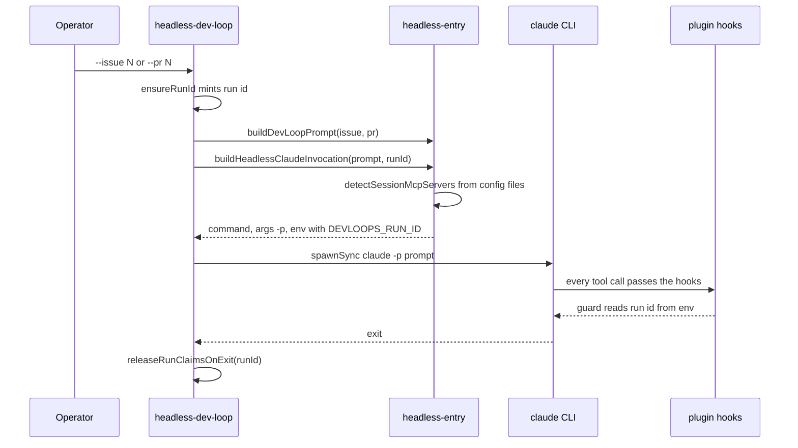

### Harness capability defaults

Type: `block-beta`

The grid shows the default cache and telemetry posture per harness used by review dispatch planning. Claude is the only harness with automatic breakpoints, a fixed cache TTL and usage telemetry; Pi and Codex default to opaque and unavailable, so the planner does not over-claim. Derived from `HARNESS_DEFAULT_CAPABILITIES` in `packages/core/src/loop/review-dispatch-plan.mjs`.

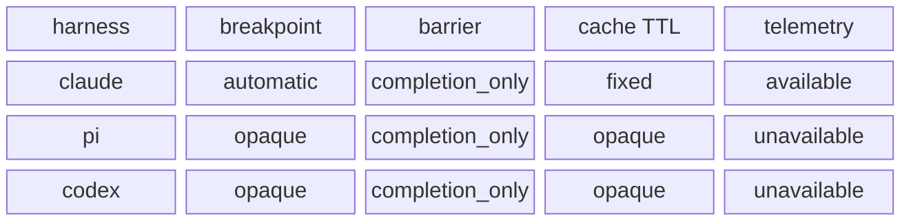

### Codex execution evidence

Type: `stateDiagram-v2`

The diagram shows how `reconcileCodexExecution` decides whether a stopped Codex worker finished, from its native session journal. The adapter is read-only: it never probes or signals a process. Only one terminal `CommandExecution` record bound to the owner thread, execution id, repo root and cwd yields `completed`; that status covers a recorded `failed` exit as well. Every gap or drift yields `unknown`, and a runtime without a session store yields `unsupported`. The module is exported from `@dev-loops/core`; `git grep -l reconcileCodexExecution` finds no caller outside its own test. Derived from `packages/core/src/loop/codex-execution-evidence.mjs`.

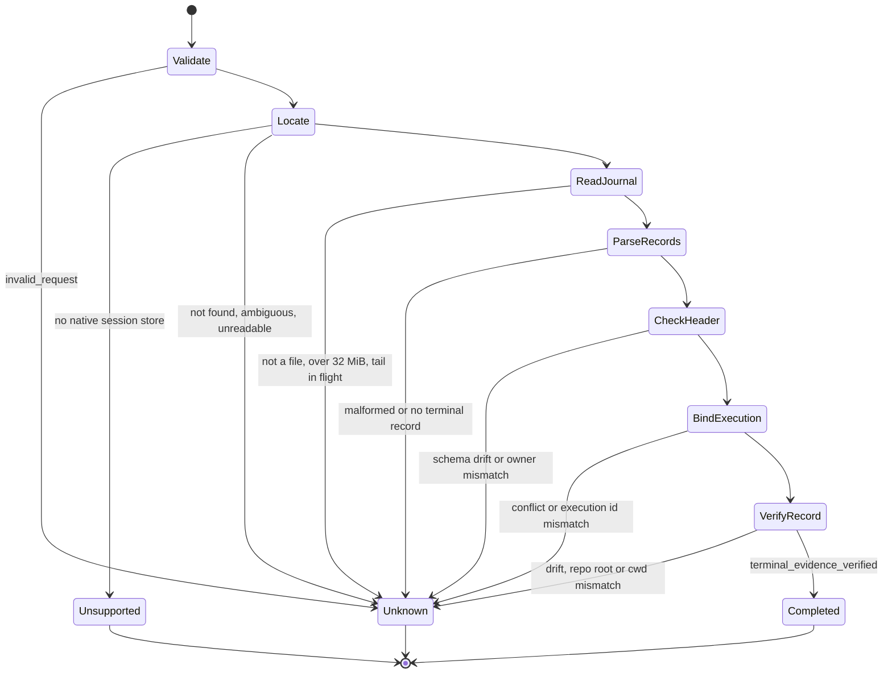

