

## Agent roles and model calls

The repository defines nine agent roles as `agents/*.agent.md` files, plus a pre-push reviewer role that exists only in the model policy. One function, `resolveRoleModel` in `packages/core/src/config/config.mjs`, maps each role to a concrete model through tier aliases, and `.devloops` retargets those aliases for this repo. Workers never receive free-form prompts. An emitter writes an immutable, hash-bound work order, and the worker gets a pointer of at most 499 bytes that tells it to run `pull-work-order.mjs` with its execution identity. The pull verifies the work-order digest and the materialized file hash before it prints the order. Review, judge and fixer required reads carry sha256 digests. The judge pull also re-hashes every judge read and refuses a changed one, while a reviewer verifies its own reads. Coordinator reads are plain repository paths with no hash claim. Budgets cap reviewer units, judge rounds, fixer passes and coordinator phases. Every reviewer work order states its computed budget and tells the reviewer to emit a blocked result when it runs over. The other three role budgets are defined in code, but only tests call them.

### Agent role catalog

Type: `classDiagram`

The nine agent files with their declared tools, context mode and invocability. Only `dev-loop` and `gate-coordinator` hold the `subagent` tool, so only they can dispatch other roles. `judge` is the one role that pins `claudeModel: opus` in frontmatter, as a fallback when the tier policy returns null. Derived from `agents/dev-loop.agent.md`, `agents/gate-coordinator.agent.md`, `agents/developer.agent.md`, `agents/fixer.agent.md`, `agents/refiner.agent.md`, `agents/docs.agent.md`, `agents/quality.agent.md`, `agents/review.agent.md` and `agents/judge.agent.md`.

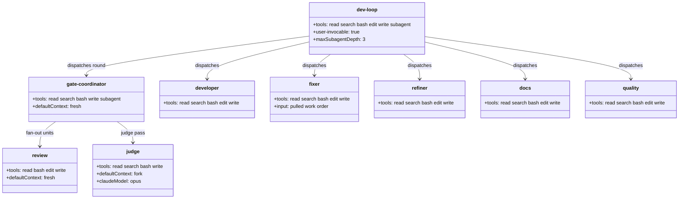

### Model resolution precedence

Type: `flowchart`

The decision path in `resolveRoleModel`. A gate angle resolves through its own tier, then the repo-level `review` override, then the built-in `review` tier. A named role resolves through a concrete `models.roles` entry first, then `roleTiers`. A role name with no tier entry falls back to its reviewer persona's tier. A null tier mapping means inherit, so the harness picks the model. Claude Code generates agent assets with the same function, but with `config = {}`, so the committed `.claude/agents/*.md` tree bakes the built-in policy (opus for seven roles, no `model:` line for `dev-loop` and `gate-coordinator`). Derived from `packages/core/src/config/config.mjs` and `packages/core/src/claude/asset-generation.mjs`.

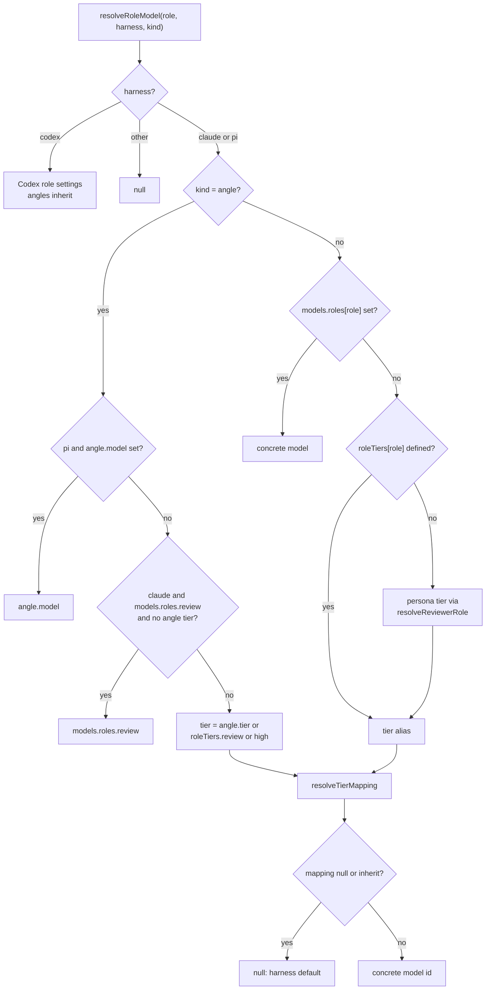

### Role to tier to Claude model in this repo

Type: `sankey-beta`

Each role contributes a flow of 1. Flows run from the role through its tier alias to the Claude model that `dev-loops-run --repo-root <checkout> cli/index.mjs gate resolve-role --role <role> --harness claude` returned for each of the ten roles on 2026-11-23. The built-in tiers map both `low` and `high` to opus. This repo's `.devloops` remaps `low` to sonnet and moves `developer`, `fixer`, `dev-loop` and `gate-coordinator` onto it, so six roles run on sonnet and four run on opus. Derived from `.devloops` (`models.tiers`, `models.roleTiers`) and the `BUILTIN_ROLE_TIERS` table in `packages/core/src/config/config.mjs`.

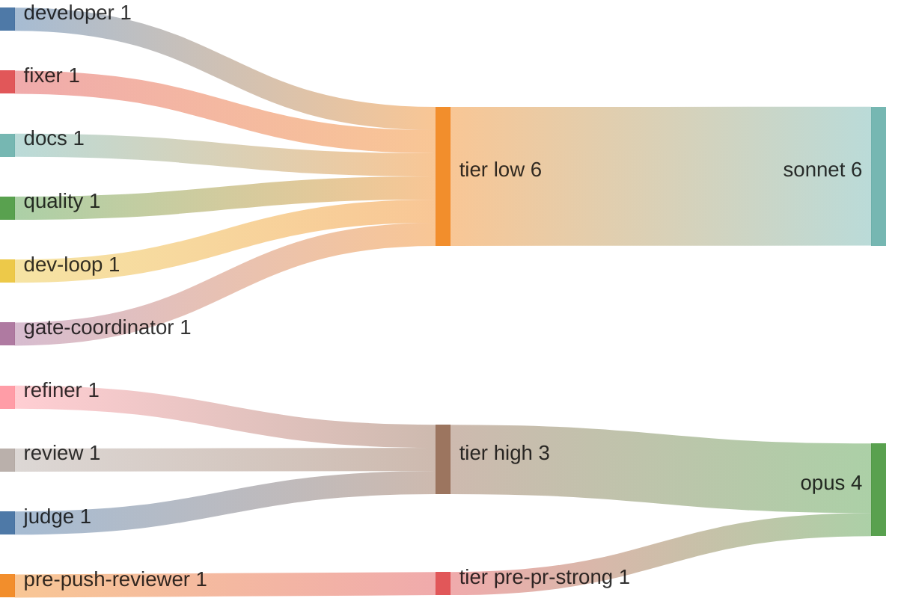

### Claude model share across roles

Type: `pie`

The count of roles per resolved Claude model in this repo. The ten values come from the same `gate resolve-role --role <role> --harness claude` loop over the ten roles. Gate review angles are not counted separately, because they resolve through the `review` tier: `gate resolve-role --gate draft_gate --angle correctness --harness claude` returned opus. Derived from `.devloops` and `packages/core/src/config/config.mjs`.

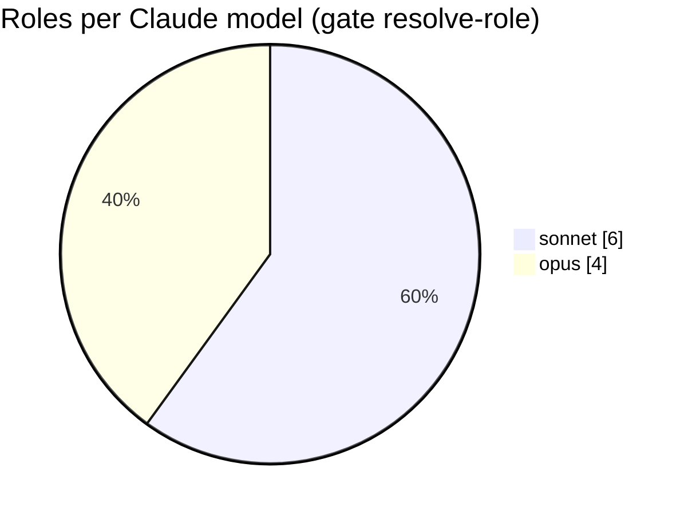

### From work order to agent prompt

Type: `sequenceDiagram`

The pull protocol (ADR 0106, ADR 0115). The emitter writes the full work order and an execution index entry, then hands the coordinator a pointer of at most 499 bytes (`DISPATCH_POINTER_MAX_BYTES`). The coordinator relays the pointer byte for byte. The worker runs the pull CLI, and the pull resolves the identity, checks the digest against the canonical emitted unit, writes a receipt and prints the order. The ref's `<role>:` prefix selects the role adapter, and the identity letter (`r` review, `j` judge, `f` fixer, `c` coordinator) must name the same role. The pull hashes the work order, not the required reads. The judge adapter is the exception: it re-hashes its reads and refuses a changed one as stale. Derived from `scripts/github/_work-order-protocol.mjs`, `scripts/github/pull-work-order.mjs`, `packages/core/src/loop/work-order-digest.mjs` and `scripts/github/emit-fanout-dispatch.mjs`.

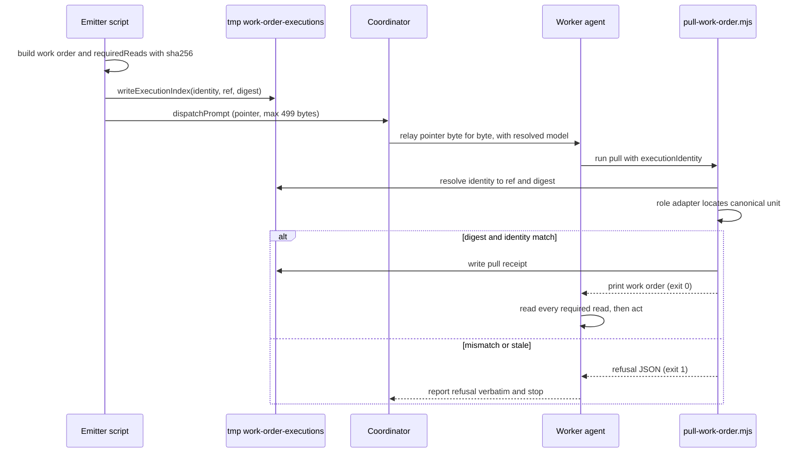

### Pull outcomes

Type: `stateDiagram-v2`

The exit states of `pull-work-order.mjs`. Exit 0 prints the work order. Exit 1 prints a typed refusal. Exit 2 is a usage or IO error, and the legacy three-flag form also gets exit 2. Only `dispatch_reference_mismatch` and `sequence_lock_busy` are retryable. Derived from the usage text in `scripts/github/pull-work-order.mjs` and `WorkOrderRefusal` in `scripts/github/_work-order-protocol.mjs`.

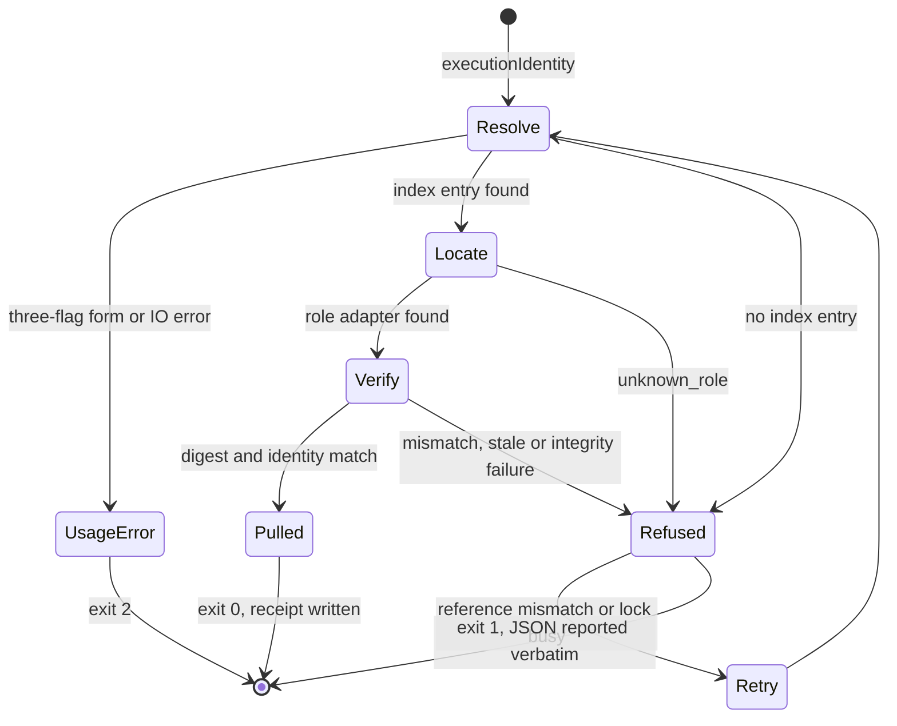

### Inputs into role outputs

Type: `flowchart`

The evidence each role consumes and the artifact it produces. Contracts and handoff reads feed the coordinator. Diffs, validation output and prior ledgers feed the review units. Fan-in merges review findings into a ledger, and the judge disposes of that ledger against the spec. The fixer acts on exactly one source kind per order. Derived from `scripts/github/write-gate-context.mjs`, `scripts/github/emit-fanout-dispatch.mjs`, `scripts/loop/emit-judge-work-order.mjs`, `scripts/loop/emit-fixer-work-order.mjs`, `scripts/loop/emit-coordinator-work-order.mjs` and `packages/core/src/loop/handoff-envelope.mjs`.

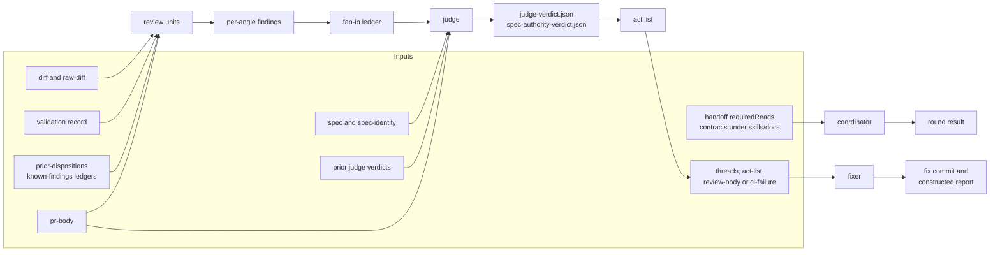

### Required-read kinds per role

Type: `sankey-beta`

Each required-read kind that an emitter attaches contributes a flow of 1 to the role that reads it. The role then passes the summed flow to its output. The value is a count of read kinds in the emitter source, not bytes or tokens. The review side carries nine kinds (a unit with `scoped-evidence` drops the shared `evidence` read) and the judge side carries seven. The fixer pins one source kind per order, and the diagram shows all four alternatives. Derived from the `kind:` literals in `scripts/github/write-gate-context.mjs`, `scripts/loop/emit-judge-work-order.mjs` and `scripts/loop/emit-fixer-work-order.mjs`.

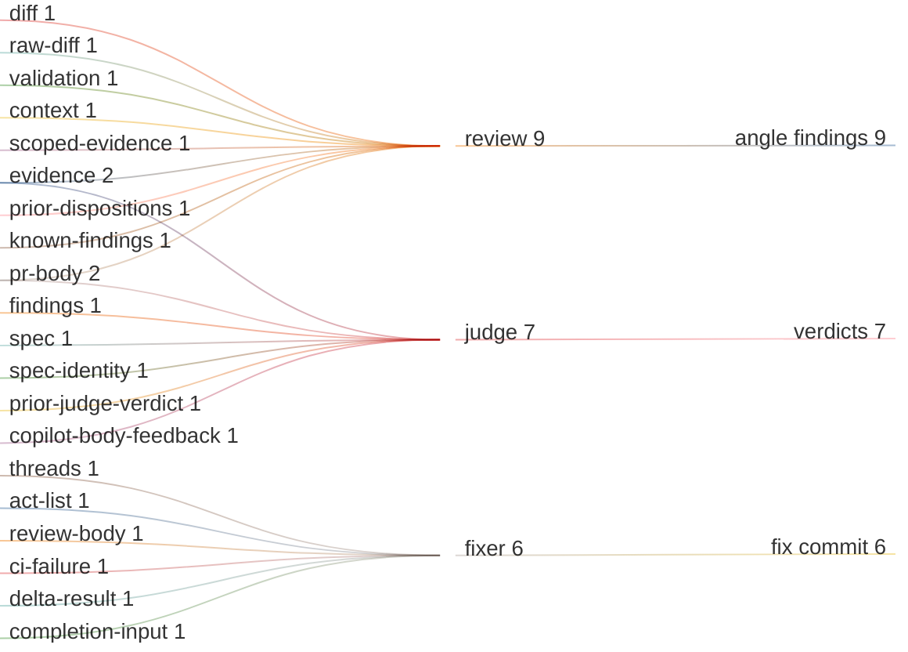

### Reviewer work order layout

Type: `block-beta`

The three byte sections of one emitted reviewer work order and the two size ceilings. Bulk evidence goes through required reads. The emitter refuses an order over 30 KiB (`REVIEWER_WORK_ORDER_MAX_BYTES`) and an order that carries a `diff --git` line. The agent sees only the pointer at dispatch and pulls the full order afterwards. Derived from `scripts/github/emit-fanout-dispatch.mjs` and `packages/core/src/loop/work-order-digest.mjs`.

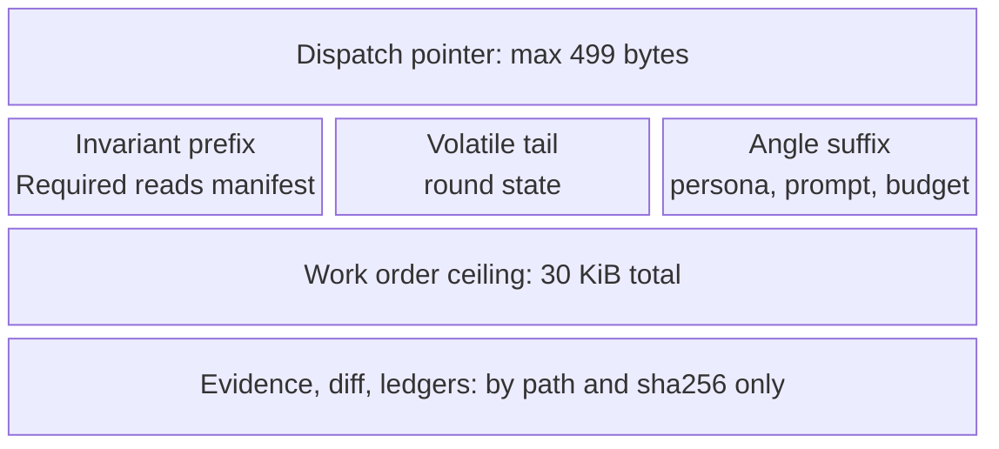

### Fixed role budgets

Type: `xychart-beta`

The maximum model turns and tool calls per role unit. The reviewer floor and cap come from `REVIEWER_UNIT_BUDGET` and `REVIEWER_UNIT_BUDGET_CAP`, and the angle suffix of every reviewer work order states the computed value. The judge, fixer and coordinator budgets come from `ROLE_BUDGETS`. A `grep -rln enforceRoleBudget` over the repo finds callers only in `packages/core/test`, so the runtime does not enforce those three budgets yet. The judge budget also caps input tokens at 100,000 and output tokens at 10,000. The coordinator budget caps output tokens at 20,000. Values read with `grep -n "max" packages/core/src/loop/role-budget-bound.mjs packages/core/src/loop/reviewer-unit-bound.mjs`.

```mermaid
xychart-beta
  title "Per-unit budget (grep of budget constants)"
  x-axis ["judge round", "coordinator phase", "fixer pass", "reviewer floor", "reviewer cap"]
  y-axis "Count" 0 --> 110
  bar [12, 40, 45, 45, 95]
  bar [15, 50, 50, 50, 100]
```

### Reviewer budget growth with diff size

Type: `xychart-beta`

Synthetic inputs: one reviewer unit with 20 changed files and changed-line counts from 0 to 25,000. `computeReviewerUnitBudget` adds ceil(0.25 x files + 0.002 x changed lines) to the 45-turn and 50-call floor and clamps at 95 turns and 100 calls. The budget reaches the cap at 22,500 changed lines, where the added term is 5 + 45 = 50. Values produced by `node scratchpad/atlas/budget-curve.mjs <repo-root>`, which calls the real function. The upper line is tool calls and the lower line is model turns. Derived from `packages/core/src/loop/reviewer-unit-bound.mjs`.

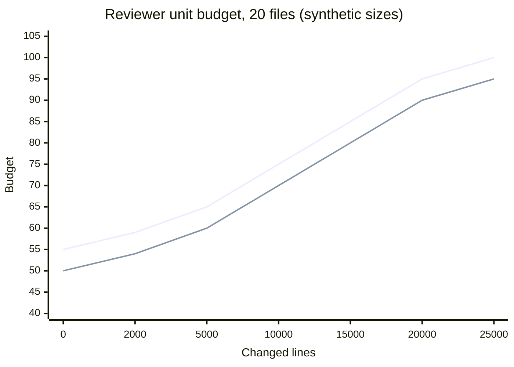

### Where the model reaches a dispatch

Type: `flowchart`

The places that turn a role into a model at dispatch time, with this repo's results. Gate angles get their model from `write-gate-context.mjs` with `kind: "angle"`. The fixer emitter resolves `fixer`, and the coordinator emitter resolves `dev-loop` for the coordinator. Each puts the model on the Claude dispatch payload. The judge emitter resolves no model, so the judge falls back to its generated agent file. That file comes from the zero-config policy plus the `claudeModel: opus` fallback. The committed `.claude/agents` tree uses `config = {}`, so it says opus where `.devloops` says sonnet. The `.devloops` comment states that the dispatch model wins on Claude and the frontmatter is only the fallback. Derived from `scripts/github/write-gate-context.mjs`, `scripts/loop/emit-fixer-work-order.mjs`, `scripts/loop/emit-coordinator-work-order.mjs`, `scripts/loop/emit-judge-work-order.mjs`, `packages/core/src/claude/asset-generation.mjs`, `.claude/agents/*.md` and `.devloops`.

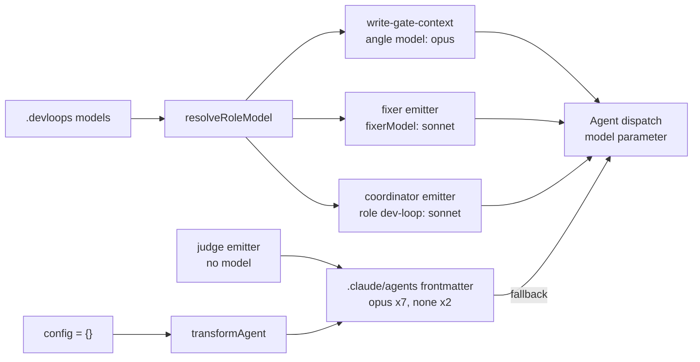

