

## CLI, skills and commands

dev-loops exposes one npm binary, `dev-loops`, whose entry `cli/index.mjs` is a thin router (`package.json` `bin`). A few top-level actions (`help`, `status`, `doctor`, `gates`, `hide`, and the `inspect` viewer lifecycle) run in-process through `executeDevLoopsCommand` in `lib/dev-loops-core.mjs`. Every other call is a `<namespace> <subcommand>` pair that the static table `SUBCOMMAND_ROUTES` maps to one script under `scripts/`, which then runs as a child `node` process. On top of the CLI sit 11 slash commands in `commands/` (`ls commands | wc -l`), 8 skills in `skills/` plus the shared `skills/docs` folder (`ls skills | wc -l` prints 9, and one entry is `docs`), and 9 agent definitions in `agents/` (`ls agents | wc -l`). `skills/docs` holds 48 files (`ls skills/docs | wc -l`): 47 Markdown contracts (`ls skills/docs/*.md | wc -l`) and `required-rules.json`. The source files call `node <dev-loops-package-root>/cli/index.mjs`. The generator `scripts/claude/generate-claude-assets.mjs` rewrites that call to the `dev-loops-run` launcher form for the Claude Code plugin copies under `.claude/`. The diagrams below follow a request from the operator's slash command down to the script that does the work, and then cover the local inspect-run viewer.

### Command tree

Type: `flowchart`

The `dev-loops` command tree as `parseTopLevelCommand` resolves it. In-process actions sit on top. The routed namespaces follow, each with representative subcommands and the script each one runs. `project` is the `queue` table with `run` removed (derived in code with a rest destructure, no table of its own), and `pr create-draft` is the only deprecated alias. `--version` and `--help` are handled before any table lookup. Derived from `cli/index.mjs` (`TOP_LEVEL_COMMANDS`, `INSPECT_LIFECYCLE_DESCRIPTIONS`, `QUEUE_ROUTES`, `PROJECT_ROUTES`, `SUBCOMMAND_ROUTES`, `SUBCOMMAND_ALIASES`).

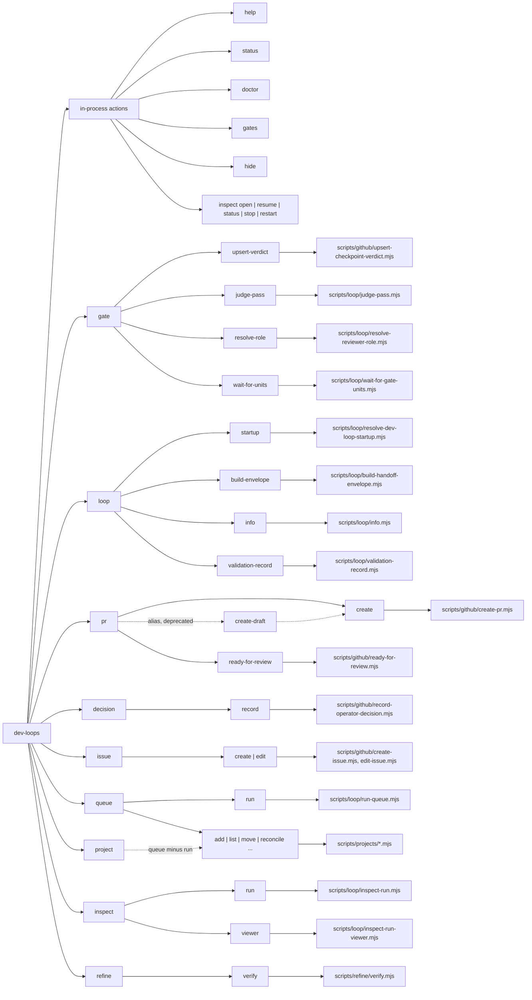

### Subcommands per namespace

Type: `xychart-beta`

The number of routed subcommands in each namespace. `loop` (34) and `gate` (18) hold most of the surface, so the CLI is mainly a toolbox for the coordinator agents, with few commands meant for the operator. Counts come from an `awk` scan of each table in `cli/index.mjs` (`awk '/^ loop: \{/,/^ \},?/' cli/index.mjs | grep -c '\.mjs"'` and the same scan for `gate`, `pr`, `issue`, `inspect` and `refine`). `decision` (1) is a one-line table, so its count is read directly. The `queue` count (12) is the number of keys in `QUEUE_ROUTES`, and `project` (11) is that table minus `run`. `inspect` shows only its 2 routed subcommands; it also has 5 in-process lifecycle actions. Derived from `cli/index.mjs`.

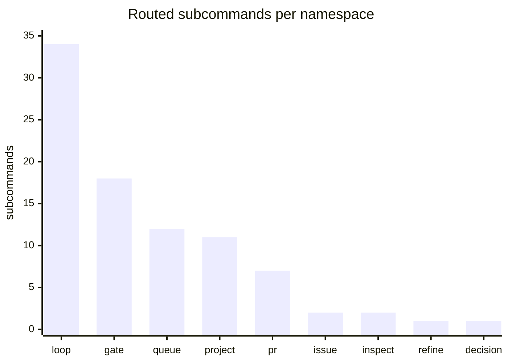

### Routed scripts by directory

Type: `pie`

Where the 77 distinct routed scripts live. `scripts/loop` holds more than half of them, and `scripts/github` holds the GitHub wrappers that gate and PR commands call. The `project` namespace adds no scripts, because it reuses the `queue` entries. Counts come from `sed -n 248,359p cli/index.mjs | grep -oE '"scripts/[a-z]+/' | sort | uniq -c` (44, 21, 11, 1) and the distinct total from the same range piped through `grep -oE '"scripts/[^"]+"' | sort -u | wc -l` (77). Slash commands also call a few unrouted scripts directly, such as `scripts/github/view-issue.mjs` and `scripts/refine/scaffold-spike-file.mjs`; the chart leaves them out. Derived from `cli/index.mjs`.

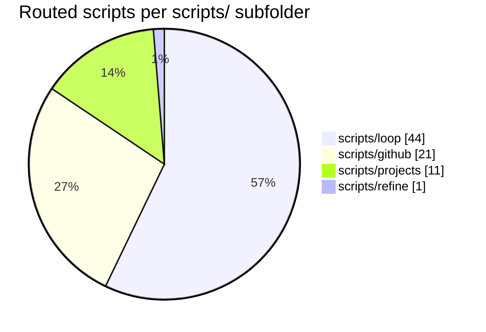

### How runCli dispatches one call

Type: `flowchart`

The decision path inside `runCli`. First, it delegates `gate`, `loop` and `pr` calls to a different source checkout when the working directory sits inside one (`CLI-CHECKOUT-DELEGATION`); it prints a skew line only when the versions differ. Second, it parses the arguments. Third, it refuses with one plain error line when `@dev-loops/core` cannot be resolved, because the deps-less plugin checkout has no `node_modules`. That check runs for every routed subcommand and subcommand help, and for the `gates` and `inspect` actions; `help`, `status` and `doctor` stay core-free. Last, it spawns the routed script with piped stdio, except `claude-launch`, which inherits the terminal while the wrapper ignores SIGINT. Derived from `cli/index.mjs` (`delegateToCheckout`, `findSkewedCheckout`, `isCoreResolvable`, `parseTopLevelCommand`, `INHERIT_STDIO_SCRIPTS`, `SPAWN_MAX_BUFFER`).

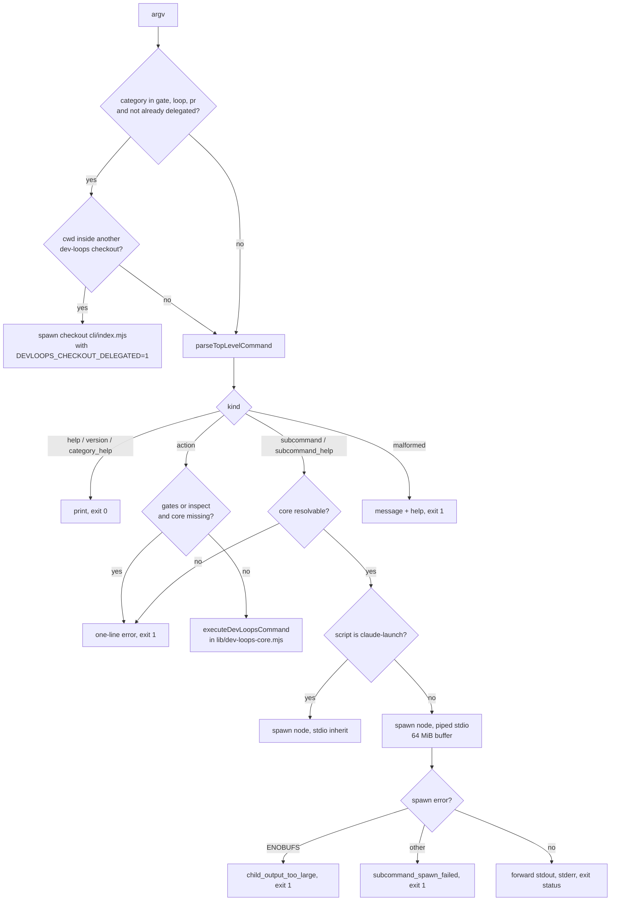

### dev-loops-run toolchain resolution

Type: `flowchart`

How the Claude Code plugin launcher picks the toolchain root. The plugin ships without `scripts/`, `packages/core` or `node_modules`, so every generated command, skill and agent calls through this launcher. A checkout is a directory whose `package.json` names `dev-loops` and that has a `scripts/` folder. The launcher never compares versions: a live source checkout always wins, so the operator's local edits run without a reinstall. `--repo-root` acts like `cd <checkout> &&` (ADR 0117). The launcher also refuses a script path that is absolute or contains `..`. Derived from `.claude/bin/dev-loops-run`.

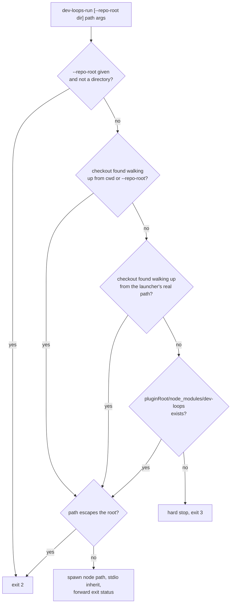

### Slash command to skill and CLI

Type: `flowchart`

Where each of the 11 slash commands lands. Five commands hand a public intent to the `dev-loop` skill. Only `/loop-start`, `/loop-auto` and `/loop-continue` first run `gate resolve-role --role dev-loop --harness claude` in the main session to choose the coordinator model. `/loop-continue` without an argument first picks the target with `resolve-active-board-item.mjs`. `/loop-start-spike` scaffolds a findings file and runs the startup resolver with `--spike`. The other commands go straight to a narrower skill, a CLI subcommand, or a `scripts/` wrapper, and `/loop-status` runs only shell checks. Derived from `commands/*.command.md` (generated as `.claude/commands/*.md`).

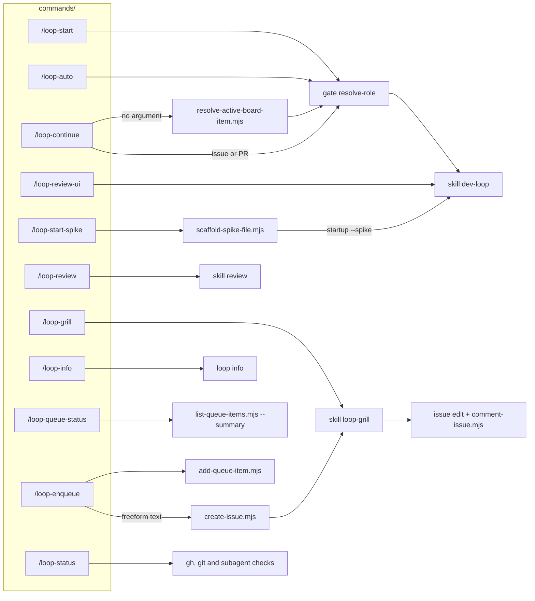

### Skill map

Type: `mindmap`

The skills tree. `dev-loop` is the only public entry. It loads a route pack only after the startup resolver has chosen `selectedStrategy`. The route table lists 8 strategies. The code enum `INTERNAL_DEV_LOOP_STRATEGY` also has `ui_review`, which the route table does not list; the `ui-review` pack is reached through the `/loop-review-ui` intent. `final-approval` is a stub, because its procedure now lives in `copilot-pr-followup`. `review`, `loop-grill` and `pi-session-audit` are standalone and run outside the gate lifecycle. `pi-session-audit` is not copied to `.claude/skills`. Derived from `skills/*/SKILL.md` (frontmatter and the route table in `skills/dev-loop/SKILL.md`), `packages/core/src/loop/public-dev-loop-routing-contract.mjs`, `ls skills/dev-loop` and `ls .claude/skills`.

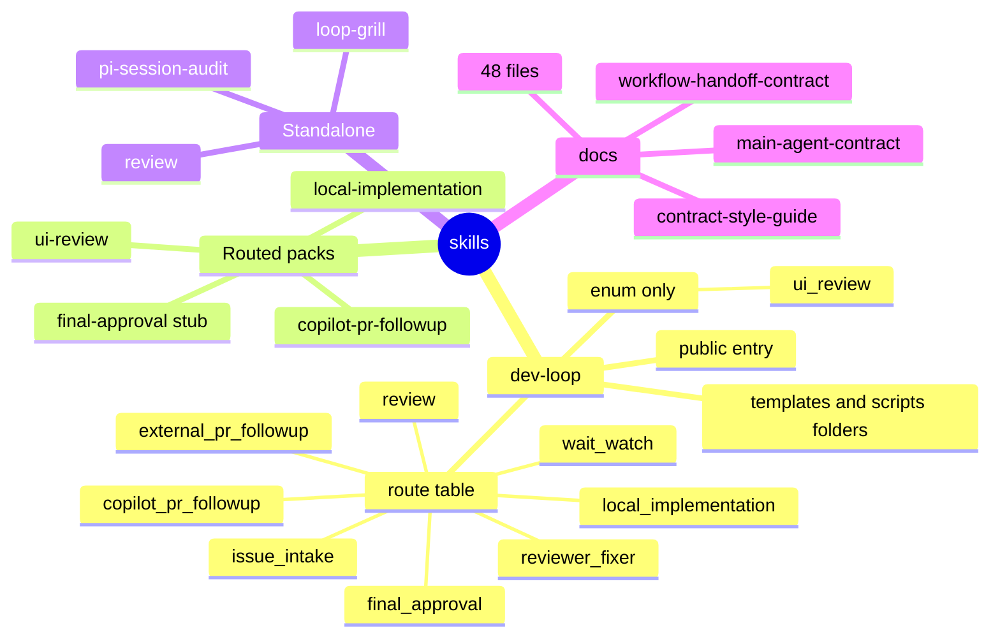

### From /loop-start to a route pack

Type: `sequenceDiagram`

One `/loop-start` call under Claude Code. The main session only picks the model and dispatches. It does not run the startup resolver, gate, fixer or reviewer steps. The `dev-loop` coordinator calls every CLI step through `dev-loops-run`. It loads only the files the handoff envelope lists in `requiredReads`, and no route pack before the resolver selects one. Derived from `.claude/commands/loop-start.md`, `skills/dev-loop/SKILL.md`, `agents/dev-loop.agent.md`, `.claude/bin/dev-loops-run`, and the `loop` and `gate` tables in `cli/index.mjs`.

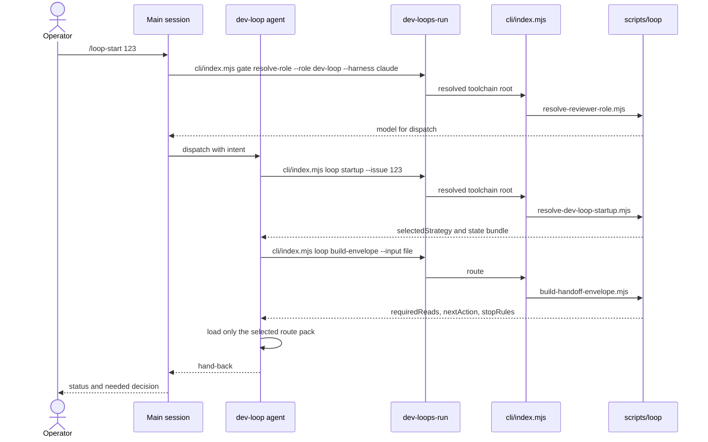

### Operator journey

Type: `journey`

What the operator does in the CLI and slash-command layer, from setup to merge approval. The scores are synthetic and only illustrate friction. No command produced them. Low scores mark the steps where the code says the operator still acts by hand: diagnosing a stale install and approving the merge. Derived from `cli/index.mjs` (`status`, `doctor`, `buildStaleInstallChecks`), `commands/loop-enqueue.command.md`, `commands/loop-queue-status.command.md`, `commands/loop-info.command.md`, `commands/loop-auto.command.md` and `INSPECT_LIFECYCLE_DESCRIPTIONS`.

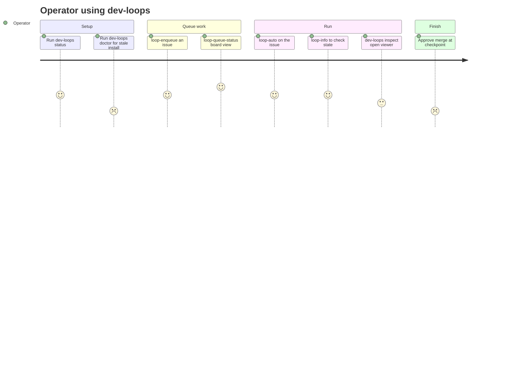

### Coordinator agent journey

Type: `journey`

The same layer from the `dev-loop` coordinator agent's side. The scores are synthetic and illustrate the effort per step. No command produced them. The agent spends most of its effort on CLI calls through `dev-loops-run`, and its reading is limited to what the envelope lists. Every step name is a real route in the `loop`, `gate` or `pr` table. Derived from `skills/dev-loop/SKILL.md`, `agents/dev-loop.agent.md`, and the `loop`, `gate` and `pr` tables in `cli/index.mjs`.

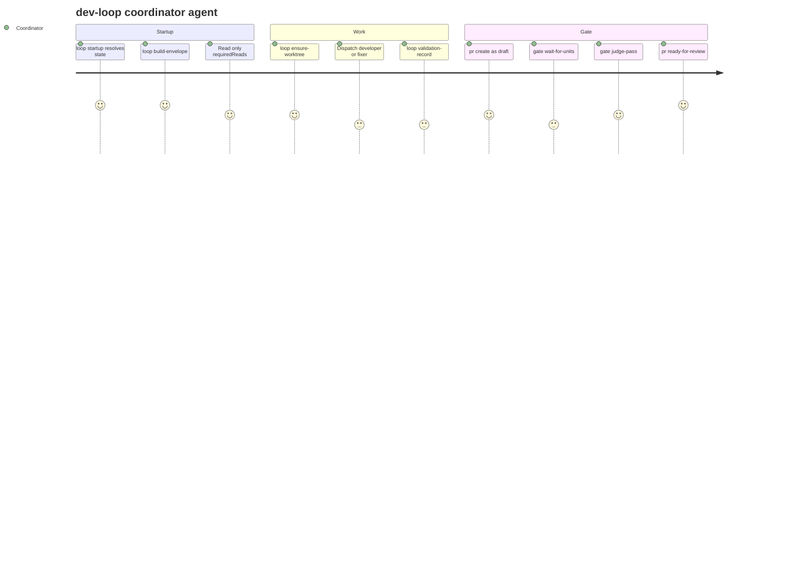

### Packaging surfaces

Type: `block-beta`

The three ways the same toolchain reaches a user. The npm package ships the `dev-loops` binary with all of `scripts/`. The Claude Code plugin ships generated commands, skills, agents, hooks and the launcher, and resolves `scripts/` through `dev-loops-run`. The Pi extension registers one `dev-loops` command through its adapter. The in-process actions of the CLI and the Pi command both call the shared executor in `lib/dev-loops-core.mjs`; routed subcommands bypass it and spawn their script. Derived from `package.json` (`bin`), the `.claude/` directory listing, `.claude/hooks/hooks.json`, `cli/index.mjs` and `extension/index.ts`.

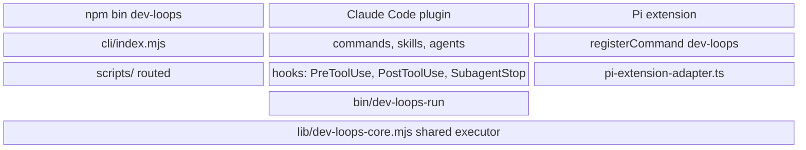

### Inspect viewer lifecycle

Type: `stateDiagram-v2`

The states the managed viewer record can report, and the in-process `inspect` actions that move between them. `open` reuses a running viewer only when it can serve the requested repo; otherwise it stops that viewer and starts a fresh one. Before a fresh start, the manager checks the port and never signals a listener there, because only the managed record PID proves ownership. It reports `conflict_unmanaged_listener` when any other listener holds the port. A managed process that ignores SIGTERM leaves the record in `stale_record`. An unreadable record also counts as `stale_record`. `restart` reuses the recorded repo arguments. Derived from `scripts/loop/inspect-run-viewer/managed-instance.mjs` (`inspectRecord`, `startFresh`, `createInspectRunViewerLifecycleManager`) and `INSPECT_LIFECYCLE_DESCRIPTIONS` in `cli/index.mjs`.

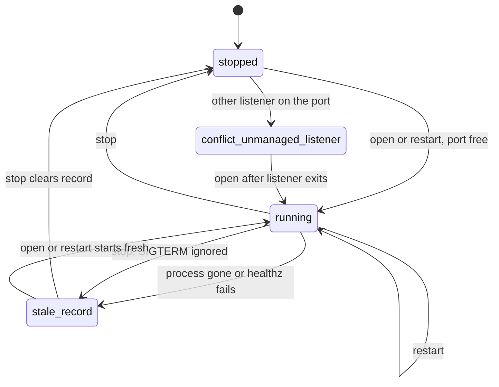

### Inspect viewer HTTP surface

Type: `sequenceDiagram`

The routes the local viewer server answers. `/healthz` answers from memory and never calls `gh`; the managed launcher polls it. The page and the JSON and fragment routes take the target from their own `?repo=&pr=` query. The envelope routes run the startup resolver with `--no-reconcile`, so the viewer stays read-only. Any other path gets 404, and a non-GET method gets 405. The viewer binds to `127.0.0.1` by default, refuses a non-loopback `--host` unless `--allow-non-localhost` is set, and rejects a `--pr` flag. Derived from `scripts/loop/inspect-run-viewer/server.mjs`, `scripts/loop/inspect-run-viewer/cli.mjs` and `scripts/loop/inspect-run-viewer/constants.mjs`. The repo and PR values are synthetic.

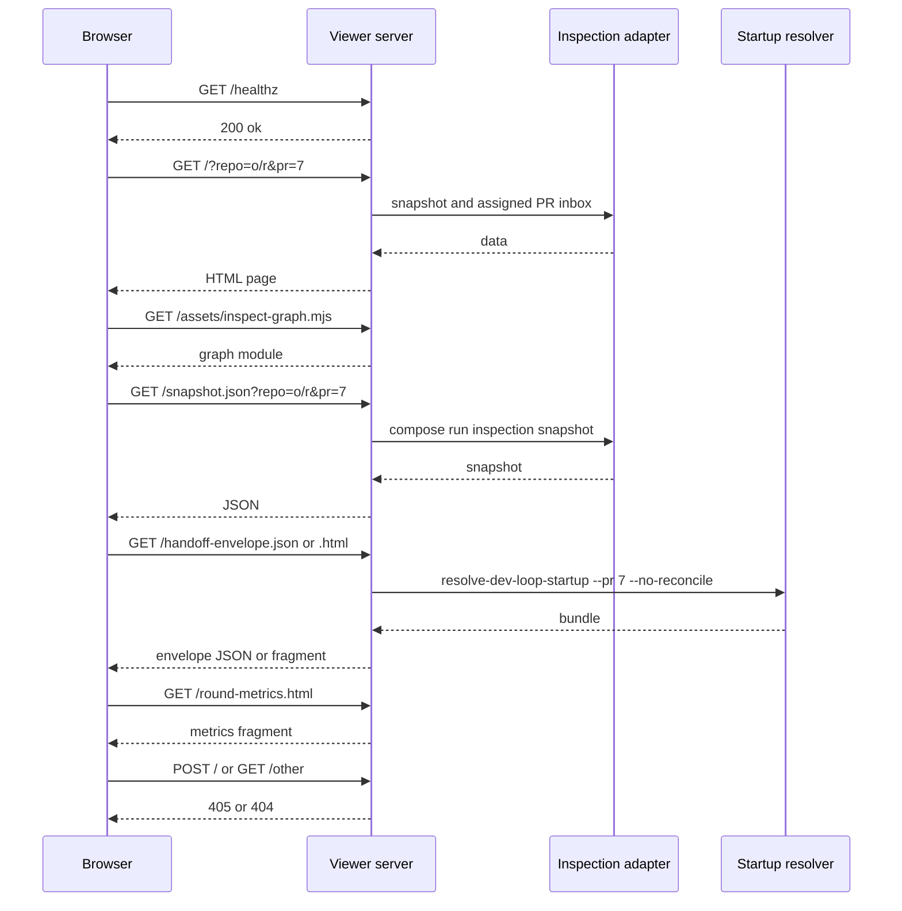

