

## Hooks, guards and permissions

dev-loops enforces its workflow contracts at the tool-call boundary, before a command or write runs. Under Claude Code, eight hook scripts in `.claude/hooks` read the hook payload on stdin, gather facts (git state, repo identity, gate evidence), and call pure deciders. A deny is a `permissionDecision: "deny"` JSON object on stdout with exit 0 (`_hook-io.mjs`); the SubagentStop block uses exit 2 and a JSON reason on stderr. Most Bash rules live in one harness-neutral module, `packages/core/src/loop/bash-gate-decisions.mjs`, vendored into `.claude/hooks/_bash-gate-decisions.mjs` by `scripts/claude/generate-claude-assets.mjs`. Pi has a separate `tool_call` gate in `extension/readonly-role-gate.ts`. That gate restricts only the read-only roles. Per the cross-harness contract, the Claude seam is the only consumer of the shared deny set today. A code search finds no `decideBashGateDeny` caller outside the Claude seam, so Pi use of the shared set is spec-only. Permissions add one more layer. The project `.claude/settings.json` allows two Bash prefixes: `Bash(node scripts/github/edit-issue.mjs:*)` and `Bash(dev-loops-run:*)`. Any other repo script matches a project allow rule only when it runs through the `dev-loops-run` launcher.

### Hook wiring by event and matcher

Type: `flowchart`

Shows which harness event and tool matcher fires each hook script, and which pure decider each script calls. Both registrations point at the same scripts: the project registration uses `${CLAUDE_PROJECT_DIR}` and the plugin registration uses `${CLAUDE_PLUGIN_ROOT}`. The insight: each PreToolUse and SubagentStop script only gathers facts at the edge, and every allow or deny comes from a decider in `_hook-decisions.mjs`, `_bash-gate-decisions.mjs` or `_ask-merge-approval.mjs`. The two PostToolUse scripts never block. The Bash one calls the `syncMainCheckout` helper in `_main-checkout-ff.mjs`. The AskUserQuestion one records a yes answer to the merge approval question. Derived from `.claude/settings.json`, `.claude/hooks/hooks.json`, `.claude/hooks/pre-tool-use-approval-guard.mjs`, `.claude/hooks/pre-tool-use-ask-answers-guard.mjs`, `.claude/hooks/post-tool-use-ask-approval.mjs`, `.claude/hooks/pre-tool-use-bash-gate.mjs`, `.claude/hooks/pre-tool-use-write-guard.mjs`, `.claude/hooks/pre-tool-use-agent-guard.mjs`, `.claude/hooks/post-tool-use-merge.mjs` and `.claude/hooks/subagent-stop-uncommitted-guard.mjs`.

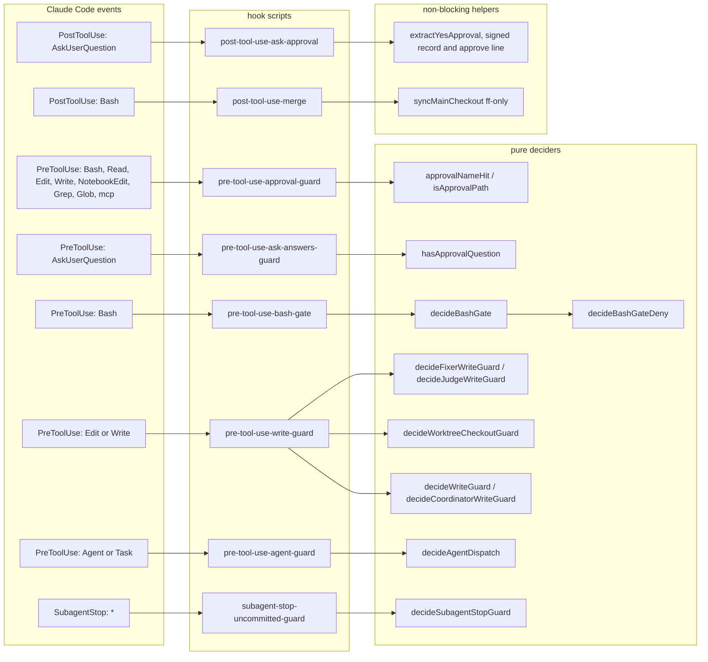

### Bash gate pre-check and decision

Type: `flowchart`

Shows the control flow of `pre-tool-use-bash-gate.mjs`. The hook has no pre-check list: every command reaches `decideBashGate`. The repo-identity lookup (`git rev-parse` and the origin slug) runs first for every command, because the gh-api predicates need the managed slug. In a managed checkout the whole-command token rule (`segmentWriteKind`) classifies the command once as a comment write, a body write or neither. A `gh pr ready` or `gh pr merge` with a PR number gets the gate evidence probe, then `decideBashGate`. That seam decider runs the unresolve owner check, the judge boundary and the fixer pull boundary before it delegates to `decideBashGateDeny`. A decider deny exits first. For a comment write, a generic raw-write deny gets the OPERATOR-OWNED-LINE comment reason instead. The token rule verdict applies last. It denies a raw comment or body write even behind a wrapper such as `timeout` or `sudo`. The insight: the managed-repo test is a `.devloops` config file at the repo root (bare, `.yaml`, `.yml` or `.json`), so the same guards apply in any consumer repo. Derived from `.claude/hooks/pre-tool-use-bash-gate.mjs` and `.claude/hooks/_bash-command-classify.mjs`.

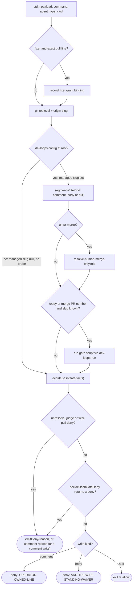

### Shared deny rule evaluation order

Type: `flowchart`

Shows the fixed order in which `decideBashGate` and then `decideBashGateDeny` check their rules. The first match wins. The three seam checks (unresolve owner, judge boundary, fixer pull boundary) run in `_hook-decisions.mjs` before the shared set, which runs the unresolve check again as its own first rule. `BASH_GATE_RULES` holds 13 registered rule IDs (count from `sed -n '/BASH_GATE_RULES = Object.freeze/,/]);/p' .claude/hooks/_bash-gate-decisions.mjs | grep -c '^  "'`). Five denies carry `ruleId: null` (count from `grep -cE '^ +ruleId: null,$' .claude/hooks/_bash-gate-decisions.mjs`): the missing-facts refusal, the unresolve owner allowlist, the subagent merge-pr deny, the `timeout` wrapper deny and the subagent external-write deny. The insight: an omitted or mistyped fact is refused before any rule runs, so a default cannot switch a deny off. The wait-tool deny also runs before the lifecycle verbs, so `gh pr create ... && probe &` cannot reach an allow path first. Derived from `.claude/hooks/_bash-gate-decisions.mjs` (generated from `packages/core/src/loop/bash-gate-decisions.mjs`).

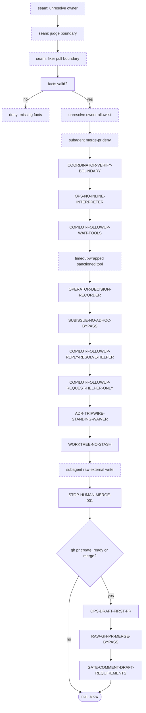

### Sequence of a denied inline-interpreter call

Type: `sequenceDiagram`

Shows one denied Bash call end to end, from the agent's tool call to the deny reason it reads back. The command is a synthetic `node -e` one-liner in a managed checkout. The insight: the command never runs. The agent receives the rule ID and the sanctioned alternative (`--jq`, `--silent` or the editor tools) as the tool error, so it can retry correctly. Derived from `.claude/hooks/pre-tool-use-bash-gate.mjs`, `.claude/hooks/_hook-io.mjs`, `.claude/hooks/_hook-decisions.mjs`, `.claude/hooks/_bash-gate-decisions.mjs` and `commandContainsInlineInterpreter` in `.claude/hooks/_bash-command-classify.mjs`.

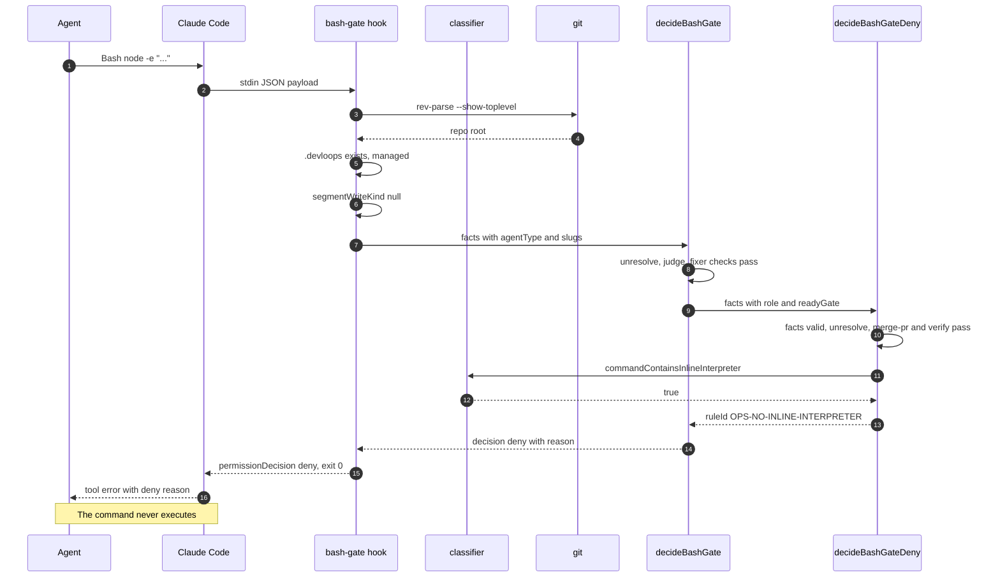

### Raw body write token rule

Type: `flowchart`

Shows the decision inside `segmentWriteKind`, the whole-command rule behind the raw comment write guard (`OPERATOR-OWNED-LINE`) and the raw PR and issue body write guard (`ADR-TRIPWIRE-STANDING-WAIVER`). A comment clause wins over a body clause. An ANSI-C `$'...'` word in a comment-shaped command fails closed, because the decoded flag is not judged. It runs only in a managed checkout and denies for every actor, the operator and the main agent included. The command is normalized into one token set: quotes and backslashes are removed, substitutions and backticks are decoded, comma brace groups are expanded (at most 64 words), and `${VAR:-x}` defaults count as tokens. Tokens are lower-cased. The insight: the rule reads tokens in any segment and any order, so a wrapper such as `timeout` or `sudo` cannot hide the write. The accepted false positive is a command that holds these tokens as data, such as a title that says gh. A brace expansion over the cap, or nested shell strings past depth 3, fail closed. Derived from `segmentWriteKind` in `.claude/hooks/pre-tool-use-bash-gate.mjs`.

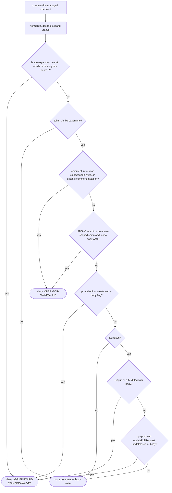

### gh pr ready with a gate evidence probe

Type: `sequenceDiagram`

Shows the one Bash rule whose verdict depends on GitHub state. For `gh pr ready <n>`, the hook runs `scripts/loop/pre-pr-ready-gate.mjs` through the `.claude/bin/dev-loops-run` launcher. Only a clean draft\_gate verdict lets the call through. The insight: a launcher startup failure, or exit 3 (trust config refused), becomes `gateError`. That error is surfaced in the deny reason, so a missing toolchain cannot pass as "no evidence" and the call still fails closed. A raw `gh pr merge` is denied even when its evidence passes. Derived from `.claude/hooks/pre-tool-use-bash-gate.mjs`, `.claude/hooks/_bash-gate-decisions.mjs` and `.claude/bin/dev-loops-run`.

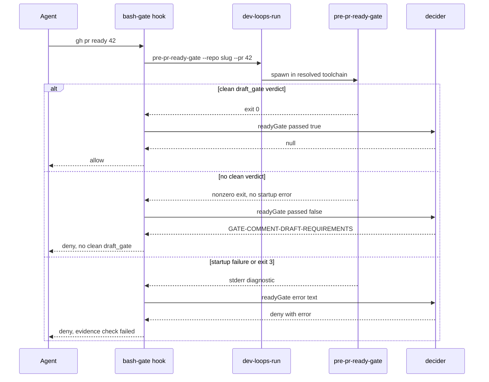

### Write and Edit guard layers

Type: `flowchart`

Shows the five Write/Edit boundaries in `pre-tool-use-write-guard.mjs`, in run order. The first deny exits. The fixer and judge boundaries key on `agent_type`. The checkout guard catches a main-checkout edit while a worktree cycle is active. A call with no `file_path` is allowed after the role checks. The last two boundaries are opt-in through environment flags. They treat any path inside a working tree that `git check-ignore` does not ignore (and any `.git` path) as a repo mutation. The insight: `.claude/settings.json` sets only `DEVLOOPS_COORDINATOR_READONLY=1`. The main-agent read-only write boundary (`DEVLOOPS_MAIN_AGENT_READONLY=1`) therefore fails open in this repo unless the operator sets the flag. Derived from `.claude/hooks/pre-tool-use-write-guard.mjs`, `.claude/hooks/_hook-decisions.mjs`, `.claude/hooks/_fixer-grants.mjs` and `.claude/settings.json`.

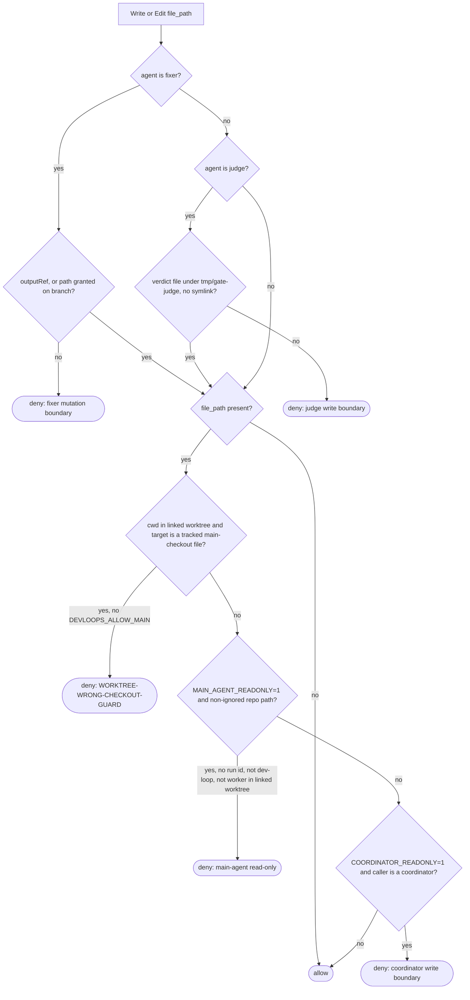

### Agent dispatch guard

Type: `flowchart`

Shows how `decideAgentDispatch` checks an Agent or Task call by caller role, target role and prompt. The insight: the dev-loop coordinator cannot dispatch a gate `review` or `judge` unit directly. It must dispatch one `gate-coordinator`. The gate coordinator may dispatch only `review` and `judge`, and only with the emitted pointer prompt relayed byte for byte. The one exemption is a standalone `review` gate judge, whose ref resolves through the execution index. Derived from `.claude/hooks/pre-tool-use-agent-guard.mjs` and `decideAgentDispatch` in `.claude/hooks/_hook-decisions.mjs`.

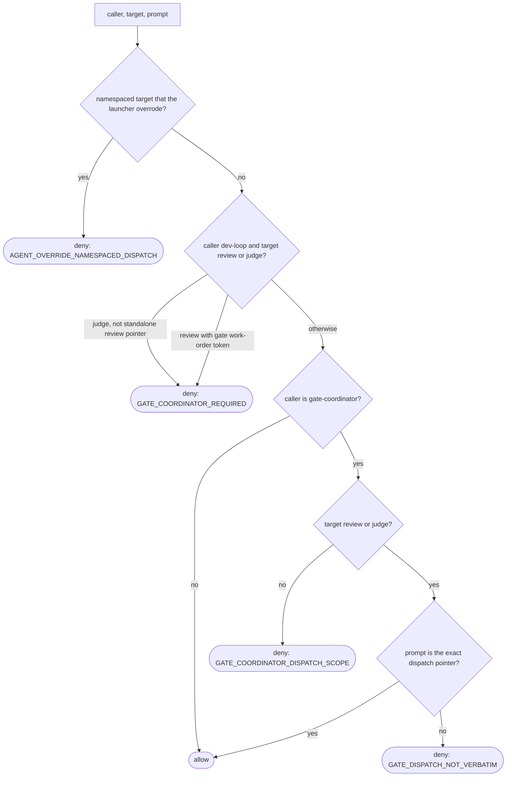

### SubagentStop uncommitted-work guard

Type: `stateDiagram-v2`

Shows the outcomes of `decideSubagentStopGuard` when a subagent stops. The insight: only a subagent whose cwd is under a dev-loop worktree and whose `git status --porcelain` output is not empty is blocked. The block uses exit 2 and lists at most 50 dirty paths. Read-only roles (`judge`, `review`, `gate-coordinator`) get an advisory allow instead, because the dirty edit belongs to the orchestrator. A `git status` failure or timeout (5 s) allows the stop. Derived from `.claude/hooks/subagent-stop-uncommitted-guard.mjs` and `.claude/hooks/_hook-decisions.mjs`.

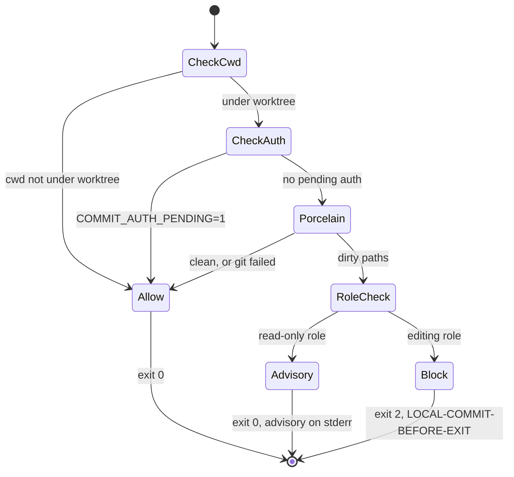

### Pi tool\_call gate

Type: `flowchart`

Shows the Pi `tool_call` handler, which the extension also registers as a required child extension so foreground children load it. The role comes from the `<active_agent name="..."/>` tag in the system prompt. An ambiguous tag, a tag for an unknown dev-loops role, or an untagged native async child resolves to `""`, and `""` fails closed. The insight: Pi restricts Bash only for `judge` and `review`. It does not run the shared `decideBashGateDeny` set, so rules such as OPS-NO-INLINE-INTERPRETER have no Pi enforcement today. Running the shared set on Pi is spec-only. Derived from `extension/index.ts`, `extension/readonly-role-gate.ts` and `skills/docs/cross-harness-regression-contract.md`.

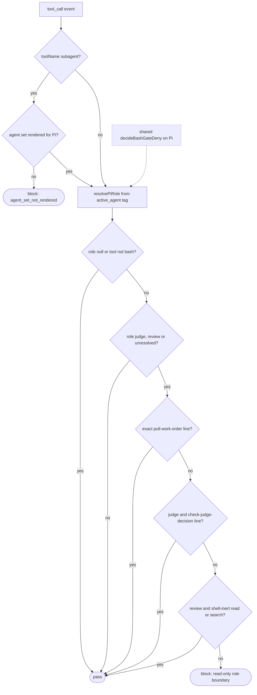

### dev-loops-run launcher resolution

Type: `flowchart`

Shows how `.claude/bin/dev-loops-run` picks the toolchain root and rejects unsafe script paths. The launcher matters for permissions: `Bash(dev-loops-run:*)` is one of only 2 project allow rules (count from `jq '.permissions | map_values(length)' .claude/settings.json`). The bash gate denies a `timeout N` wrapper in front of it because the wrapper hides that head from the allow rule. The insight: a live source checkout always wins over the installed package, and an absolute path or `..` segment exits 2 before any spawn. Derived from `.claude/bin/dev-loops-run`, `.claude/settings.json` and `.claude/hooks/_bash-gate-decisions.mjs`.

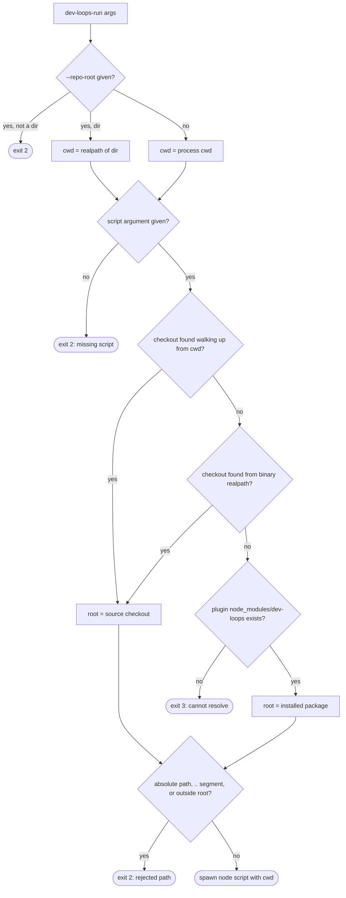

### Guard inventory by harness

Type: `mindmap`

Groups every guard named in this section by harness and hook event. The insight: Claude Code has eight hook entry points (six can deny or block; the two PostToolUse hooks never block), but Pi has one `tool_call` gate covering two roles plus the agent-set preflight. Cross-harness parity covers the judge and review restrictions, and stops there. Derived from `.claude/settings.json`, `.claude/hooks/*.mjs`, `extension/index.ts` and `extension/readonly-role-gate.ts`.

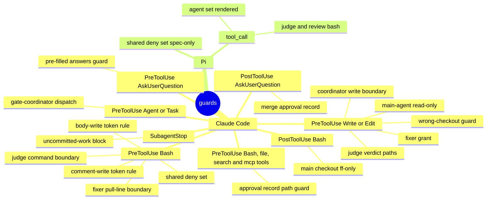

### Vendored decider modules

Type: `classDiagram`

Shows how the hook bundle is built. The pure deciders are written in `packages/core` and copied into `.claude/hooks` by `scripts/claude/generate-claude-assets.mjs`, which only rewrites the relative import paths, because the hook bundle cannot import the core package. The insight: the Claude seam keeps only the judge and fixer role checks. Everything harness-neutral lives in `bash-gate-decisions.mjs`, where a second adapter can call it. Derived from the GENERATED headers of `.claude/hooks/_hook-decisions.mjs` and `.claude/hooks/_bash-gate-decisions.mjs`, and from `docs/decisions/0245-one-shared-bash-gate-deny-decision.md`.

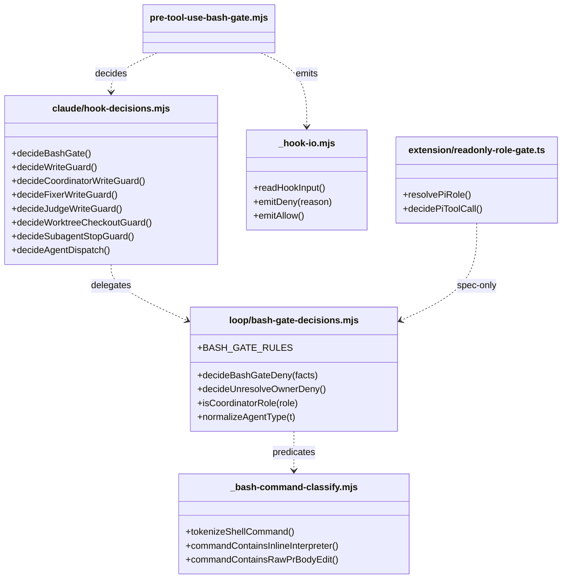

### Hook module sizes

Type: `xychart-beta`

Shows the line count of each file in `.claude/hooks`, from `wc -l .claude/hooks/*.mjs` (6303 lines in total). The insight: the shell classifier is the largest file at 2013 lines. Hook policy is mostly shell parsing (tokenizing, heredocs, substitutions, brace expansion). The eight entry scripts are thin by comparison. Derived from `.claude/hooks/*.mjs`.

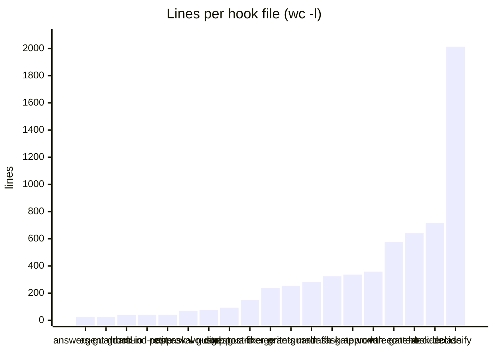

### Deny sites by decision source

Type: `pie`

Shows where deny decisions are produced, counted per rule (a rule such as GATE-COMMENT-DRAFT-REQUIREMENTS has several return sites). There are 13 registered Bash rules (`BASH_GATE_RULES`) and 5 `ruleId: null` Bash denies (`grep -cE '^ +ruleId: null,$' .claude/hooks/_bash-gate-decisions.mjs`). `grep -c 'decision: "deny"' .claude/hooks/_hook-decisions.mjs` reports 13 deny returns in the Claude seam deciders. Two of them only relay a shared-set deny (the unresolve relay and the `decideBashGateDeny` wrapper in `decideBashGate`), so the seam owns 11: judge Bash, fixer pull, main-agent write, coordinator write, judge write, worktree checkout, fixer write and four dispatch denies. The SubagentStop `block` and the two ask-approval guard denies are not counted. The insight: the Bash gate owns the largest share of the policy, and most of it is shared and harness-neutral. Derived from `.claude/hooks/_bash-gate-decisions.mjs` and `.claude/hooks/_hook-decisions.mjs`.

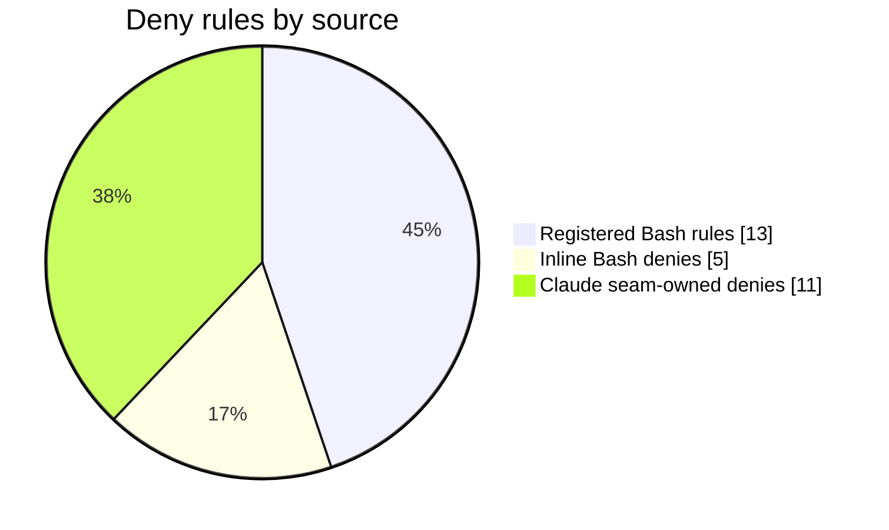

### When each guard entry script landed

Type: `timeline`

Shows the date each guard entry file was first added at its current path, from `git log --diff-filter=A --format=%ad --date=short -- <file>`. With `--follow`, the first three files trace back one day earlier, to 2026-06-23, under an earlier path. The insight: the Bash and write gates arrived together, and role-specific guards followed. The shared deny module was split out of the Claude seam in early November, and the three ask-approval hooks landed last. Derived from git history of `.claude/hooks/*.mjs` and `extension/readonly-role-gate.ts`.

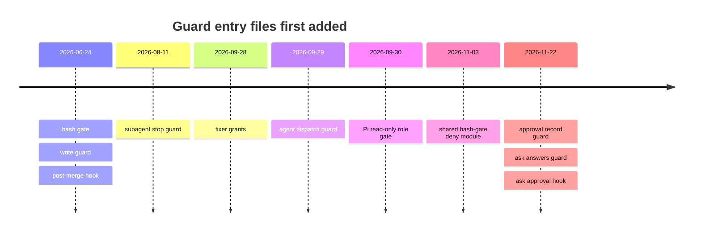

