

## Ops, CI and release

dev-loops ships through six GitHub Actions workflows and a tag-driven release. Pull requests run on a feature branch inside a worktree under `tmp/worktrees/dev-loops/`. CI on the current head is the validation authority, because this repo's `.devloops` sets `validation.mode: ci-only`. The runbook lands the release commit directly on `main` under the `DEVLOOPS_ALLOW_MAIN=1` override. The recent tags sit on squash-merged release pull requests instead, a path that `merge-pr.mjs --stable-release` supports. Pushing a `v*` tag then creates the GitHub Release and dispatches the npm publish. A stable tag also needs a fresh operator `approve release v<version>` comment, which two workflows check independently. Counts in this section come from `git tag` and `git for-each-ref` on the main checkout on 2026-11-19, unless a caption names another command.

### Event to workflow map

Type: `flowchart`

Which GitHub event starts which workflow. Pull requests reach only `CI` and `Gate evidence`. A push to `main` also runs Pages and the wiki compile. Only a `v*` tag reaches the release path, and `npm-publish.yml` is started by an explicit `gh workflow run` because a release created with `GITHUB_TOKEN` never fires `on: release`. Derived from the `on:` blocks of `.github/workflows/ci.yml`, `.github/workflows/gate-evidence.yml`, `.github/workflows/release.yml`, `.github/workflows/npm-publish.yml`, `.github/workflows/pages.yml` and `.github/workflows/wiki.yml`.

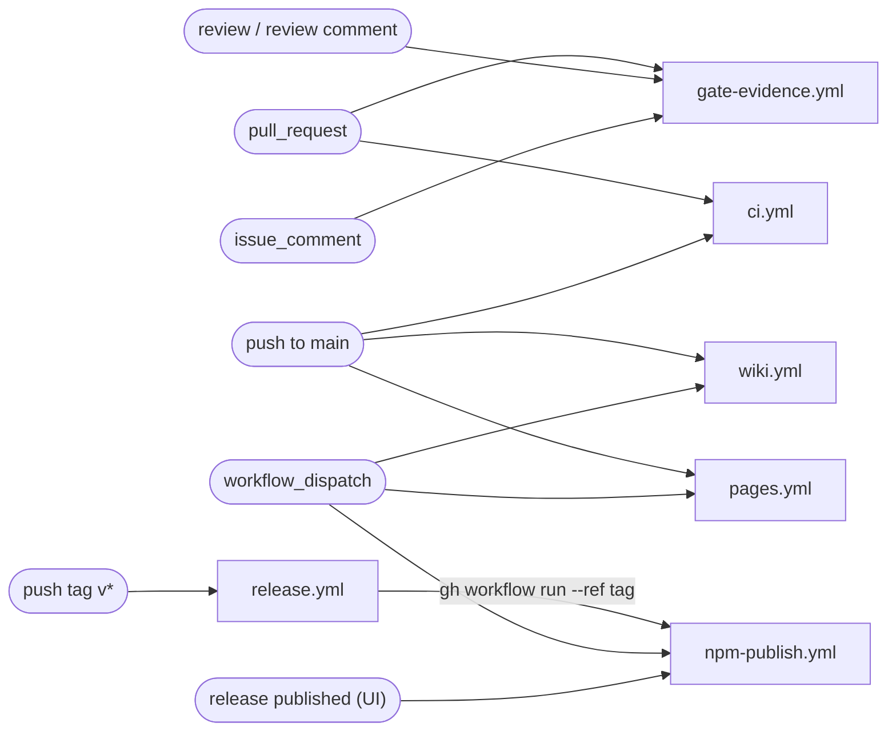

### CI jobs in ci.yml

Type: `block-beta`

The job layout of the `CI` workflow. `changes` computes diff scopes and a trusted timing snapshot. Six `verify-suite` matrix legs run in parallel: `test:docs`, `test:workflows` and four `test:all` shards. Three WebKit smoke jobs run on `ubuntu-24.04` only when their scope output is true. `verify` is the single aggregate check and accepts `skipped` only for the smoke jobs. `publish-timings` runs only on a push to the default branch. Derived from the `jobs:` block of `.github/workflows/ci.yml` and the suite list in `scripts/verify.mjs`.

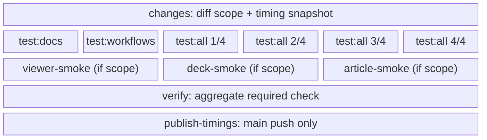

### Pull request and release on one graph

Type: `gitGraph`

A feature branch created by `ensure-worktree.mjs` from fresh `origin/main`, a squash-merged pull request, then a release branch whose bump is squash-merged and tagged on `main`. The runbook also allows a direct release commit on `main` with `DEVLOOPS_ALLOW_MAIN=1`, which the default-branch guard hooks refuse otherwise. The tags from v1.0.11 to v1.0.12-pre.5 point at release commits whose subjects carry a PR number (`git log -1 --format=%s <tag>`), while v1.0.5 to v1.0.10 carry none. Branch names, tag names and the PR number are synthetic. Derived from `skills/docs/worktree-guidance.md` (`WORKTREE-CREATE-PROVISION`, `WORKTREE-DEFAULT-BRANCH-GUARD`), `skills/docs/release-runbook.md` (Procedure), `scripts/release/bump-version.mjs` and `scripts/github/merge-pr.mjs` (default `--method squash`, `--stable-release`).

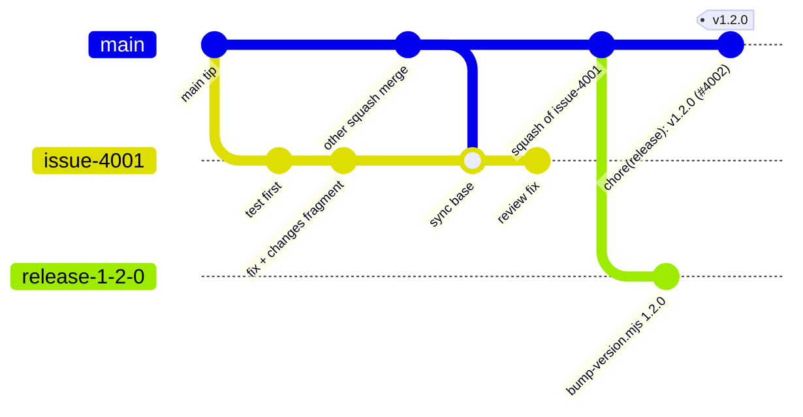

### Tag push to npm

Type: `sequenceDiagram`

The automated path after the operator or an agent pushes a tag. `release.yml` runs four guards before it creates the Release: the commit is on `origin/main`, the manifests and lockfile are in lockstep, the stable approval exists, and the CHANGELOG section exists. `npm-publish.yml` repeats the on-main guard and the approval gate for both packages, runs `bun run verify`, dry-run packs both packages, and publishes each package only when the version is absent from the registry. Derived from `.github/workflows/release.yml`, `.github/workflows/npm-publish.yml` and `skills/docs/release-runbook.md` ("What happens automatically").

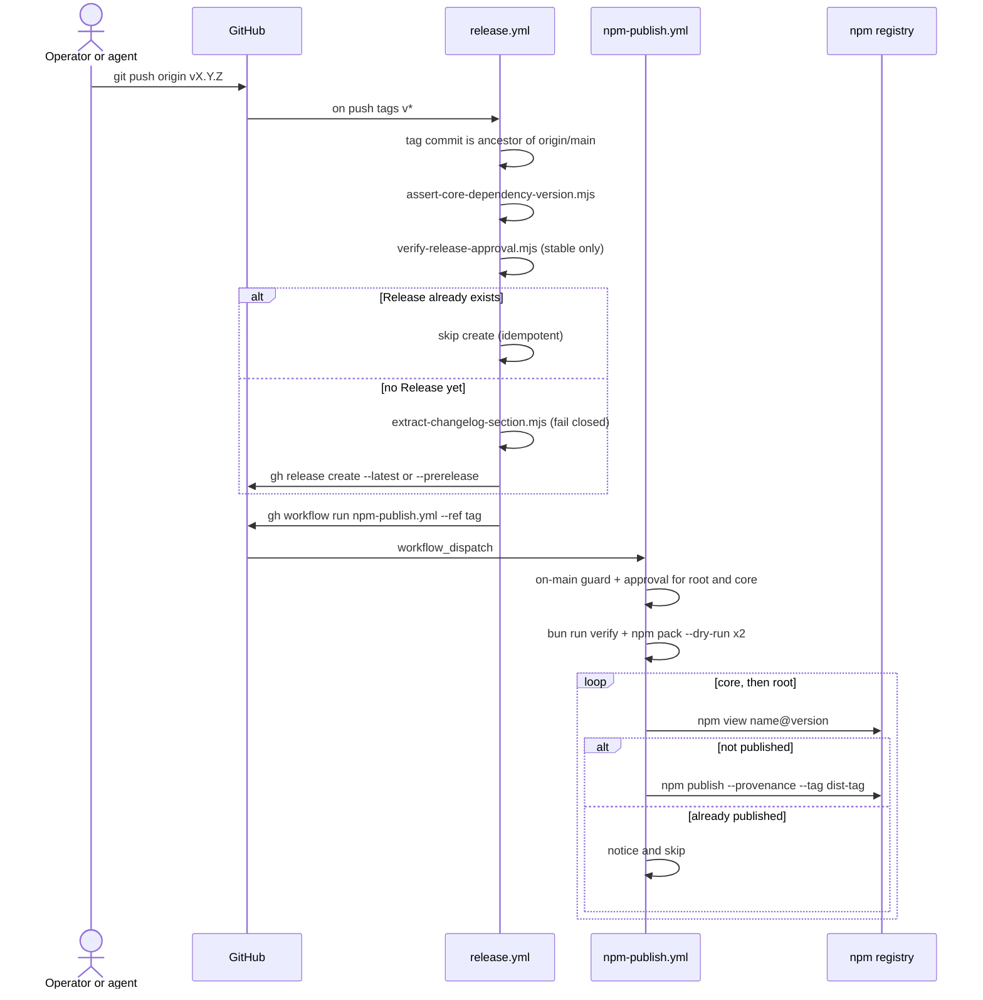

### Stable approval gate

Type: `stateDiagram-v2`

How `resolveApprovalState` decides a release. A prerelease resolves to a non-`latest` dist-tag and the gate does not apply. A stable version without a parseable release commit date throws, so the gate fails closed. For a stable version, only comments by the operator that pass `isGenuineApprovalAssertion` count: quoted, instructional and negated phrases are dropped. One genuine approval whose `created_at` is strictly after the release commit date is enough. Otherwise the refusal names the case in this order of preference: stale, unverifiable, or missing. Derived from `scripts/release/verify-release-approval.mjs` and the "Operator release approval gate" section of `skills/docs/release-runbook.md`.

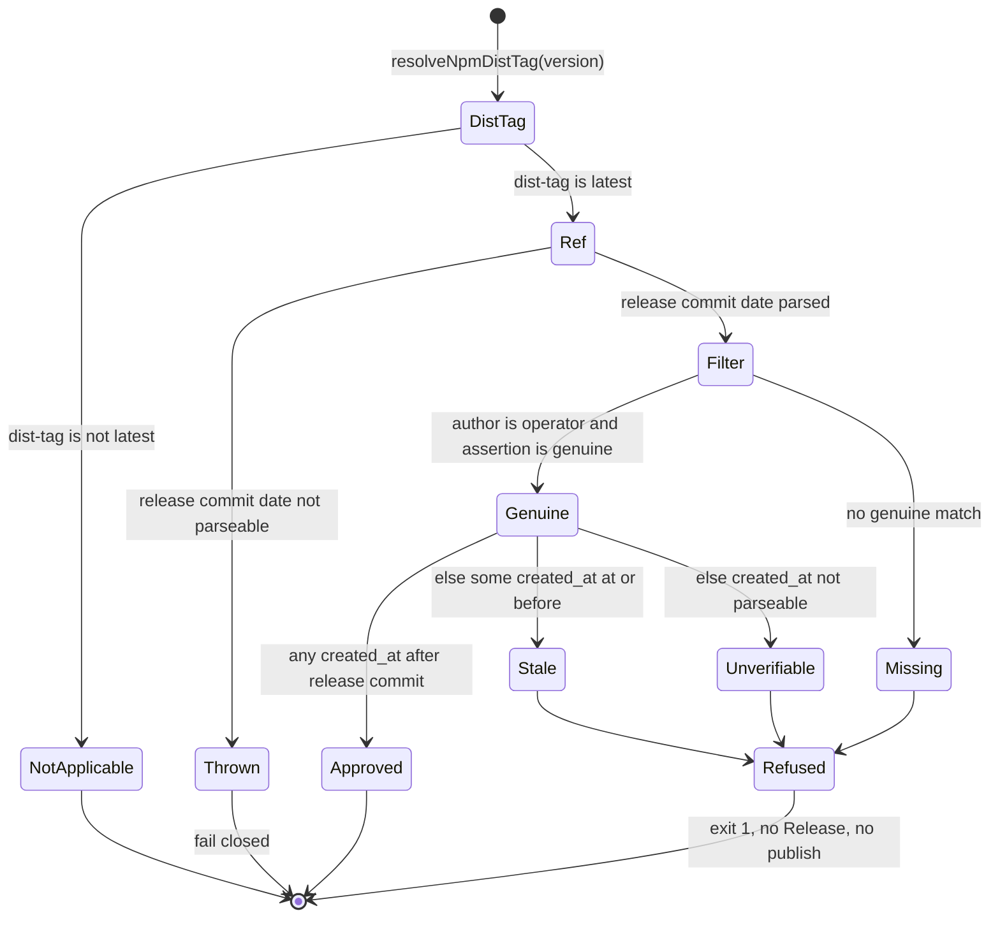

### npm dist-tag resolution

Type: `flowchart`

How `resolve-npm-dist-tag.mjs` picks the npm dist-tag. Both `release.yml` (for the `--latest` or `--prerelease` flag) and `npm-publish.yml` (for `--tag`) call it, so the GitHub Release flag and the npm dist-tag cannot drift. Build metadata is stripped before the prerelease part is read. A purely numeric prerelease and the token `latest` both fall back to `next`. A garbled version fails closed with exit 2 and never falls through to `latest`. Derived from `scripts/release/resolve-npm-dist-tag.mjs`, `.github/workflows/release.yml` and `.github/workflows/npm-publish.yml`.

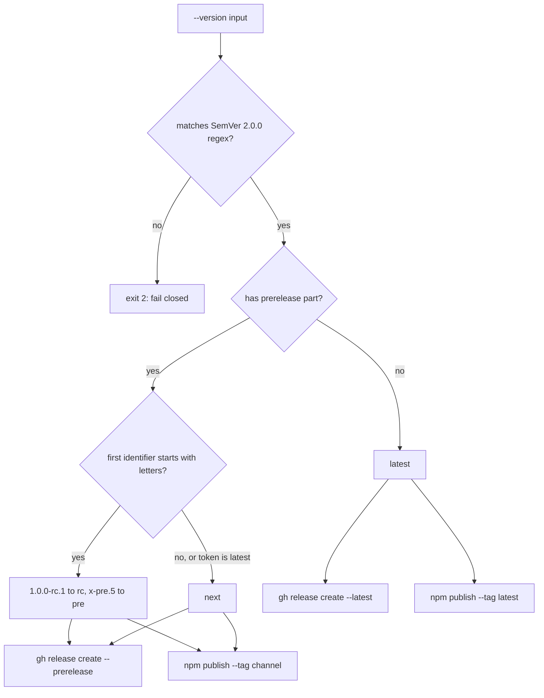

### Gate validation authority

Type: `flowchart`

How `gate resolve-validation` produces full-repository evidence. A dirty worktree or a stale base resolves `incomplete` first. The gate reads the `validation` block from the default branch, never from the PR head. A PR whose checkout block differs in anything other than `paths` resolves `incomplete` and runs nothing (ADR 0192 admits a paths-only difference). In `ci-only` mode, which this repo uses, current-head CI is the only authority and no local suite runs. In `local` mode, the gate runs the declared `fullCommand`, or else checks the Bun pin and runs the `package.json` suites, reusing another lifecycle gate's passing artifact for the same head when one matches. Derived from `scripts/loop/resolve-validation.mjs`, `skills/docs/validation-policy.md` (`VALIDATE-TARGETED-FIRST`) and the `validation:` block of `.devloops`.

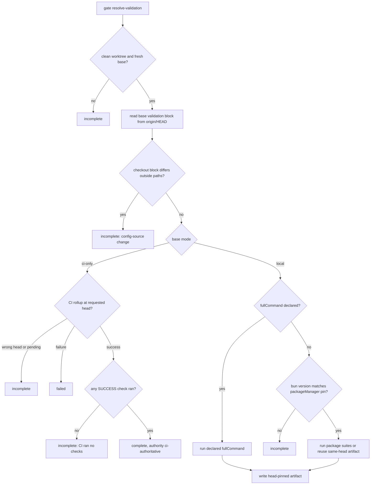

### Gate evidence trust split

Type: `sequenceDiagram`

The three jobs of `Gate evidence` and their trust boundary. PR head code runs only in `head-declared-keys`, which has `permissions: {}` and no secrets, and its output is data. The runner and reporter run default-branch code only. The runner uses a cancelling per-PR concurrency group. The reporter uses a non-cancelling group, so the final event in a burst always posts the required status. On `issue_comment`, only gate verdict, `approve merge` and carried-heads markers from owners, members or collaborators start a run. Derived from `.github/workflows/gate-evidence.yml`.

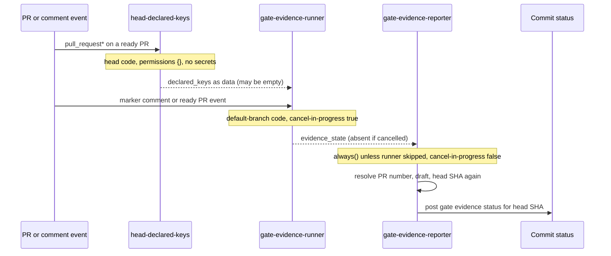

### Worktree lifecycle

Type: `stateDiagram-v2`

The life of a loop-owned worktree. `ensure-worktree.mjs` fetches, then reuses an existing worktree at the canonical path or creates one. An existing worktree on a different branch is a hard conflict. On create, the branch origin is an existing local branch, a tracked remote branch, or a new branch off the base, and only a created worktree gets `bun install --frozen-lockfile`. Both paths install the `pre-commit`, `pre-merge-commit` and `pre-push` guard hooks. After a confirmed merge, `scripts/github/merge-pr.mjs` calls `cleanupWorktree`. Cleanup skips a dirty or locked worktree or one that holds `tmp/gate-findings/` files, and never touches a path outside `tmp/worktrees/dev-loops/`. Derived from `skills/docs/worktree-guidance.md` (`WORKTREE-CREATE-PROVISION`, `WORKTREE-CLEANUP`), `scripts/loop/ensure-worktree.mjs`, `packages/core/src/loop/default-branch-guard.mjs` and `scripts/loop/cleanup-worktree.mjs`.

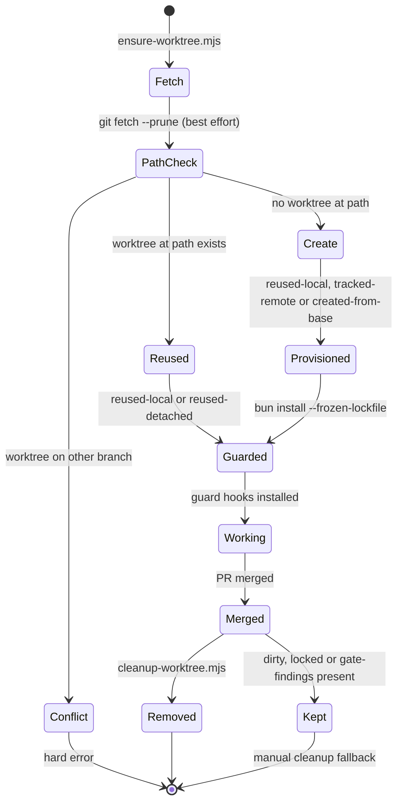

### Seven bump surfaces

Type: `mindmap`

The seven release surfaces that one `bump-version.mjs <version>` call sets in lockstep, plus the drift guards it runs afterwards. The script stages only these files and never commits, tags, pushes or publishes. Derived from `skills/docs/release-runbook.md` (Procedure step 1), `scripts/release/bump-version.mjs`, `scripts/release/assemble-changelog-fragments.mjs` and `scripts/release/assert-core-dependency-version.mjs`.

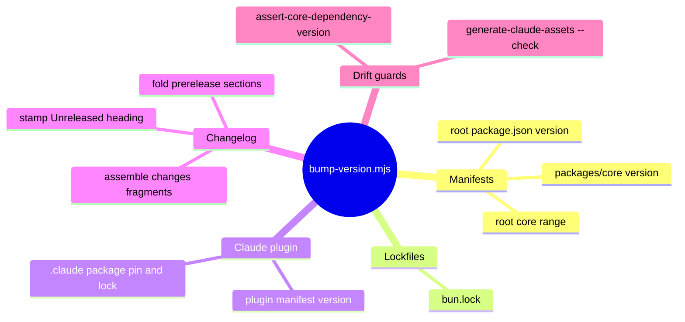

### Release week

Type: `gantt`

One release week from v1.0.11-pre.1 to v1.0.12-pre.5. The milestone dates are real tag creation dates from `git for-each-ref --sort=creatordate refs/tags`. The bar spans between tags are synthetic and only show the order of work. The combined retro and the five post-release steps are runbook rules (`RELEASE-COMBINED-RETRO`, `RELEASE-POST-RELEASE-RECURRING-STEPS`) that the orchestrator files as issues, so their bars are spec-only and their dates are synthetic. Derived from `skills/docs/release-runbook.md` and the tag list.

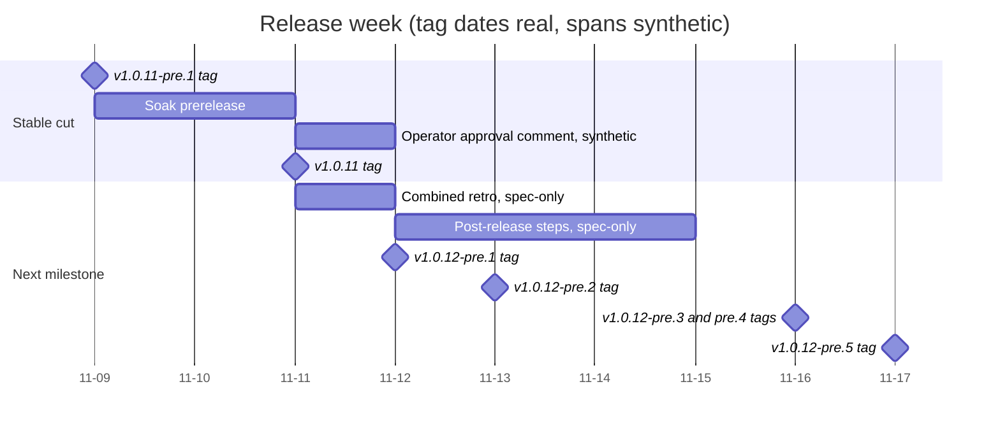

### Stable release history

Type: `timeline`

The stable tags from v1.0.5 to v1.0.11 with their creation dates, and the prereleases cut before each one. Dates come from `git for-each-ref --sort=creatordate --format='%(refname:short) %(creatordate:short)' refs/tags`. The insight: from v1.0.8 on, every stable cut follows one to four `-pre.N` tags, while v1.0.7 shipped without one. Derived from the repository tags and `.github/workflows/release.yml`.

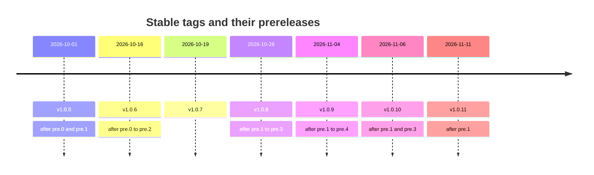

### Days between stable tags

Type: `xychart-beta`

The gap in days from each stable tag to the previous one. The values are differences of the tag dates from `git for-each-ref --sort=creatordate refs/tags`. The cadence tightened from 15 days to between 2 and 9 days. Derived from the repository tags.

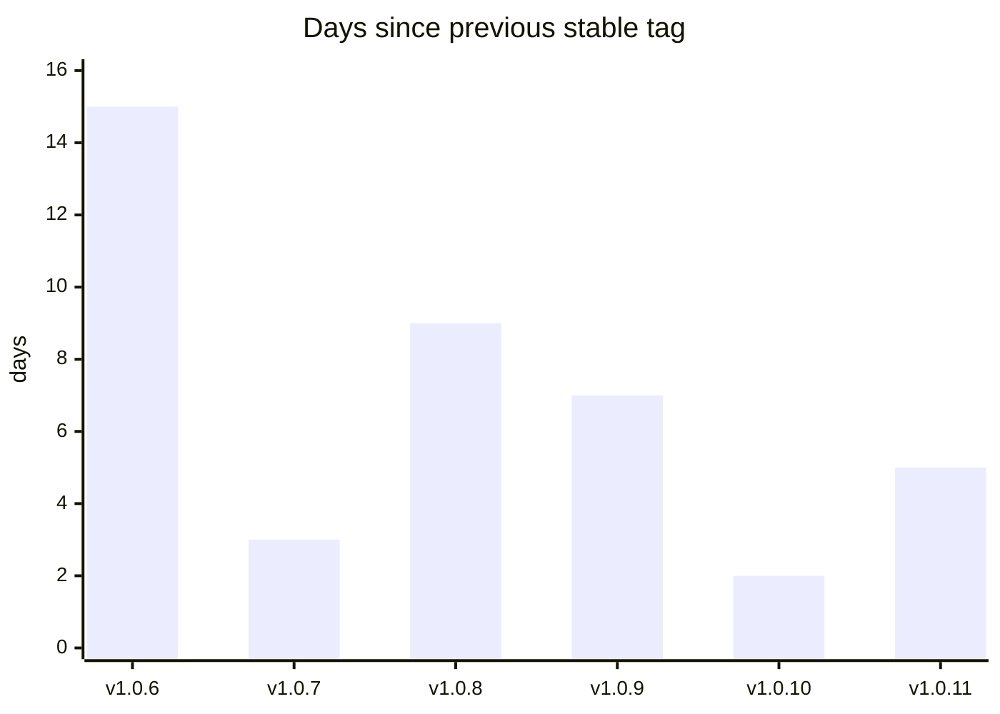

### Tags by kind

Type: `pie`

All 68 version tags split by kind. `git tag | grep -c -v -e '-'` gives 35 stable tags, and the prerelease suffixes give 25 `pre`, 7 `rc` and 1 `slim`. Every prerelease kind maps to its own npm dist-tag channel and never to `latest`. Derived from `git tag` and `scripts/release/resolve-npm-dist-tag.mjs`.

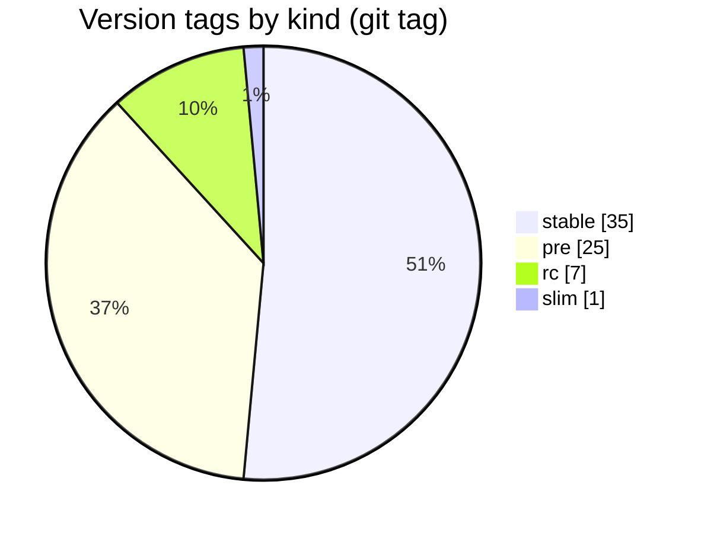

