

## Development process

dev-loops runs its own development through the same machinery it ships. A GitHub Projects board orders the work, and the driver picks only from the `Next Up` column. Every unit of work starts from exactly one authoritative artifact: a GitHub issue, a markdown plan file, or the PR body on the lightweight path. A refinement grill must bring an issue to a clean spec before it can enter `Next Up`. When `workflow.requireRetrospective` is true (this repo's `.devloops` sets it), each merge carries a retrospective obligation that `merge-pr` enforces on the next merge. Stable releases trigger a combined retro and a fixed sequence of audit issues. The diagrams below come from the queue, startup, grill and retrospective modules and their contracts. Card names and counts in example data are synthetic unless a caption names the command that produced them.

### Queue board columns

Type: `kanban`

The four canonical Status columns from `QUEUE-COLUMN-CANONICAL`, filled with synthetic cards. The driver never picks from Backlog. Promotion to Next Up is the deliberate prioritization step, and a blocked or failed item returns to Backlog. Derived from `skills/docs/projects-queue-contract.md`, `packages/core/src/loop/queue-board-sync.mjs` and `packages/core/src/loop/queue-driver.mjs`.

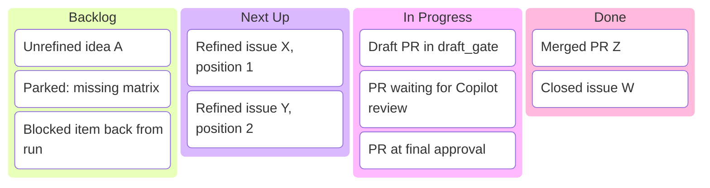

### Loop state to board column

Type: `flowchart`

The stateless mapping in `boardColumnForLoopState`. Every loop state resolves to a logical column and then to a display name. `ready_for_review` falls back to In Progress unless the operator configures that opt-in column. An unmapped state lands in In Progress as the safe default. Derived from `packages/core/src/loop/queue-board-sync.mjs` and `skills/docs/projects-queue-contract.md`.

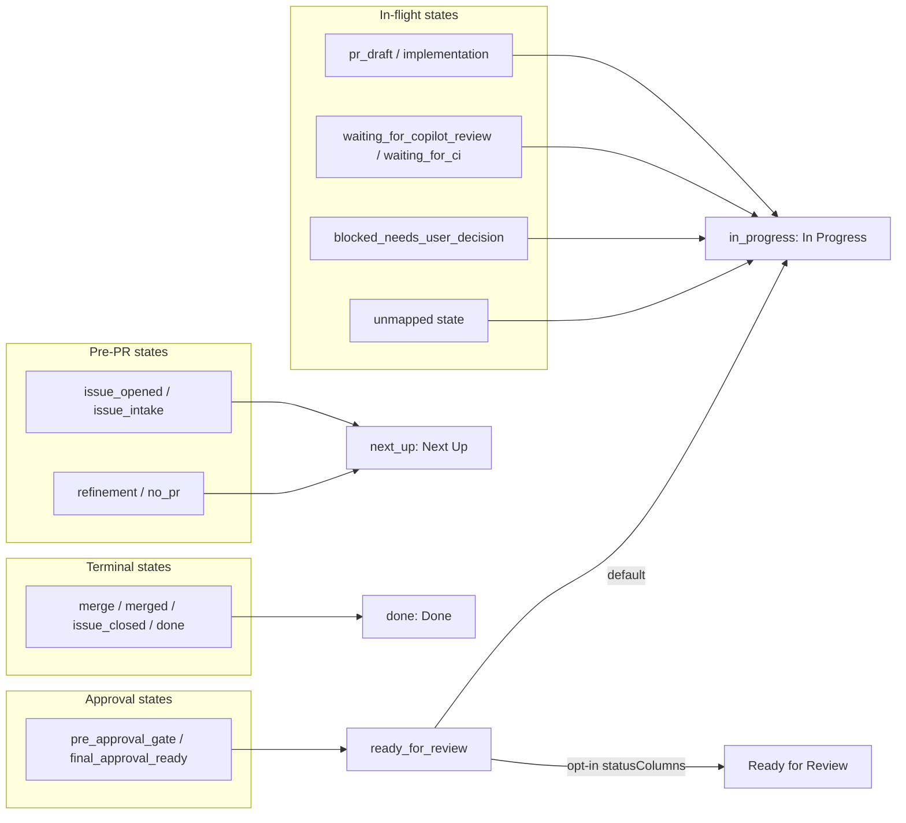

### Queue pickup from Next Up

Type: `flowchart`

The two pickup paths. The queue driver (`queue run`) checks the Next Up order against the local queue file. Bare `/loop-continue` checks In Progress first, then walks Next Up with an ownership gate that skips items assigned to another human and claims unassigned ones. Both read Next Up by position ascending, and neither falls back to Backlog or local queue order. The reason strings come from the `REASON_*` constants. Derived from `packages/core/src/loop/queue-driver.mjs`, `packages/core/src/loop/queue-board-ordering.mjs`, `scripts/projects/resolve-active-board-item.mjs` and `skills/docs/projects-queue-contract.md`.

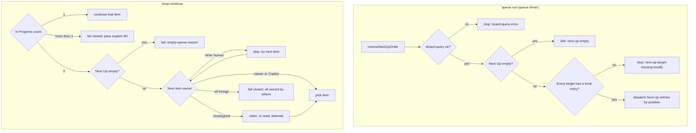

### Local queue entry lifecycle

Type: `stateDiagram-v2`

The `VALID_TRANSITIONS` table for entries in `.pi/dev-loop-queue.json`. `done` is terminal. `failed` can only return to `queued`, and only the `RECOVERABLE_FAILURES` (`timeout`, `round_cap_reached`, `acceptance_report_parse_failure`) are retried, up to `reDispatchMaxRetries`; any other failure goes to `blocked`. Board sync moves the card to In Progress on `running`, to Done on `done`, and to `queue.nonSuccessStatus` (default Backlog) on a throw. Derived from `packages/core/src/loop/queue-state.mjs` and `packages/core/src/loop/queue-driver.mjs`.

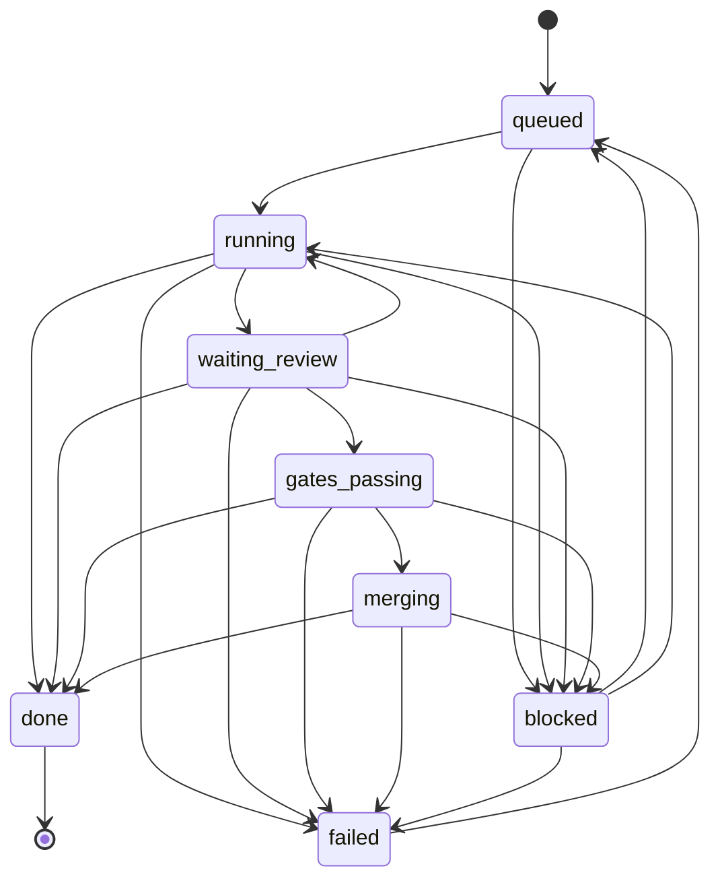

### Artifact authority mode selection

Type: `flowchart`

How startup selects the authoritative artifact. `strategy` in `.devloops` sets only the routing preference. The explicit startup flag selects the artifact for each run. `--lightweight` composes only with `--issue`, is rejected with `--plan-file`, and used alone requires light mode and an in-threshold change unless `localImplementation.issueless` is set. Derived from `scripts/loop/resolve-dev-loop-startup.mjs`, `packages/core/src/config/config.mjs` and `skills/docs/artifact-authority-contract.md`.

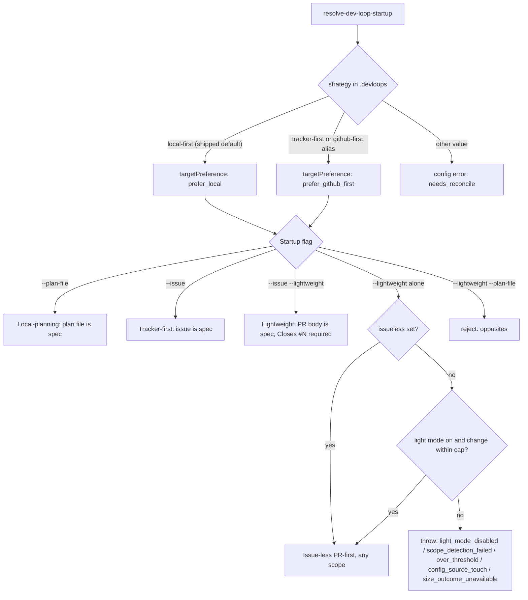

### Lightweight PR body invariants

Type: `requirementDiagram`

The invariants a lightweight PR body must carry under `ARTIFACT-LIGHTWEIGHT-BODY-INVARIANTS`. The closing reference is conditional: required when an issue backs the work, forbidden on the issue-less path. The validator fails closed with a distinct reason per violated invariant. Derived from `scripts/loop/validate-pr-body-spec.mjs`, `packages/core/src/loop/issue-refinement-artifact.mjs` and `skills/docs/artifact-authority-contract.md`.

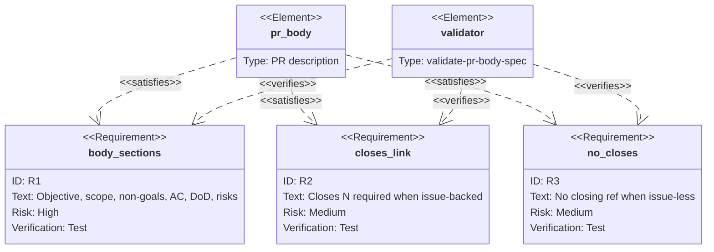

### Enqueue refinement gate

Type: `sequenceDiagram`

What happens when an issue is enqueued into the pickup column under `QUEUE-ENQUEUE-REFINEMENT-GATE`. The gate reuses `detectIssueRefinementArtifact`, the same check the draft gate uses. Without `--auto` the enqueue throws `MISSING_REFINEMENT_ARTIFACT` (exit 4). With `--auto` it diverts the issue to the `queue.nonSuccessStatus` park column, which must differ from Next Up. The grill and re-enqueue steps belong to the orchestration layer: the contract requires them, and `add-queue-item.mjs` does not run them. Derived from `scripts/projects/add-queue-item.mjs`, `packages/core/src/projects/move-queue-item.mjs`, `packages/core/src/loop/issue-refinement-artifact.mjs` and `skills/docs/projects-queue-contract.md`.

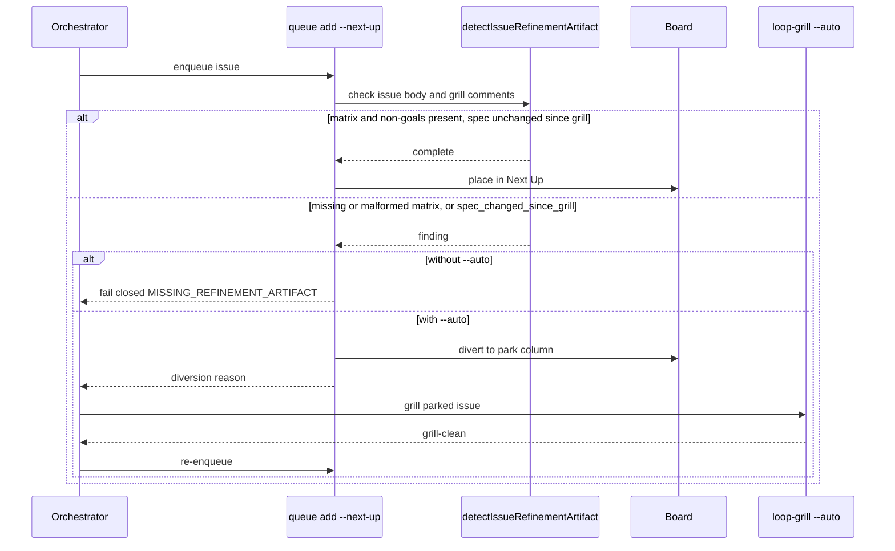

### Refinement grill sub-loop

Type: `stateDiagram-v2`

The bounded grill state machine. Iteration lives in the transition graph: synthesis always re-grills until it reaches a fixed point or hands off. The three terminal states have no outgoing edges. Derived from `packages/core/src/loop/refinement-grill-state.mjs`, `scripts/loop/detect-refinement-grill-state.mjs` and `skills/loop-grill/SKILL.md`.

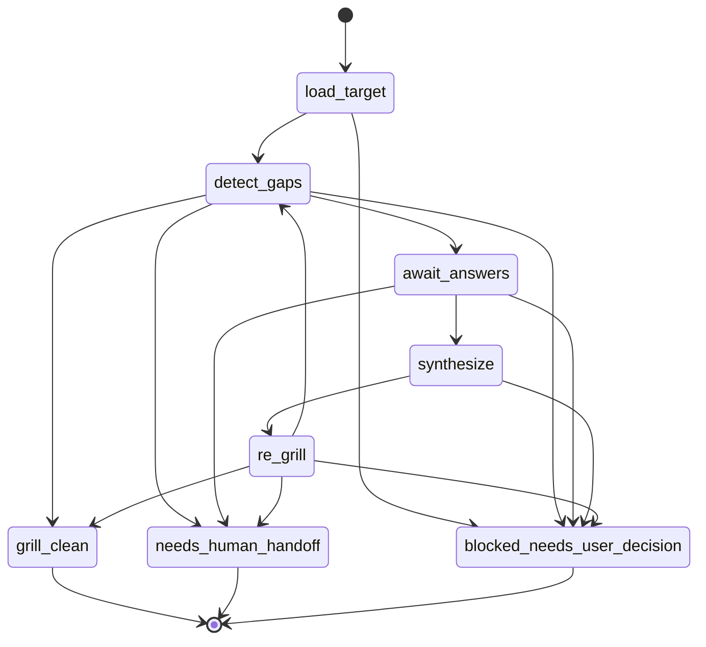

### Grill answer sources

Type: `mindmap`

Where the grill gets its answers and which gap kinds it must detect. In `--auto` mode an answer with only an inferred source and no citation is flagged unresolved. Some spec-lint findings can never be disposed in the results comment and block `grill-clean` until the body is fixed. Derived from `skills/loop-grill/SKILL.md` and `scripts/loop/spec-lint.mjs`.

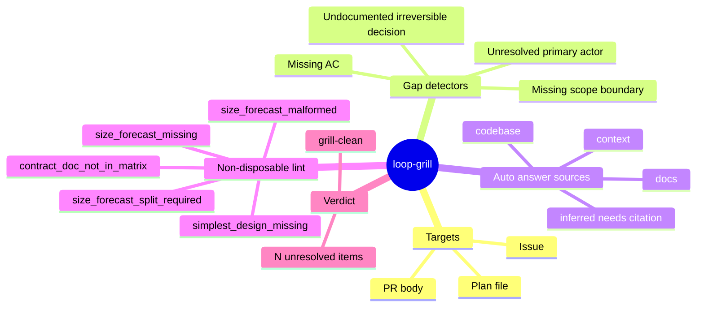

### Retrospective checkpoint states

Type: `flowchart`

How a fresh session maps `.pi/dev-loop-retrospective-checkpoint.json` to a checkpoint state. The whole check runs only when `workflow.requireRetrospective` is true. An absent file never blocks. The identity and newer-merge checks live in `resolvePendingRetrospectives`, which startup and `merge-pr` share. Any broken, stale, identity-less or inline record maps to MISSING. Startup routes a MISSING state normally and reports `pendingRetrospectives`; `merge-pr` refuses the next merge until the cycle is discharged. Derived from `packages/core/src/loop/retrospective-checkpoint.mjs`, `scripts/loop/resolve-dev-loop-startup.mjs`, `scripts/github/merge-pr.mjs` and `skills/docs/retrospective-checkpoint-contract.md`.

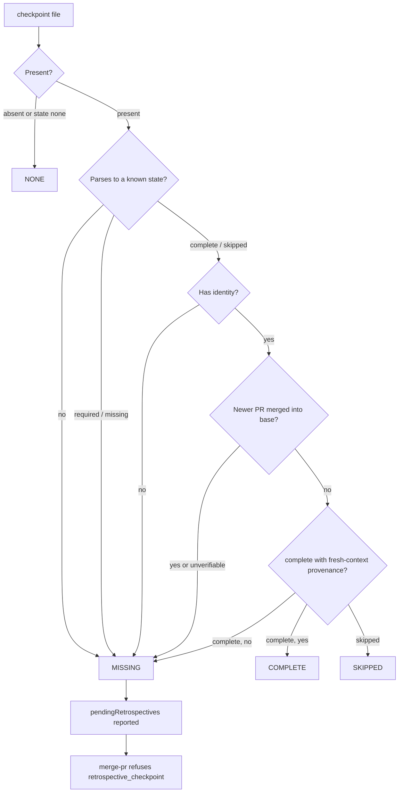

### Post-release process

Type: `flowchart`

The fixed sequence after every stable release (spec-only: the rules live in the release runbook and a contract test pins the prose; no script drives the order). A combined retro runs first and folds the per-merge retros. Then the orchestrator files five issues in the next milestone and drives them in order. Issues get a milestone through the `--milestone` flag of the issue wrapper. The operator keeps the tag, publish and approval decisions. Derived from `skills/docs/release-runbook.md`, `test/contracts/release-post-release-steps-contract.test.mjs` and `scripts/github/create-issue.mjs`.

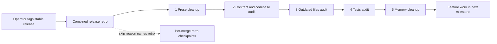

### Release timeline

Type: `timeline`

Selected releases from `CHANGELOG.md`. Dates for entries without a date in the changelog come from `git log -1 --format=%cs <tag>`. The project moved from 0.x through seven release candidates to 1.0.0, then shipped 1.0.x patch releases roughly weekly and is now on 1.0.12 pre-releases. Derived from `CHANGELOG.md` and the release tags.

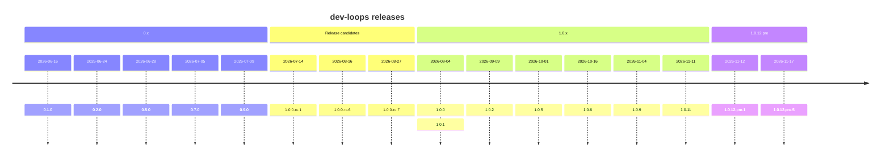

### Changelog entries per 1.0.x release

Type: `xychart-beta`

The number of top-level bullets in each 1.0.x stable changelog section. The counts come from `awk '/^## /{v=$2} /^- /{c[v]++} END{for(k in c) print k, c[k]}' CHANGELOG.md`. Release size peaked at 1.0.6 with 112 entries. 1.0.10 and 1.0.11 are smaller, at 14 and 34 entries. 1.0.1 has no bullets in that output, so the chart omits it. Derived from `CHANGELOG.md`.

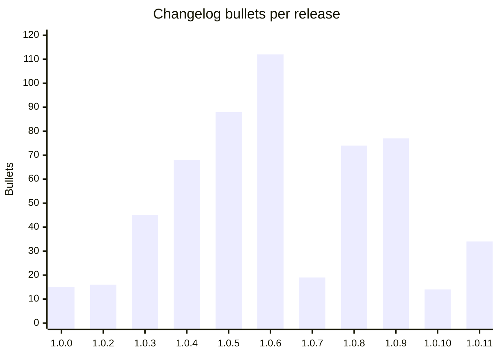

### Process artifacts and their links

Type: `erDiagram`

The artifacts the process connects. An issue or plan file is the spec in tracker-first and local-planning modes; on the lightweight path the PR body is the spec. A board item tracks an issue or PR. A local queue entry mirrors a board item only when a board is configured. A merged PR creates one retrospective checkpoint cycle, and a gate audit reads both verdict surfaces of a PR. Derived from `skills/docs/artifact-authority-contract.md`, `packages/core/src/loop/queue-state.mjs`, `packages/core/src/loop/retrospective-checkpoint.mjs` and `scripts/github/audit-gate-evidence.mjs`.

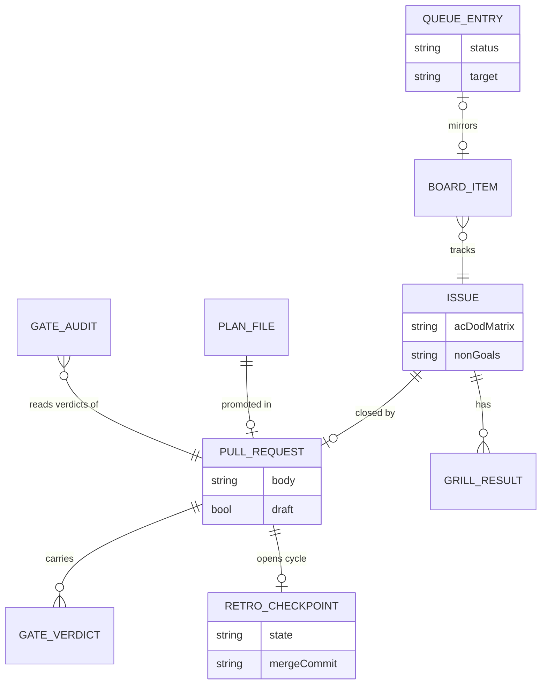

