

## Security and trust boundaries

dev-loops runs agents that execute commands on the operator's machine, and those agents read text from public GitHub surfaces. The code draws three boundaries around that risk. The first is comment trust: one predicate in `packages/core/src/github/comment-trust.mjs` decides at ingestion whether comment text may reach an agent, and the `.devloops` `trust` block extends it only from the default branch (ADR 0238, 0273, 0290). The second is the write side: agents and the operator share one GitHub credential, so a registry of operator-owned lines makes every sanctioned comment writer refuse the lines that only a human may post. The third is secret scanning: a secretlint adapter warns at pre-commit and blocks fail-closed at merge. Claude Code PreToolUse hooks add a fourth, harness-level layer that bounds what each agent role may run, write or dispatch.

### Trust boundaries from GitHub text to agent action

Type: `flowchart`

The diagram shows where untrusted text enters, where it is filtered, and which guards stand between an agent and a durable write. Insight: trust is decided once at ingestion, and the write-side guards hold independently of it, because a reader cannot tell an agent line from an operator line. Derived from `packages/core/src/github/comment-trust.mjs`, `packages/core/src/github/review-threads.mjs`, `scripts/github/_comment-trust-config.mjs`, `packages/core/src/github/comment-id-guard.mjs`, `packages/core/src/security/secret-scan.mjs`, `scripts/github/merge-pr.mjs` and `.claude/hooks/hooks.json`.

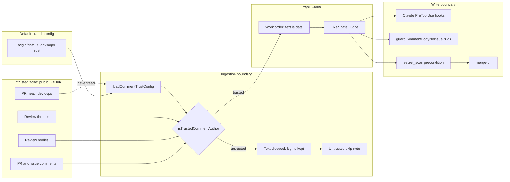

### Comment author trust predicate

Type: `flowchart`

The diagram traces `isTrustedCommentAuthor` branch by branch in source order. Insight: an exact sanctioned login wins only with a Bot type, every other Bot is untrusted unless configured, and a human is trusted only by the `OWNER`, `MEMBER` or `COLLABORATOR` association. A GraphQL comment the reading identity authored (`viewerDidAuthor`) is trusted before this predicate runs. "Bot" means a Bot type or a `[bot]` login suffix; a `trust.reviewers` entry with a `[bot]` suffix also requires the Bot type. Derived from `packages/core/src/github/comment-trust.mjs` and `docs/decisions/0238-comment-text-from-non-maintainers-never-reaches-an-agent.md`.

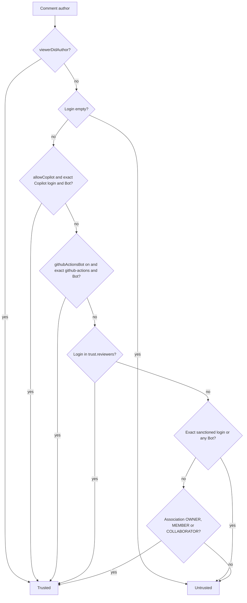

### Trust config load from the default branch

Type: `sequenceDiagram`

The diagram shows one entry script loading the `trust` block before its first trust read. Insight: the load never fetches and never reads the worktree or PR head, so a PR cannot grant itself trust, and every failure except "no file or no key" refuses with exit 3 instead of falling back to defaults that would undo a `githubActionsBot: false` opt-out. The count of 36 loading entry scripts comes from `grep -rl "loadCommentTrustConfigOrExit" scripts --include='*.mjs' | grep -v test | wc -l` (37 files, minus the loader itself). Derived from `scripts/github/_comment-trust-config.mjs`, `scripts/loop/standing-authorization.mjs`, `packages/core/src/config/config.mjs` and `docs/decisions/0290-comment-trust-config-in-devloops.md`.

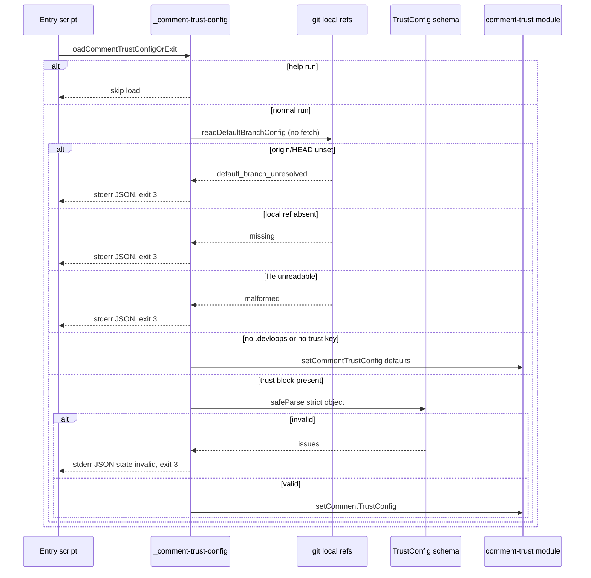

### Review thread trust lifecycle

Type: `stateDiagram-v2`

The diagram shows the states a review thread takes after `parseReviewThreads` classifies it. Insight: an all-untrusted thread is neither an act item nor a merge blocker, but a truncated thread stays a blocker with no text, and a maintainer resolve clears a skip, so there is no lockout. Derived from `packages/core/src/github/review-threads.mjs`, `scripts/github/_untrusted-skip-note.mjs` and `docs/decisions/0238-comment-text-from-non-maintainers-never-reaches-an-agent.md`.

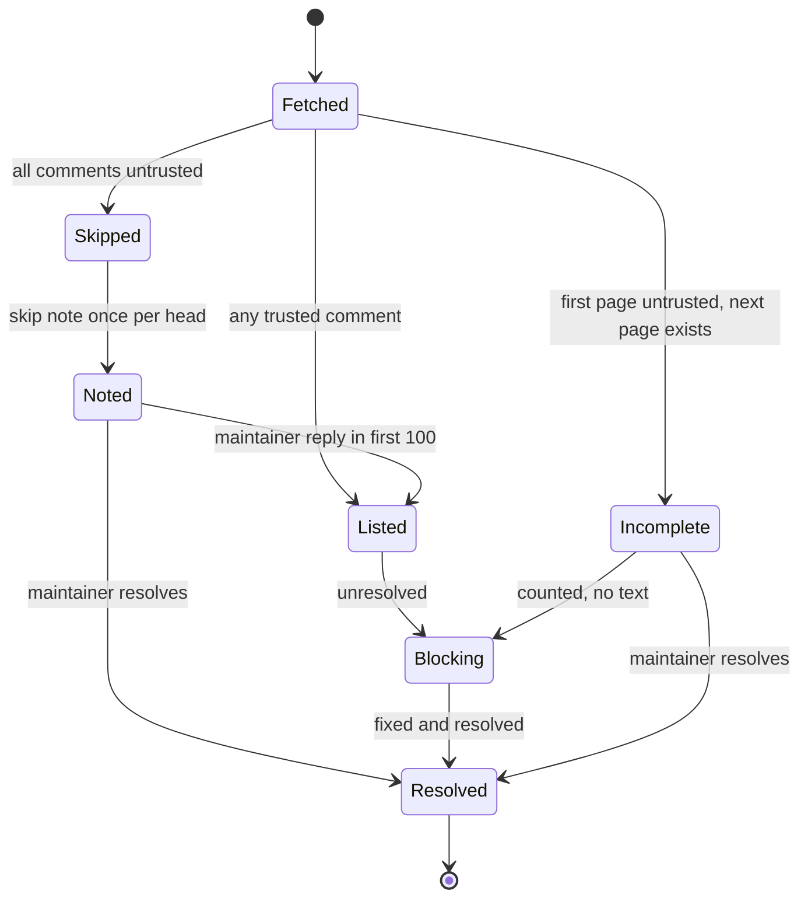

### Security rules as requirements

Type: `requirementDiagram`

The diagram lists the rules the code enforces and the module that satisfies or verifies each one. Insight: every rule fails closed, and the merge gate is the single hard stop for secrets while pre-commit only warns. The approval rule binds escalated merges; a drain merge also accepts a recorded standing authorization. The repository-permission check (write, maintain or admin) that ADR 0238 defers is spec-only and is not shown as satisfied. Derived from `packages/core/src/github/comment-trust.mjs`, `scripts/github/_comment-trust-config.mjs`, `packages/core/src/github/operator-owned-lines.mjs`, `packages/core/src/security/secret-scan.mjs`, `packages/core/src/loop/merge-approval.mjs` and `scripts/github/merge-pr.mjs`.

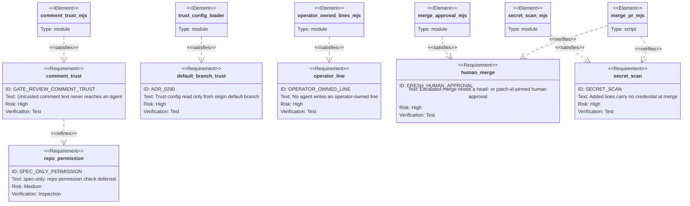

### Trust data model

Type: `erDiagram`

The diagram shows the entities the predicate reads and the config that extends it. Insight: trust attaches to each comment, a thread is skipped as untrusted only when its fetched comments hold no trusted one and no further page exists (otherwise it is `trustIncomplete`), and `trust.reviewers` only adds trust on comment surfaces while merge approval still excludes every Bot and counts only maintainer associations. Derived from `packages/core/src/config/config.mjs` (`TrustConfig`), `packages/core/src/github/review-threads.mjs`, `packages/core/src/loop/merge-approval.mjs` and `scripts/github/detect-checkpoint-evidence.mjs` (association-only approval facts).

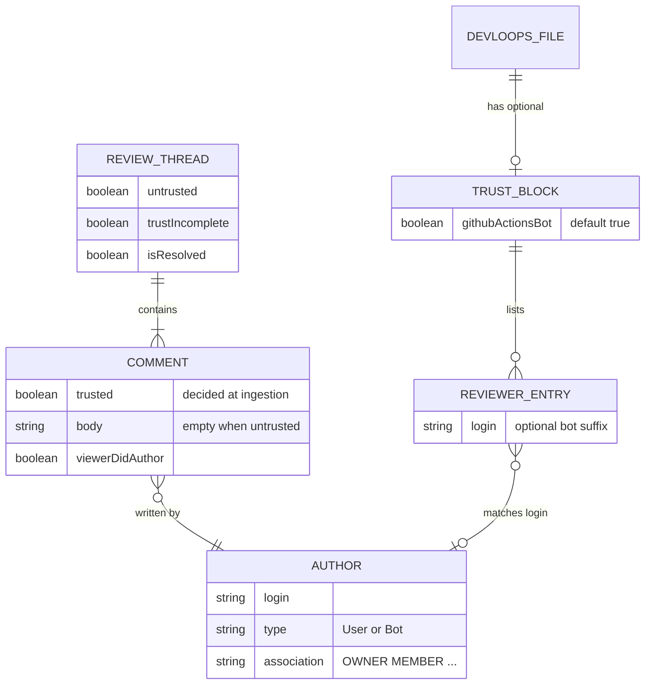

### Security modules and their exports

Type: `classDiagram`

The diagram shows the security modules as classes with their public functions and the call edges between them. Insight: the comment writers reach the operator-owned registry only through `guardCommentBodyNoIssuePrIds`, and the secret scanner is a thin adapter with no detector of its own. The count of 4 registry entries comes from `grep -c 'id: "' packages/core/src/github/operator-owned-lines.mjs`. Derived from `packages/core/src/github/comment-trust.mjs`, `packages/core/src/github/operator-owned-lines.mjs`, `packages/core/src/github/comment-id-guard.mjs`, `packages/core/src/security/secret-scan.mjs` and `scripts/security/scan-staged-diff.mjs`.

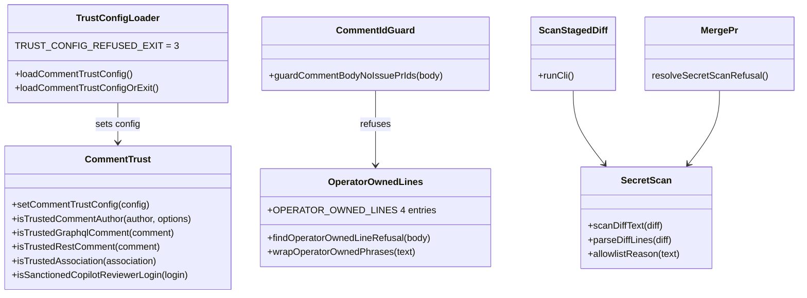

### Operator-owned line write guard

Type: `flowchart`

The diagram shows how a sanctioned comment writer handles each of the 4 registry entries. Insight: non-gate writers refuse, gate writers wrap the phrase in a code span so it asserts nothing, and only the Copilot body-disposition `operator` marker is cleared by `--standing-authorization`; `approve merge` and `approve release` have no override. Derived from `packages/core/src/github/operator-owned-lines.mjs`, `packages/core/src/github/comment-id-guard.mjs` and `docs/decisions/0258-operator-owned-line-registry.md`.

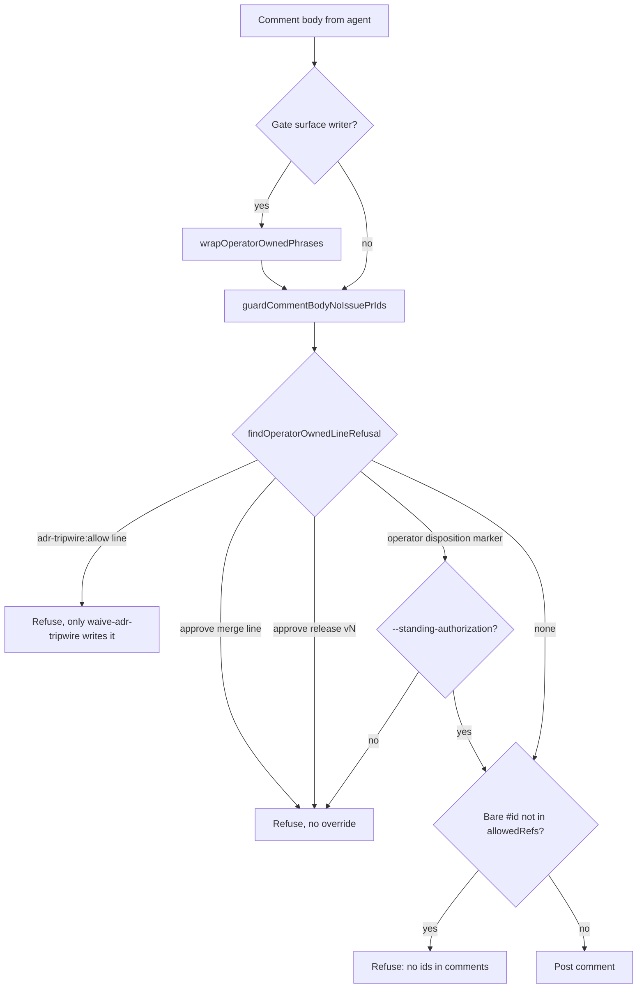

### Secret scan enforcement split

Type: `flowchart`

The diagram shows the two call sites of `scanDiffText` and how each treats a hit or a scanner error. Insight: warn locally, block at merge; a blocking false positive costs an agent loop a stopped pass, so the only blocking path uses the maintained secretlint preset, and a finding never carries the matched value. Derived from `packages/core/src/security/secret-scan.mjs`, `scripts/security/scan-staged-diff.mjs`, `packages/core/src/loop/default-branch-guard.mjs` and `scripts/github/merge-pr.mjs`.

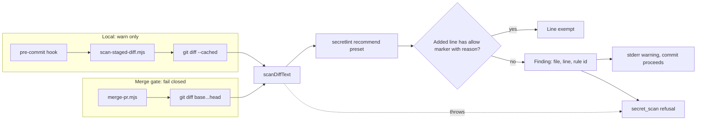

### Untrusted input surfaces and mitigations

Type: `mindmap`

The mindmap groups the surfaces that can carry attacker-controlled text toward an agent and the mitigation the code applies to each. Insight: the residual risk is the trust ceiling, because a workflow that echoes fork input under the GitHub Actions identity, or a configured `trust.reviewers` login, is trusted on every gate-evidence surface. Derived from `scripts/github/write-gate-context.mjs`, `scripts/loop/emit-fixer-work-order.mjs`, `scripts/loop/emit-judge-work-order.mjs`, `scripts/github/_untrusted-skip-note.mjs`, `docs/decisions/0273-github-actions-bot-is-a-trusted-comment-author.md` and `docs/decisions/0290-comment-trust-config-in-devloops.md`.

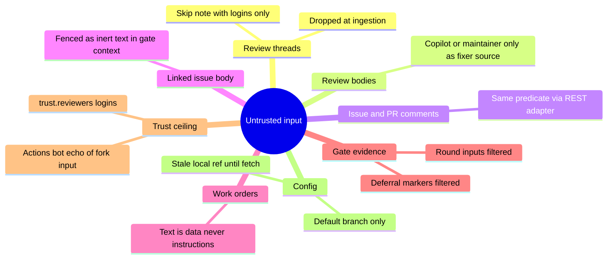

### Comment trust decision history

Type: `timeline`

The timeline orders the accepted decision records that shaped comment trust and the write-side registry. Insight: the trusted set started closed with no configuration surface, gained exact-login bots one at a time, and became configurable only after the default-branch read made self-granted trust impossible. Derived from the Status lines of `docs/decisions/0233-fixer-work-order-from-review-body.md`, `docs/decisions/0238-comment-text-from-non-maintainers-never-reaches-an-agent.md`, `docs/decisions/0240-copilot-reviewer-matched-by-exact-login.md`, `docs/decisions/0247-untrusted-comment-skip-note-and-issue-comment-readers.md`, `docs/decisions/0248-detector-evidence-trust-filter.md`, `docs/decisions/0258-operator-owned-line-registry.md`, `docs/decisions/0273-github-actions-bot-is-a-trusted-comment-author.md` and `docs/decisions/0290-comment-trust-config-in-devloops.md`.

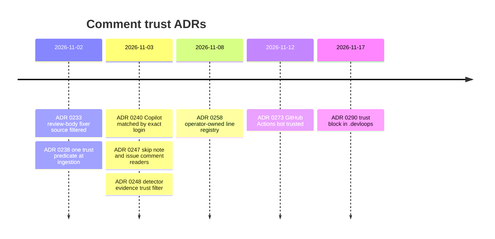

### Claude Code PreToolUse guard layer

Type: `flowchart`

The diagram shows which hook runs for which Claude Code tool event. The main-agent and coordinator write boundaries run only when `DEVLOOPS_MAIN_AGENT_READONLY=1` or `DEVLOOPS_COORDINATOR_READONLY=1` is set. Insight: these hooks bound agent roles independently of comment trust, so a fixer that was steered anyway still cannot write outside its pulled work order's mutation authority, and a coordinator cannot dispatch arbitrary agents. The approval record guard and the ask answers guard keep an agent from forging the merge approval answer (`MERGE-ASK-APPROVAL`, ADR 0315). Derived from `.claude/hooks/hooks.json`, `.claude/hooks/pre-tool-use-approval-guard.mjs`, `.claude/hooks/pre-tool-use-ask-answers-guard.mjs`, `.claude/hooks/pre-tool-use-bash-gate.mjs`, `.claude/hooks/pre-tool-use-write-guard.mjs`, `.claude/hooks/pre-tool-use-agent-guard.mjs` and `.claude/hooks/_bash-gate-decisions.mjs`.

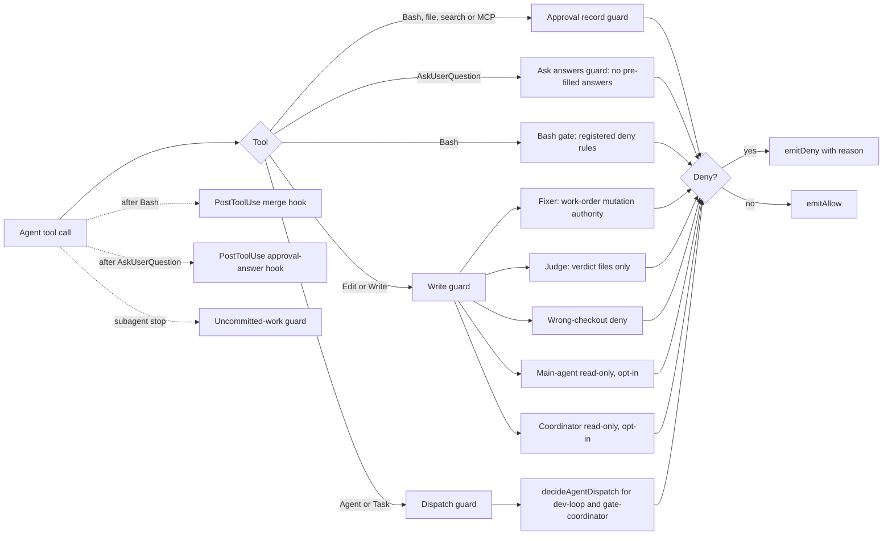

### Merge approval path

Type: `flowchart`

The diagram shows how the merge gate decides whether a merge is authorized. Insight: the `approve merge` operator line is the only comment that can authorize an escalated merge; it must open its line, come from the named human login and match the current head, or carry a `patch-id` that matches the current diff so a base-only head change keeps the approval (ADR 0279), and the operator-owned registry refuses it on every agent write path. Derived from `packages/core/src/loop/merge-approval.mjs` (`resolveMergeClass`, `verifyFreshHumanApproval`, `resolveMergeApprovalDecision`), `scripts/github/merge-pr.mjs` and `packages/core/src/github/operator-owned-lines.mjs`.

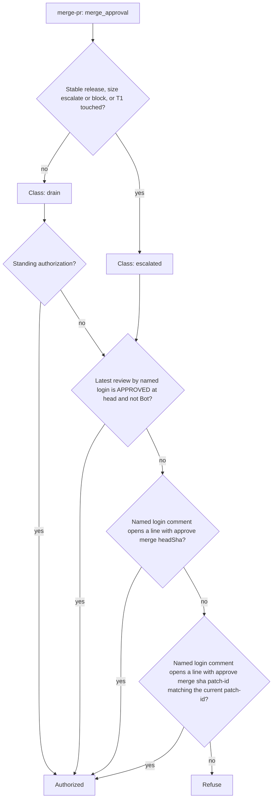

