

## The repo in numbers

This section counts the repository at commit `f6619004d` on `main` (2026-11-23). Every number comes from a shell command run in the repository root, and each caption names that command. The counts show a code base of 1691 tracked files that is mostly `.mjs` code and Markdown prose. Tests outnumber scripts in most areas. One contract, the gate review sub-loop, defines about a quarter of all rule IDs (73 of 304 unique IDs). The ADR rate is highest in the partial month of November 2026, and the CHANGELOG grew fastest between 1.0.3 and 1.0.9.

### Tracked files per top-level directory

Type: `xychart-beta`

The bar chart shows tracked files per top-level directory. `test` is the largest directory, and `docs`, `scripts` and `packages` follow at similar sizes, so tests, prose and code carry about equal file weight. Counts come from `git ls-files | awk -F/ 'NF>1{print $1}' | sort | uniq -c | sort -rn`; the total of 1691 comes from `git ls-files | wc -l`, and the 14 root files are that total minus the directory sum. Directories with 3 or fewer files (`.pi`, `.llmwiki`, `schemas`, `lib`, `cli`, `.claude-plugin`) are left out. Sources: `test/`, `docs/`, `scripts/`, `packages/core/`, `skills/`.

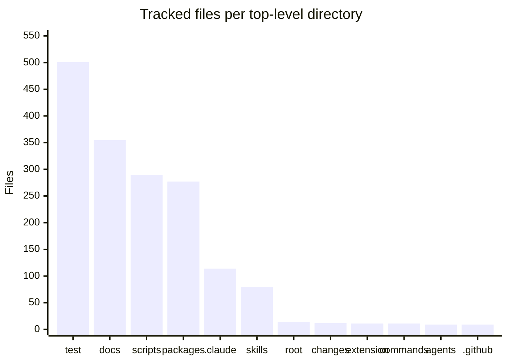

### Tracked files by extension

Type: `pie`

The pie shows the file mix by extension. `.mjs` code and `.md` prose make up 1628 of 1691 files, which matches a repo whose behavior lives in ES modules and whose rules live in Markdown contracts. Counts come from `git ls-files | sed -nE 's/.*\.([a-z]+)$/\1/p' | sort | uniq -c | sort -rn`; "other" is 1691 minus the listed counts and covers files with fewer than 10 per extension or no lowercase extension. Sources: `cli/index.mjs`, `packages/core/`, `skills/docs/`.

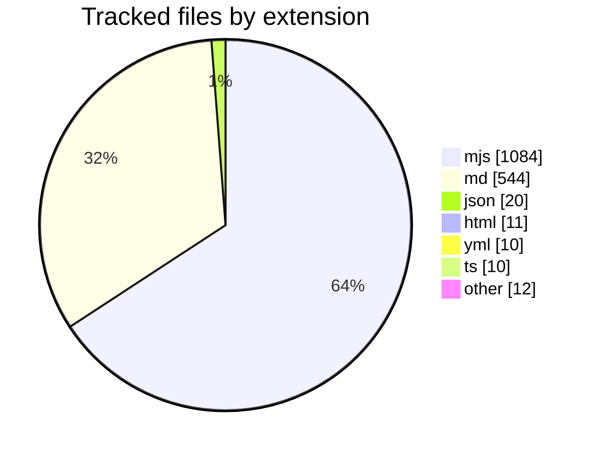

### Test files per area

Type: `pie`

The pie shows where the 594 test files live. `test/loop`, `packages/core`, `test/github` and `test/contracts` hold 522 of them, so tests concentrate on the loop engine, the core package, the GitHub layer and the contract checks. Counts come from `git ls-files '*.test.*' | awk -F/ '{print $1"/"$2}' | sort | uniq -c | sort -rn`, and the total from `git ls-files '*.test.*' | wc -l`. "test (root)" sums the 21 single files directly under `test/`; "other" sums `test/lib` (4), `test/unit` (3), `test/pages` (3), `skills/dev-loop` (3), `test/security` (2) and `test/release` (2). Sources: `test/`, `packages/core/`.

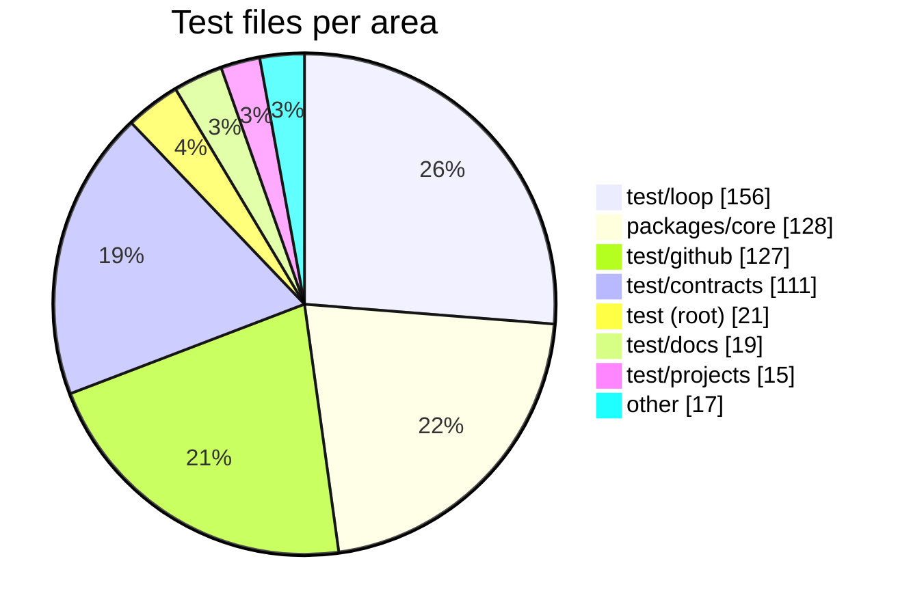

### Script files per namespace

Type: `pie`

The pie shows script files per `scripts/` namespace. `scripts/loop` and `scripts/github` hold 222 of 279 namespaced script files, so loop control and GitHub I/O carry most of the script surface. Counts come from `for d in scripts/*/; do echo "$(git ls-files "$d" | grep -E '\.(mjs|js|sh)$' | wc -l) $d"; done | sort -rn`. The 8 root-level script files such as `scripts/verify.mjs` are excluded; `git ls-files scripts | grep -E '^scripts/[^/]+\.(mjs|js|sh)$' | wc -l` counts them. Sources: `scripts/loop/`, `scripts/github/`, `scripts/README.md`.

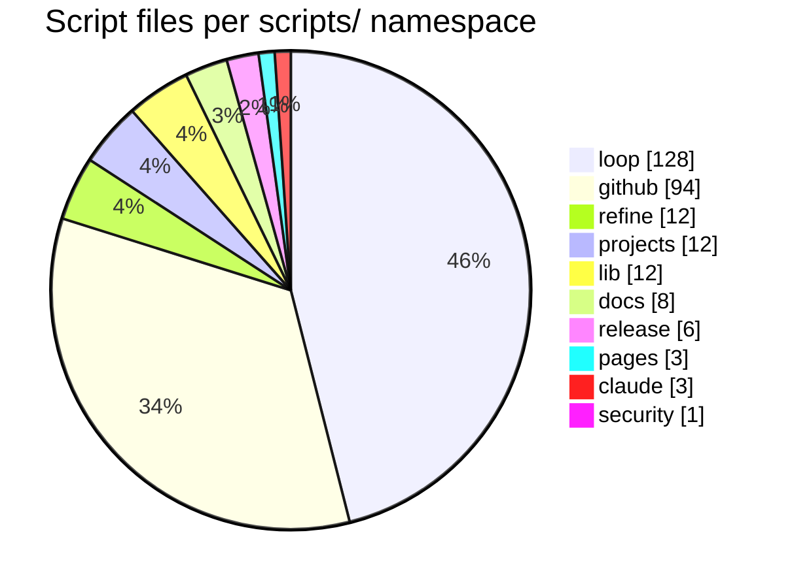

### Scripts against tests per area

Type: `radar-beta`

The radar puts script files and test files for the same area side by side. Tests exceed scripts in `loop`, `github`, `projects`, `docs` and `security`, and `pages` is even; `lib` and `release` have fewer tests than scripts. Script counts come from the namespace command in the previous caption; test counts come from `git ls-files '*.test.*' | awk -F/ '{print $1"/"$2}' | sort | uniq -c`, matching `scripts/<area>` to `test/<area>`. `refine` and `claude` have no `test/<area>` folder and are left out. Sources: `scripts/`, `test/`.

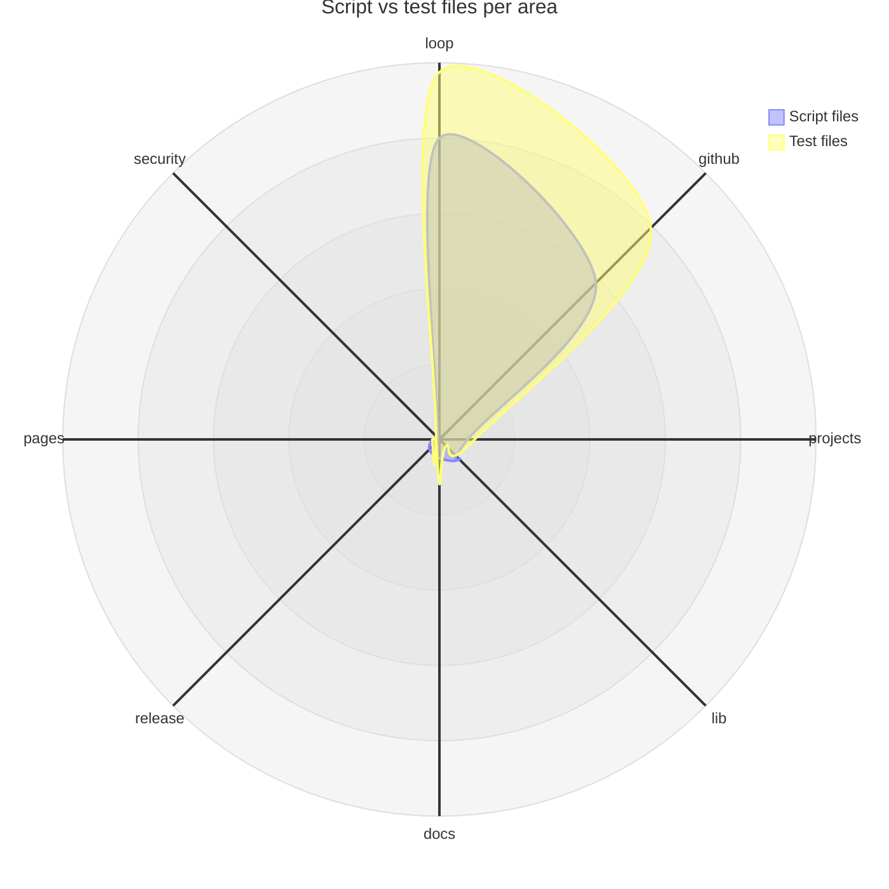

### Rule IDs per prefix

Type: `radar-beta`

The radar shows the eight largest rule ID prefixes. A rule ID is defined by a `<!-- rule: <ID> -->` marker in `skills/docs/`. There are 304 unique rule IDs in 31 files, and the `GATE` prefix alone holds 88 of them. Counts come from `grep -rhoE '<!-- rule: [A-Z0-9-]+ -->' skills/docs | sort -u | awk '{print $3}' | cut -d- -f1 | sort | uniq -c | sort -rn`; the total comes from the same pipeline ending in `wc -l`, and the file count from `grep -rlE '<!-- rule: ' skills/docs | wc -l`. Sources: `skills/docs/contract-style-guide.md`, `skills/docs/gate-review-sub-loop-contract.md`.

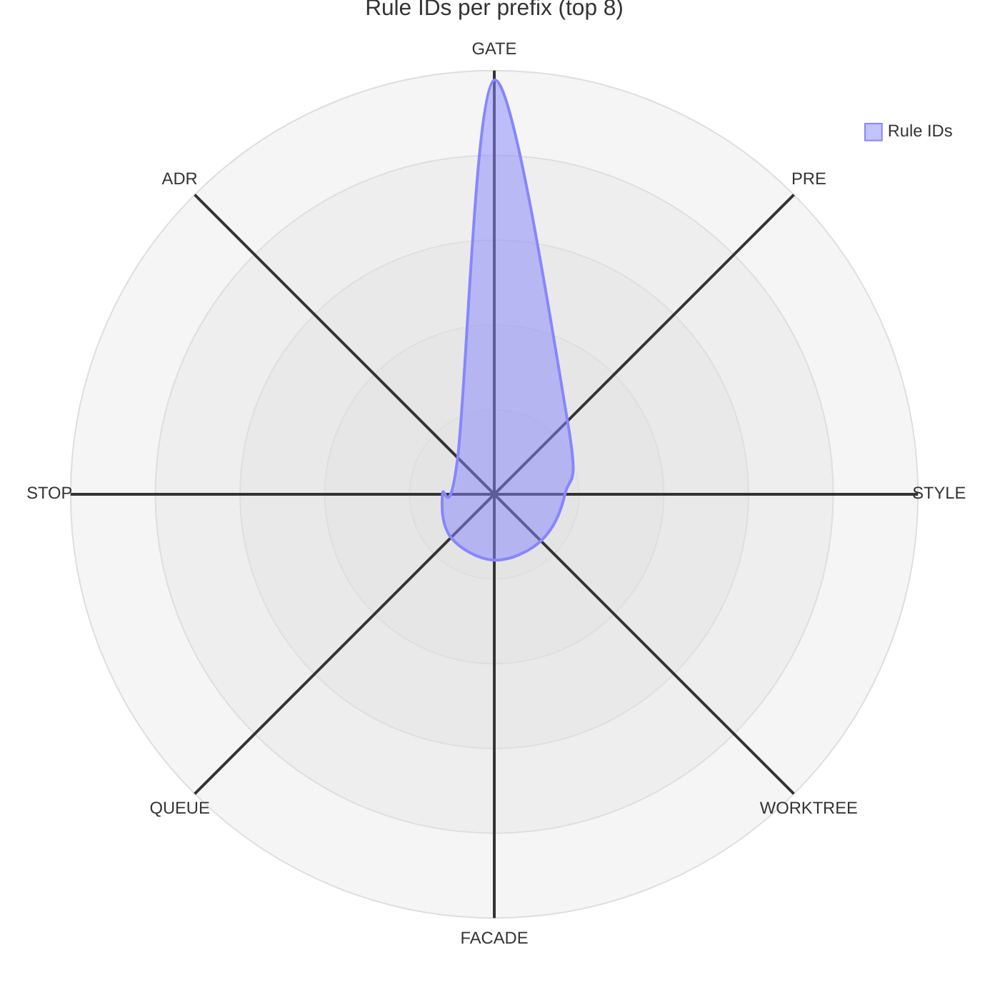

### Rule markers per contract file

Type: `xychart-beta`

The bar chart shows the ten files under `skills/docs/` with the most rule markers. `gate-review-sub-loop-contract.md` carries 74 markers, three times the next file, so gate review is the most tightly specified surface. Counts come from `grep -rcE '<!-- rule: ' skills/docs | grep -v ':0$' | sort -t: -k2 -rn | head -10`. The 74 markers in the gate file name 73 unique IDs, per `grep -hoE '<!-- rule: [A-Z0-9-]+ -->' skills/docs/gate-review-sub-loop-contract.md | sort -u | wc -l`. The context: `ls skills/docs/*.md | wc -l` gives 47 Markdown files, and `ls skills/docs/*contract*.md | wc -l` gives 22 with "contract" in the name. Sources: the ten files named on the axis, all under `skills/docs/`.

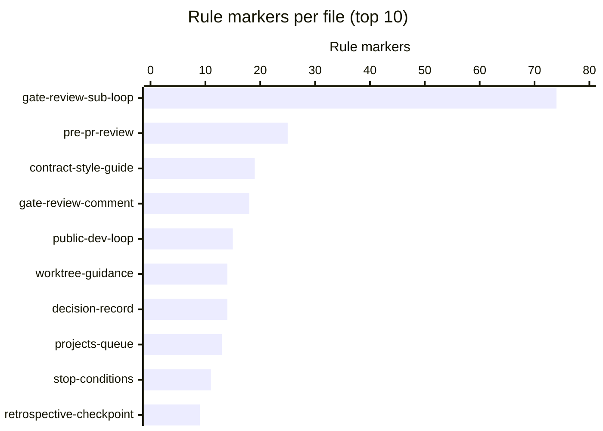

### ADRs added per month

Type: `xychart-beta`

The chart shows ADR files added under `docs/decisions/` per month, by the date of the commit that added each file. The first ADRs landed in July 2026, and the rate reached 90 in October and 95 in November. November is partial (up to 2026-11-23). Counts come from `git log --diff-filter=A --date=format:%Y-%m --format='D %ad' --name-only -- docs/decisions | awk '/^D /{m=$2;next} /\.md$/{print m}' | sort | uniq -c`; they sum to 294, which matches `git ls-files docs/decisions | wc -l` (this includes `0000-template.md`). Source: `docs/decisions/`.

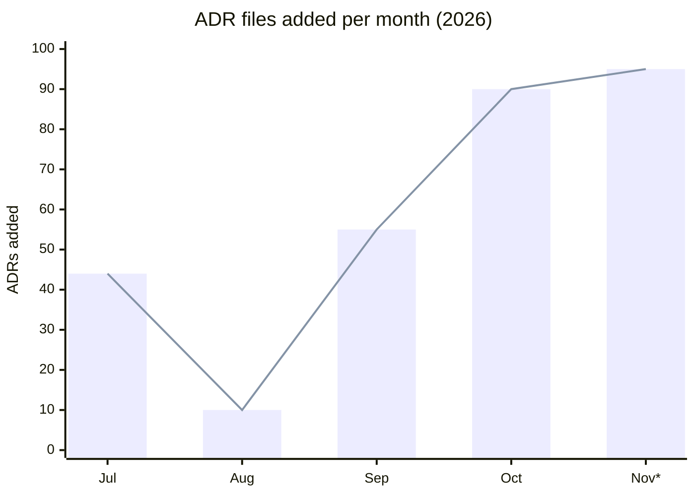

### ADR status

Type: `pie`

The pie shows the status line of each ADR. 281 of 293 records are Accepted, so most decisions are settled and few are superseded. Counts come from `for f in docs/decisions/0*.md; do awk '/^## Status/{getline; while($0=="")getline; print $1; exit}' "$f"; done | sort | uniq -c`. "Accepted" sums the plain form (246), the "Accepted," form with an amendment note (34), and one record the pipeline misses: `grep -lE '^Status: ' docs/decisions/0*.md` finds `0062-bun-development-toolchain.md`, which uses an inline `Status: Accepted` line instead of a `## Status` heading. The template file `0000-template.md` has a comment as its status line and is excluded. Source: `docs/decisions/`.

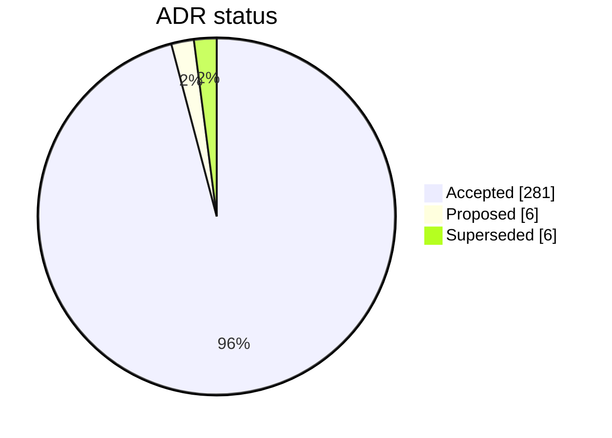

### Commits per month

Type: `xychart-beta`

The chart shows commits on `main` per month. Commit volume was highest in the first month (May 2026) and fell as work moved from bulk build-out to issue-sized PRs. ADR output rose over the same period (previous chart). November is partial (up to 2026-11-23). Counts come from `git log --date=format:%Y-%m --format=%ad | sort | uniq -c`, and the total of 2332 from `git rev-list --count HEAD`. Source: the git history of the repository.

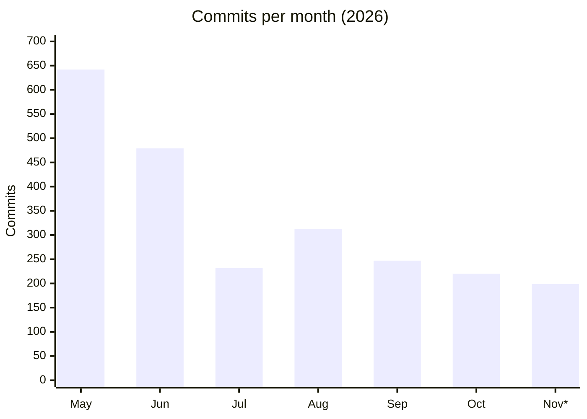

### CHANGELOG entries per 1.0 release

Type: `xychart-beta`

The chart shows top-level CHANGELOG bullets per release from 1.0.0-rc.1 to 1.0.12-pre.6. The 1.0.3 to 1.0.9 releases carry the most entries, with a peak of 112 at 1.0.6. The 1.0.12 pre-releases up to pre.5 are small, which fits the early-pre cut pattern, and pre.6 carries 84. Counts come from `awk '/^## /{r=$2} /^- /{c[r]++} END{for(k in c) print c[k], k}' CHANGELOG.md | sort -k2 -V`; nested bullets are not counted. 1.0.1 has a `## 1.0.1` heading with one prose paragraph and no bullet, so the command prints no line for it and the chart shows 0. The axis is in release order, with pre-releases before their stable release; `sort -V` prints `1.0.0` before the rc builds and `1.0.2` before `1.0.2-pre.0`. Axis labels shorten `1.0.0-rc.N` to `rcN`, `1.0.N` to `N`, `1.0.2-pre.0` to `2pre0`, `1.0.2-slim.0` to `2slim0`, and `1.0.12-pre.N` to `12pN`. Source: `CHANGELOG.md`.

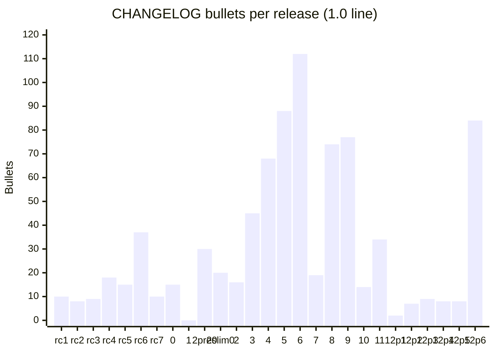

### CHANGELOG entries per 0.x release

Type: `xychart-beta`

The chart shows top-level CHANGELOG bullets per 0.x release. The 0.5.0 and 0.7.0 minors each carry about 30 entries, and most patch releases carry 1 to 6. Counts come from the same command as the previous chart: `awk '/^## /{r=$2} /^- /{c[r]++} END{for(k in c) print c[k], k}' CHANGELOG.md | sort -k2 -V`. Source: `CHANGELOG.md`.

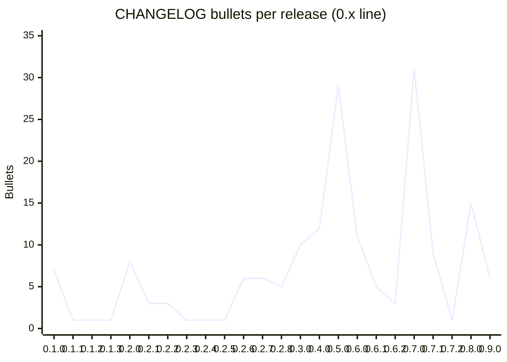

