

## Ideas and roadmap (not decided)

This section maps what the backlog proposes, not what the code does. Every item here is not decided. Milestones are planning labels that the operator moves, and an open issue can change scope, move or close without shipping. The v2 epic states that it "defines requirements to qualify, not delivered capabilities", and a search of the repository code finds no v2 runtime (no Octokit and no SQLite store), so every v2 diagram is marked spec-only. The only code hits for "sqlite" are the `--experimental-sqlite` Node flag in `packages/core/src/loop/bash-command-classify.mjs` and its hook copy. All issue counts come from one snapshot on 2026-11-19 of `gh issue list --state open --limit 200 --json number,title,milestone`, run in the repository checkout, which returned 153 open issues. Local phase status comes from `docs/IMPLEMENTATION_STATE.md` and `docs/phases/phase-8.md`.

### Open issues per milestone

Type: `xychart-beta`

Bar chart of the 153 open issues grouped by milestone label. The insight: the near patch milestone v1.0.12 holds 41 issues, more than any later milestone, so the backlog leans toward near fixes, and v2.0.0 holds only 5 planning issues. All counts are from `gh issue list --state open --limit 200 --json number,title,milestone`, grouped by `milestone.title`. Every milestone assignment is not decided. Source: that command output; milestone order follows the version numbers.

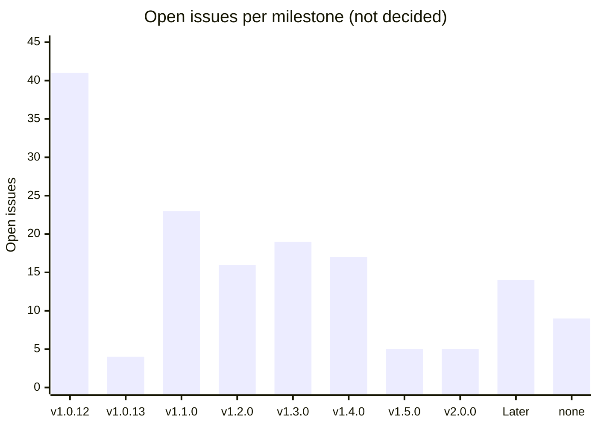

### Open issues by title type

Type: `pie`

Share of the 153 open issues by the conventional prefix in the title (`fix`, `feat`, `gate` and so on). The insight: fixes (63) outnumber features (28) by more than two to one, so most open work repairs the existing v1 loop rather than adding surface. The numbers come from `gh issue list --state open --limit 200 --json number,title,milestone` followed by a title-prefix tally (`grep -oE '^[a-zA-Z-]+[(:]'`); "planning" groups epic, rfc, research and design; "other prefix" groups size, refactor, pre-pr, perf and contracts. Not decided.

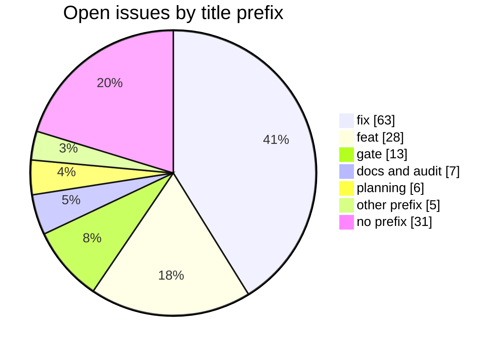

### Backlog themes by scope tag

Type: `mindmap`

Mind map of the scope tags in open issue titles, such as `fix(gate)` or `feat(loop)`. The insight: the review gate dominates the backlog (24 titles tagged `gate`, plus 5 tagged `cost` that all target gate token cost), and hooks and dispatch form the next cluster. Counts come from `gh issue list --state open --limit 200 --json number,title,milestone` and a tally of the parenthesized scope tag in each title. The map shows a selection: untagged titles and smaller tags (for example `github` 2 and about 20 single-use tags) are left out. Not decided.

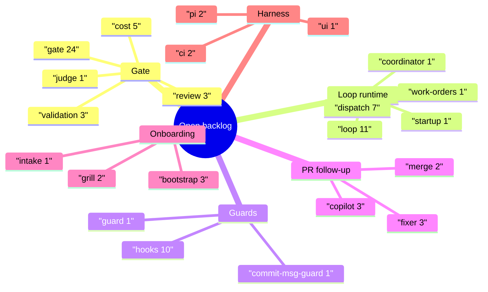

### Horizon versus scope of selected open items

Type: `quadrantChart`

Quadrant chart of twelve selected open issues and epics. The x value is derived from the milestone label (v1.0.12 = 0.1 up to v2.0.0 = 0.95, Later = 0.85). The y value is the analyst's estimate of scope breadth (a single fix is low, an epic or runtime rewrite is high); it is not a measured value. The insight: the broad items (v2 epic 2995, review-expectations epic 2840, bootstrap 2723) all sit on the far horizon, and the near milestone holds narrow fixes plus one broad gate change (soft round caps 3105). Positions are not decided. Source: `gh issue list --state open --limit 200 --json number,title,milestone`.

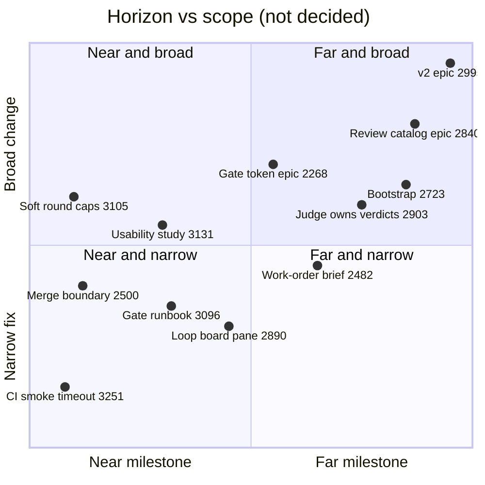

### Milestone horizon with representative items

Type: `timeline`

Timeline of the milestone labels in version order, with two or three representative open titles per milestone. The insight: v1.0.12 through v1.5.0 continue the v1 patch and minor lane (gate cost, judge authority, hook hardening), and v2.0.0 is a separate planning track. Milestone membership comes from `gh issue list --state open --limit 200 --json number,title,milestone`. Dates are not assigned to any milestone in the issue data, so the axis shows order only. Not decided.

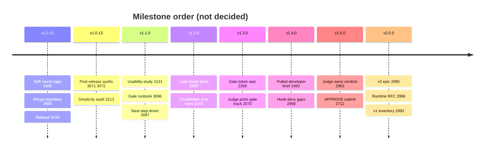

### Open work as a board

Type: `kanban`

Board view of a sample of open issues, one column per milestone group. The insight: only the first column is the active release lane; the other columns are parked proposals that the operator can reorder at any time. Membership comes from `gh issue list --state open --limit 200 --json number,title,milestone`. The card selection is the analyst's sample, not a priority order. Not decided.

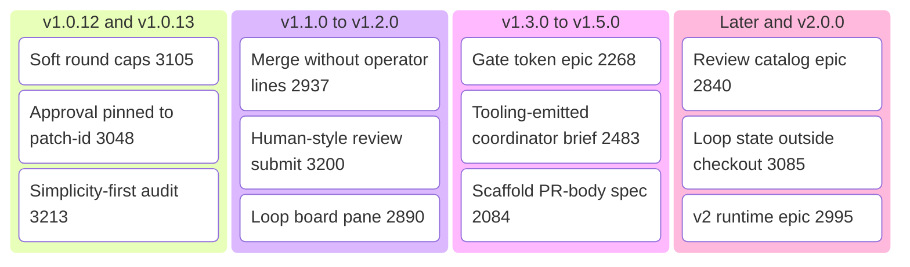

### Local phase status

Type: `stateDiagram-v2`

State diagram of the local durable phases. Phases 0 to 6 are complete, Phase 7 (second-repo pilot) is deferred and not started, and Phase 8 (workflow configuration contract) is active with slice 1 on `main`. The insight: Phase 8 was pulled forward ahead of Phase 7, and the state file leaves later phases undescribed on purpose, so any phase after 8 is not decided. Derived from `docs/IMPLEMENTATION_STATE.md` and `docs/phases/phase-8.md`; no count is shown.

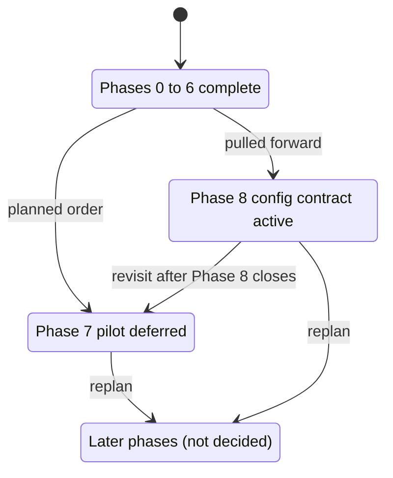

### v2 required scope areas (spec-only)

Type: `mindmap`

Mind map of the required v2.0.0 scope table in the v2 epic (issue 2995). The insight: v2 moves lifecycle coordination from agent prose into an application with a SQLite store and an Octokit adapter, keeps Claude Code as the primary frontend, and limits deployment to one host per runtime. None of this exists in code: a search of `*.mjs`, `*.js`, `*.ts` and `*.json` files finds no Octokit import and no SQLite store; the only "sqlite" hit is the `--experimental-sqlite` Node flag listed in `packages/core/src/loop/bash-command-classify.mjs`. Spec-only and not decided. Source: v2 epic issue 2995 body (`gh issue view 2995 --json body`).

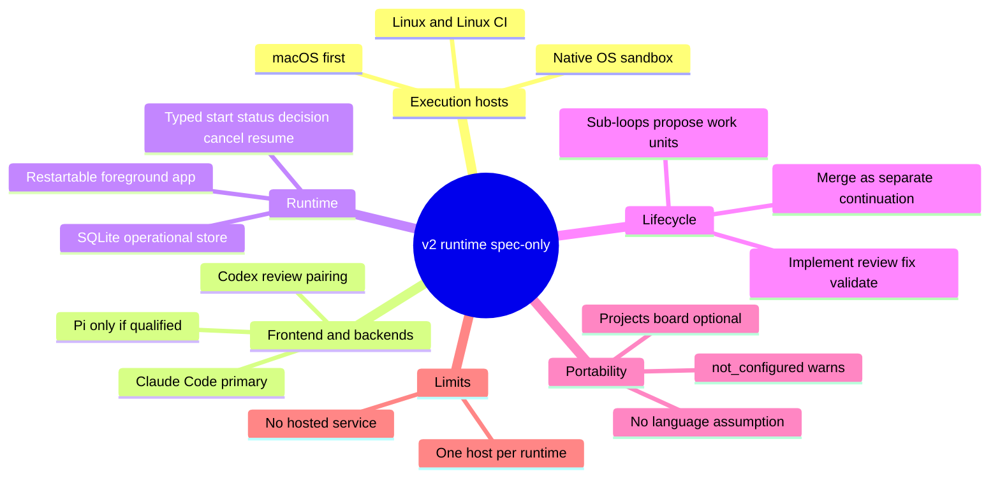

### v2 delivery phases (spec-only)

Type: `flowchart`

Dependency graph of the v2 delivery phases P0 to P5 from the v2 epic. The insight: P0 (architecture baseline) fans out into three parallel tracks, P0-B (trusted v1 delivery proof) must land before substantive slice merges, and the first useful pilot (P3) waits on the executable lifecycle, the runtime probes and shared-target exclusion. The epic states that phases are planning scopes, not existing implementation children. Spec-only and not decided. Source: v2 epic issue 2995, section "Delivery phases".

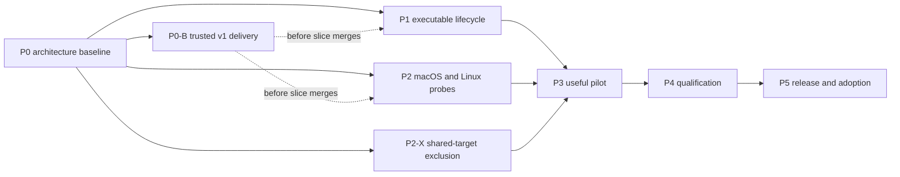

### v2 proposed branch line (spec-only)

Type: `gitGraph`

Git graph of the proposed delivery line in the v2 epic: maintained v1 stays on protected `main`, tested v2 slices land on a protected `integration/v2` branch created from a recorded approved commit after stable v1.0.9, and a protected `maintenance/v1` release path is qualified before v2 replaces v1 on `main`, when adoption still needs it. The insight: v1 patches keep shipping while v2 integrates, and v1 changes reach v2 through reviewed sync PRs. No `integration/v2` branch is created by this plan. Spec-only and not decided; commit labels are synthetic. Source: v2 epic issue 2995, section "Trusted delivery, coexistence and release".

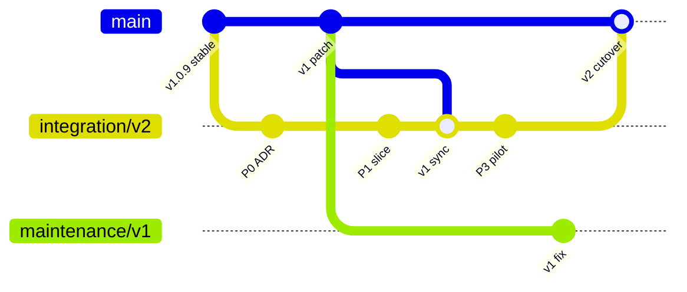

### v2 controller-loss recovery (spec-only)

Type: `sequenceDiagram`

Sequence of the controller-loss scenario that the v2 epic requires the backend contract to survive. The controller persists the operation identity before launch; if it dies after a successful launch but before it records the execution reference, a restarted controller must find the existing execution or establish non-start, and must never start a second mutator. The epic leaves the lookup mechanism open (backend-native lookup or durable supervisor registration), so the "Backend" participant stands for either. The insight: recovery keys on the persisted operation identity, not on the returned reference, and an unresolved launch stays ambiguous and blocks replacement. Spec-only and not decided; v1 has no such runtime. Source: v2 epic issue 2995, section "Work orders, recovery and supervision".

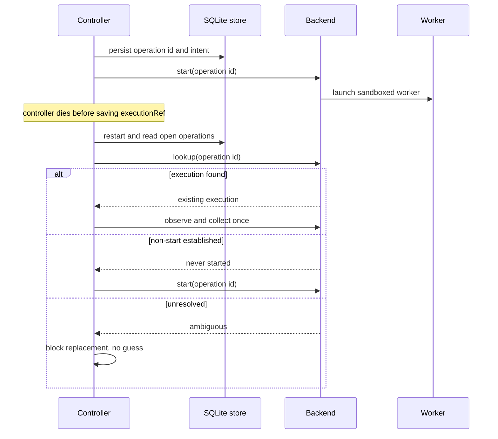
