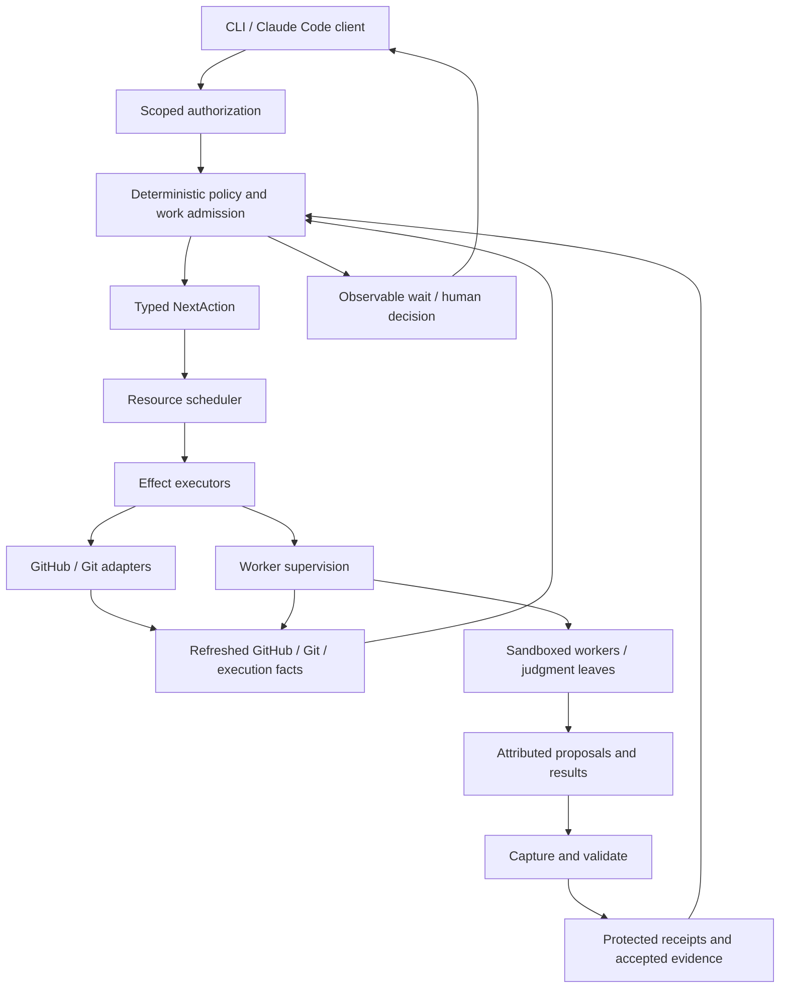

# 0217. Application-owned v2 runtime with bounded agent work

## Status

Proposed

## Context

[RFC #2996](https://github.com/mfittko/dev-loops/issues/2996) owns this decision-only record for [the v2 umbrella](https://github.com/mfittko/dev-loops/issues/2995). The [review disposition](https://github.com/mfittko/dev-loops/issues/2995#issuecomment-6546311049) records the operator's requirements: adaptive sub-loops with controlled dispatch, native sandboxing before mandatory containers, macOS priority with Linux execution from the outset, operation-specific effect guarantees, and existing local subscriptions, especially Claude Code.

The [harness decision](https://github.com/mfittko/dev-loops/issues/2995#issuecomment-6525868020) selects Claude Code as frontend/default worker and Codex as the first additional backend. The [transition clarification](https://github.com/mfittko/dev-loops/issues/2995#issuecomment-6526068786) retains v1 as the delivery system until v2 is qualified and adopted. These requirements are not proof that the proposed process, authentication or isolation arrangements work together.

V1 already has deterministic work orders, reconciliation policy and execution evidence. Its process-ownership limits are explicit in ADR 0081. V2 must establish application-owned execution and recovery without rediscovering those foundations or claiming that TypeScript, Octokit or SQLite supplies workflow correctness.

This proposed record separates the accepted product requirements from architectural resolutions still under review. In particular, exact-byte runtime delivery, the host-supervision arrangement, CI ownership separation and the preference for dormant incremental integration are proposals here. This PR does not change active v1 policy or certify any runtime configuration.

## Decision

### 1. One application owns the workflow

Use a modular TypeScript/Node application, with a programmatic core and thin CLI/Claude Code clients. Reconciliation selects semantic actions from refreshed observations, accepted evidence and scoped authorization. The scheduler admits selected work to available resources; executors perform it. The supervisor supplies execution mechanisms and observations. Neither scheduling nor supervision may invent a different lifecycle action after failure.

Agents own semantic tasks, including planning, implementation and review. Humans retain the approval boundaries required by the governing policy. A completed worker result is evidence, not permission to merge or skip independent review.

Use Octokit in-process behind a domain adapter. Keep SDK response shapes, SQL and host paths outside policy. Validate external data at runtime. Consumer repositories remain language/framework agnostic: an absent optional validation command warns with `not_configured` and continues; configured failures, malformed configuration and unavailable required checks remain distinct failures. GitHub Projects is optional input.

### 2. Adaptive decomposition uses controlled admission

A sub-loop may discover and propose independently executable work units. Deterministic policy admits them within the parent's authorized objective, permissions and cumulative limits. Routine in-scope decomposition needs no additional human approval. Scope expansion or changed obligations returns to the appropriate decision boundary.

A work order separates tooling-authored governing instructions from attributed task inputs. The proposal is data, like a finding or review comment; it cannot replace the parent's requirements. Tooling fixes the role, identities, authority references, capabilities, limits and output contract, and delivers that governing brief without model authorship or relay. Deterministic construction does not imply that every input or resulting implementation was generated deterministically.

When admission needs semantic assessment, reconciliation requests a bounded judgment leaf. Its identity-bound typed verdict becomes evidence for the next deterministic admission decision. The judge cannot dispatch the proposed units or grant permissions. Schema validity alone proves neither semantic scope nor correctness. Do not add a judgment call to every decomposition when mechanical conditions suffice.

Children inherit applicable restrictions and cannot reset accounting, weaken acceptance obligations, certify their own independence or authorize parent progression. Native delegation is supported only through the same admission and tracking contract. Ordinary tool subprocesses do not each require an agent work order, but remain within the execution boundary. Reuse the runtime's child-operation mechanisms rather than adding a second global scheduler or workflow language.

### 3. Persist operation evidence; reconstruct continuation

GitHub owns its current PR/review/check facts; Git owns commit/worktree facts; backends supply execution facts they can substantiate. Build an ephemeral `AuthoritySnapshot`; derive the next action rather than replaying a canonical stored phase or next-action pointer.

Use SQLite for protected local operation state: intents, attempts, execution references, owner generations, control intents, cumulative reservations/accounting and accepted evidence. Accepting a result and completing/accounting for its attempt must commit atomically. External calls occur outside database transactions. Large artifacts use protected storage with verified references; exports and status projections are not authority.

The persistence interface exposes only required domain operations. Do not implement speculative server-database adapters. Bind evidence to the applicable target, run, attempt, head/base, specification, policy, contract and round identities. Specification revisions are not Git SHAs. Missing, incomplete, stale or contradictory evidence is not a successful empty result. Producer authenticity does not establish semantic correctness.

P1 owns concrete schemas and migrations. P2 owns transactional/crash qualification. P4/P5 own usable export, backup/restore and upgrade qualification. Detailed storage settings and fault procedures belong to those work items, not this architecture record.

### 4. Effects require guarantees appropriate to their consequences

Persist stable intent before external effects. Record real attempts, returned resource identities and relevant response data. SDK retries must not hide ambiguous writes. After a lost acknowledgement, reconcile whether the effect occurred before retrying.

| Effect | Required guarantee |
| --- | --- |
| Historical reporting | Valid scope and ownership permit a report explicitly bound to its original revision/execution after head movement. It cannot satisfy obligations for a newer revision. |
| Authority-changing effects | Required preconditions must hold at the relevant effect boundary. Use authority-native conditional operations or effect-system-validated fencing where needed; refuse unsupported safety-critical guarantees with a supported remedy or explicit decision. |

Classification depends on consumers. A comment, label or check that authorizes progression is not merely informational. Historical reporting still requires permission, ownership and recovery; this distinction is not a blanket check-then-act exemption. An adapter records which conditions the external system enforces and which are local checks. Local leases cannot fence external writers or already-sent requests by assertion.

For the initial GitHub adapters, disagreement after a write enters bounded `pending_reconciliation`. Preserve receipts and refresh; do not infer event order from opaque ETags or unrelated timestamps, overwrite a genuinely later edit, or turn uncertainty into a duplicate write. Add a more specific stale-observation classifier only with demonstrated endpoint-specific causal evidence. Exhaustion produces a named recovery/decision outcome. Re-observation cannot retroactively authorize an unlawful effect.

Before enabling each authority-changing operation, its owning adapter work must resolve the exact preconditions and failure path. Human approval remains scoped and rechecked where applicable. This preserves ADR 0074's safety intent without demanding irrelevant latest-head freshness for a historical report.

### 5. The runner owns execution, not the frontend conversation

The initial process-owned lane uses runtime-delivered immutable work-order bytes through a supported CLI machine-input interface. The trusted emitter and runtime bind the semantic digest, applicable local materialization hash and preallocated execution identity. Qualify this transport first; do not implement parallel pull and push protocols by default. V1's verified pull protocol remains unchanged.

Record separately what emission, delivery to the selected execution and result association prove. An OS pipe write alone is not evidence that the harness accepted the complete work order; the adapter needs an execution-bound receipt or equivalent qualified evidence at its supported input boundary. No receipt claims that a model understood or obeyed the content. An inadequate interface disqualifies the configuration and returns the transport decision for review, rather than falling back to a model relay.

The backend contract includes `start`, `observe`, `collect`, `cancel` and recovery by an operation identity persisted before launch. Launch may succeed before its returned execution reference reaches storage. Recover that existing execution, or establish non-start, using backend lookup or durable supervisor registration. An unresolved launch remains ambiguous; never blindly replace an active or ambiguously active mutator.

The Claude Code frontend is a client of an independently hosted runner. The executable remains a foreground application under existing host supervision. Initial candidates are a launchd user agent on macOS and a systemd user service on Linux, with controller and worker execution units given separate lifetimes. A separately launched foreground arrangement is eligible only if it proves the same advertised guarantees. This does not require a custom daemon manager or a permanently active service for every consumer.

P2 must demonstrate that frontend disconnect leaves managed execution active, and that controller restart neither kills nor loses an in-flight worker. Service-manager configuration alone is not that proof. Whole-host loss and CI runner destruction have weaker guarantees: reconstruct from surviving evidence and refuse unsafe replacement when it is insufficient.

Cancellation request, acknowledgement and confirmed cessation are distinct. Verify owned descendants too. Keep no-commit completion, crash, supersession and orphan recovery separate. Bounded logs may truncate with disclosure; structured results must be intact or rejected as incomplete/oversize.

### 6. Qualify isolation and subscription authentication together

Require macOS and Linux execution from the outset, including Linux CI. Start with one reference arrangement per OS and shared behavioral tests, not every combination of backend, host and login mode. Prefer existing native OS enforcement. Containers are optional deployments, not the mandatory Linux answer. Windows/WSL and hosted execution fleets are outside this release.

Assume workers can exercise all granted capabilities; exclude the operator/host administrator from the hostile-worker threat model. Protect lifecycle credentials, accepted evidence, receipts, signing operations and database files from workers. Enforce reviewer read-only and mutator scope restrictions across the whole harness, candidate build/test/install commands, descendants and enabled external tools. A sandbox around shell commands alone does not cover other access paths. External services require their own scoped authority. An unkeyed artifact seal is not producer authentication.

Local execution must retain supported subscription authentication, especially Claude Code. Do not replace it with API-only billing or silently switch modes when quota/login fails. Use the unmodified harness's supported authentication, not account credentials repurposed through an incompatible SDK. CI authentication is separately configured and qualified.

P2 begins with concrete candidates: a dedicated harness configuration with enforced credential access, provider-supported scoped authentication for the harness, or a separate OS identity/keychain where necessary. Claude Code's documented `setup-token`/`CLAUDE_CODE_OAUTH_TOKEN` path is a candidate, not a proven isolation solution. A directory change or environment variable alone does not protect a secret from descendants. Test the chosen arrangement's login/refresh/restart behavior and attempts to access unrelated GitHub/host credentials, impersonate producers, modify protected evidence or interfere with other executions.

Pin the tested OS, harness and sandbox versions. A successful login with failed isolation, or secure isolation with broken subscription operation, fails the combined qualification. Failure cannot silently make containers mandatory, permit unsandboxed work or remove subscription compatibility from scope.

Use Claude Code as the initial developer/fixer backend and Codex for the mixed-backend independent-review proof, subject to configured data policy. Probe Pi next and support only qualified roles. Capability records distinguish enforced limits, measured usage and unavailable telemetry. Inherited hard limits cover their claimed descendant scope; unsupported hard-limit settings are rejected. Preserve accounting across restart and quota waits.

Provider references for qualification: [Claude Code authentication](https://code.claude.com/docs/en/authentication), [sandboxing boundaries](https://code.claude.com/docs/en/sandboxing), and [GitHub conditional-request guidance](https://docs.github.com/en/rest/using-the-rest-api/best-practices-for-using-the-rest-api). These do not substitute for deployment-specific probes.

### 7. Separate CI evidence from lifecycle ownership

V2.0 uses one lifecycle owner per target and no automatic cross-host lease acquisition or failover. CI may execute isolated validation and publish producer-scoped evidence for a locally owned revision. It does not independently dispatch competing developer/fixer work, push that branch or merge its PR. Policy validates CI evidence against the current obligations before accepting it.

An autonomous CI workflow requires an explicitly separated target with enforced admission and permissions. A label or local ownership read is not sufficient separation. This permits Linux CI without making distributed lifecycle coordination a release requirement. V1/v2 coexistence uses proven exclusion on supported scopes or enforced target separation; shared mutations wait for that evidence, whereas isolated probes do not.

### 8. Deliver under independent authority in reviewable increments

Use an approved, installed and version-pinned v1 engine/policy/contract bundle to develop v2. Candidate code may be tested but cannot replace its own governing rules through the worktree, PATH, dependencies, generated assets or CI. A pinned, qualified trusted-main revision is an alternative; a moving branch is not. Adoption promotes an independently reviewed bundle, not merely a source merge.

Prefer dormant incremental slices on `main` after proving packaging, install, dependency and activation isolation. The baseline manifest discovers `packages/*`; adding `packages/v2` is not inert by its name. Choose an excluded candidate location or explicit discovery/publication exclusions and verify them before relying on this route. No runtime, hook or extension is activated implicitly.

Use a protected non-default integration branch for changes that cannot safely coexist with maintained v1. Qualify trusted-v1 base/spec/diff/check/merge/tracker behavior before merging slices through that route. That dependency does not block isolated design or simulation. Do not plan a blanket size waiver for a final aggregate merge; retain ordinary review controls, original slice evidence and fresh composed validation. Record relevant v1 fix integration or deliberate non-applicability.

Finalize stable v1.0.9 before the implementation transition. This documentation proposal does not start that transition. Maintain v1 through actual v2 adoption, with a protected continuing-v1 release path before replacing it on `main`. Keep publication, installed-authority promotion and adoption separate. Rollback preserves work and reconciles external effects; it does not replay a v2 journal through v1. Mid-run migration is not required for launch.

### 9. Inheritance and qualification ownership

This record proposes the following v2-specific treatment. Accepted v1 files and active v1 behavior remain unchanged; further departures require explicit decisions.

| Existing decision | V2 treatment |
| --- | --- |
| [ADR 0074](0074-deterministic-reconciliation-owns-mechanical-transitions.md) | Preserve ephemeral snapshots, evidence-based recovery, deterministic policy, typed judgment and worker/observer lifetime separation. Clarify sections 9/11 through operation-specific preconditions; do not weaken safety-critical conditionality or claim local fencing is remotely enforced. |
| [ADR 0081](0081-harness-mediated-agent-io-context-contained.md) | Replace the harness-relay execution boundary for qualified v2 roles with process-owned execution. This does not reschedule v1 runtime commitments or claim all native workers expose that capability. |
| [ADR 0106](0106-workers-pull-deterministic-work-orders.md) and [ADR 0115](0115-dispatch-pointer-carries-the-execution-identity-alone.md) | Replace the pull-pointer transport for the initial v2 lane with qualified exact-byte runtime delivery. Preserve deterministic governing instruction production, digest/identity binding and verified delivery. Explicitly distinguish model-produced task inputs and judgment evidence from those instructions. |
| [ADR 0204](0204-seal-gate-ledgers-against-out-of-band-writes.md) | Retain hashes for integrity where useful, but require enforced storage/producer boundaries for v2. The existing rewritable seal does not meet the hostile-worker requirement. |

P1 owns executable policy/schema and transactional contracts. P2 owns real spawn/recovery/cancellation, transport, subscription and isolation probes on the required hosts. P3 proves one useful lifecycle; P4 proves the required mixed-backend/platform/consumer behavior and comparison with maintained v1. P5 owns release, adoption and rollback qualification. At decomposition, assign those obligations to actual children; umbrella-level completion may aggregate evidence from several children.

Use the production policy in simulations with independent invariants and fault injection. Declare probe bounds before measurement, retain failures/counterexamples and test refusal recovery. Neither simulation nor a live happy path establishes all executions or agent judgment quality. Compare semantic quality separately from coordination latency/cost; unknown telemetry is not zero. Do not make historical PR-count or token-saving estimates release gates.

## Consequences

The design removes the model conversation from mechanical scheduling while preserving adaptive implementation and judgment. It adds responsibility for real process ownership, protected local persistence and tested permission boundaries. The first probes may disprove a proposed transport, supervisor or authentication arrangement. Revisit that mechanism explicitly rather than weaken required local subscriptions, platforms, independence or human authority.

Dormant integration can reduce long-lived branch divergence, but only after repository-specific isolation evidence. Target separation avoids a distributed ownership system while limiting simultaneous laptop/CI autonomy. Native isolation avoids a universal container dependency but requires two reference host qualifications. Those are deliberate trade-offs, not claims of free portability or exactly-once external effects.

After acceptance, link this record from #2995 and remove duplicate architectural decision prose while retaining product scope, delivery dependencies and completion evidence. Detailed storage/fault procedures belong in their owning children. Use a separate release-contract record for full SemVer/backport mechanics; compatible features belong in minors and compatible fixes in patches. Do not turn this ADR into a synchronized copy of the umbrella.

Follow the [decision-record contract](../../skills/docs/decision-record-contract.md). Before merge, replace Proposed with Accepted and genuine dated acceptance evidence. This draft grants no runtime, release or merge authorization and closes neither the v2 umbrella nor its qualification obligations.
